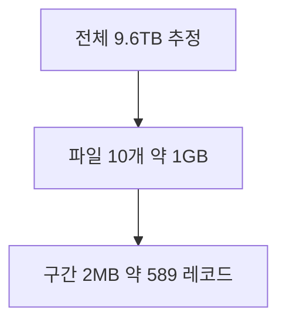

# WET 파일 샘플링

> 크롤 전체(수 TB)를 받지 않고 **WET 파일 몇 개, 또는 한 파일의 일부 구간만 받아** 정제 파이프라인을 시험하는 방법이다.

## 쉽게 말하면
공장 전체를 돌리기 전에 시제품 100개로 기계가 잘 도는지 본다. 크롤 전체가 아니라 샘플로 필터·중복 제거·개인정보 치환이 의도대로 되는지 확인하는 단계다.

## 자세히
- 규모 감각(2026-11-27 직접 확인): `CC-MAIN-2024-10`의 `wet.paths.gz`에는 파일 90,000개가 있고, 첫 파일 하나가 107,022,614바이트(약 102MiB)였다. 모든 파일이 비슷한 크기라 가정하면 WET 전체는 약 9.6TB로 추정된다(추정 — 한 파일만 측정).
- 절차(이번 실행에서 실제로 한 순서):
  1. `curl -O https://data.commoncrawl.org/crawl-data/CC-MAIN-2024-10/wet.paths.gz`(180,690바이트) 받기 — [크롤 ID 읽기](#cc-crawl-ids).
  2. 경로 중 원하는 줄을 골라 `https://data.commoncrawl.org/<경로>`로 요청 — 일부 구간만 필요하면 [Range 요청](#http-range-request).
  3. `zcat`으로 풀어 레코드를 센다: 앞 2MB에서 WARC 레코드 589개(마지막은 잘림), 풀면 레코드당 평균 약 8.8KB 텍스트(변환 레코드 587개 기준 평균 8,764바이트).
  4. 정제 단계(언어 식별·품질 필터·중복 제거·PII 치환)를 샘플에 적용하고 결과 개수·샘플을 눈으로 확인.
- 샘플 선택 요령: 앞부분만 쓰면 편향이 생긴다([파일 앞부분 샘플의 편향](#head-sample-bias)). 파일 여러 개를 균등 간격으로 고르거나(`paths` 줄 번호를 섞음), 한 파일에서 여러 구간을 뽑는다(제안).
- 비용 계산: 파일 1개(약 102MiB)를 받는 데 이번 환경에서 구간 요청 2MB가 몇 초였다(정확한 시간은 재지 않음). 파일 10개면 약 1GB다.
- 예의: 공개 데이터라도 공식 안내의 접근 방식·요청 빈도를 따른다. 반복 시험은 내려받은 파일을 로컬에 캐시한다(제안).
- 한계: 샘플 통계로 전체 비율을 말하려면 층화·표본 크기 계산이 필요하다.

## 그림으로 보기



## 예시
```bash
curl -s -O https://data.commoncrawl.org/crawl-data/CC-MAIN-2024-10/wet.paths.gz
zcat wet.paths.gz | head -3
```
- 교육: "대규모 데이터 작업은 작은 표본으로 먼저 설계한다"는 원칙 사례.

## 헷갈리는 것과 비교
| 개념 | 차이 |
|---|---|
| WET 샘플링 | 크롤 일부로 파이프라인 시험 |
| 전체 처리 | 클러스터·병렬 필요 |
| [파일 앞부분 샘플](#head-sample-bias) | 샘플 방식 중 편향 위험이 있는 쪽 |

## 더 읽을거리
- [Common Crawl: Get Started](https://commoncrawl.org/get-started) — 파일 형식·접근 방법.
- 직접 실행: `wet.paths.gz` 받기, 107MB 파일 일부 구간 받기.
