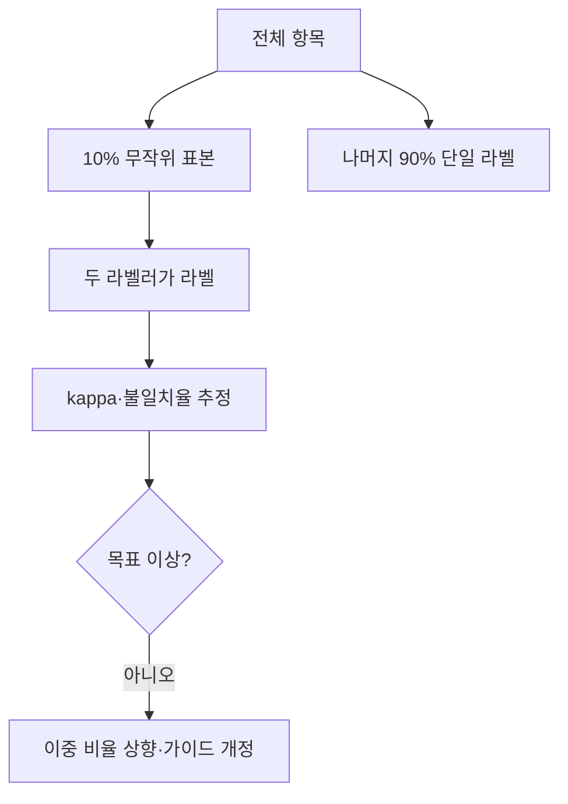
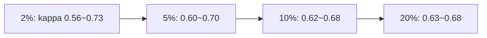

# 일부 표본만 이중 라벨링

> 전 항목을 두 사람이 라벨하면 비용이 2배이므로, **대부분은 한 사람이 라벨하고 일부 표본만 두 사람이 라벨**해 일치도와 오류율을 추정하는 설계다. 비용을 약 5~20% 늘리고 품질 감시를 얻는다.

## 쉽게 말하면
공장의 모든 제품을 두 명이 검사하지 않고, 일부를 무작위로 뽑아 두 번 검사해 불량률 추정치를 얻는 품질 표본검사와 같다. 표본의 불일치율로 전체 품질을 가늠한다.

## 자세히
- **핵심 아이디어**: 이중 라벨링한 표본의 kappa·불일치율이 전체 일치도의 추정치가 된다. 표본이 작아지면 추정이 흔들린다.
- **직접 시뮬레이션(이진 라벨 10,000개, 라벨러 2명 각자 정확도 0.9, 전체 kappa 0.649, 표본을 300회 반복 추출)**
  | 이중 라벨 비율 | 표본 수 | kappa 평균 | 5~95% 범위 | 비용 배수 |
  |---|---|---|---|---|
  | 2% | 200 | 0.652 | 0.560~0.731 | 1.02배 |
  | 5% | 500 | 0.650 | 0.596~0.704 | 1.05배 |
  | 10% | 1,000 | 0.648 | 0.616~0.684 | 1.10배 |
  | 20% | 2,000 | 0.649 | 0.627~0.675 | 1.20배 |
  | 100% | 10,000 | 0.649 | — | 2.00배 |
  표본 10%(1,000개)면 kappa 범위가 ±0.03 안팎으로 좁아져 "목표 0.6 이상" 같은 판단에는 충분하다. 2%는 폭이 0.17이라 합격 여부를 결정하기엔 불안정하다. 평균은 표본 크기와 무관하게 정확하다(편향 없음).
- **오류율 추정**: 표본 10%의 불일치율 0.172(전체 0.176)로부터 라벨러 한 명의 오류율을 약 0.086으로 추정했고 실제는 0.098이었다. 오류가 독립이고 두 사람의 정확도가 같다는 가정을 한 근사치이며, 공통 오류([공통 편향](#shared-annotator-bias))는 이 추정에 안 잡힌다.
- **설계 요령**
  1. 표본은 **무작위**로 뽑는다(쉬운 것만 이중 라벨하면 편향).
  2. 라벨러별·클래스별·주차별로 고르게 포함(드리프트 감시).
  3. 일치도가 목표 아래로 떨어지면 이중 비율을 올리고 [가이드 개정](#guideline-draft-iteration).
  4. 불일치 항목은 [판정자](#adjudicator-role)가 정리하고 단일 라벨 항목에는 별도 판정이 없다.
  5. 신규 라벨러 투입 초기에는 비율을 높인다(경험칙).
- 이 수치는 합성 이진 데이터의 한 설정이다.

## 그림으로 보기

## 예시
- 라벨 2만 건 프로젝트: 전체는 라벨러 1명, 매주 새 항목의 10%만 두 번째 라벨러가 라벨해 주간 kappa를 대시보드로 감시.
- 교육: 품질관리에서 "전수 검사 vs 표본 검사"의 비용·신뢰 구간 트레이드오프.

## 헷갈리는 것과 비교
| 개념 | 차이 |
|---|---|
| 표본 이중 라벨링 | 일부만 두 번 라벨, 품질 감시 |
| 전수 이중 라벨링 | 비용 2배, 모든 항목에 합의 |
| [이중 검수](#double-annotation-review) | 두 사람이 보고 불일치는 전문가 |
| [목표 일치도](#target-agreement-setting) | 감시 기준값 |

## 더 읽을거리
- [McHugh 2012: Interrater reliability: the kappa statistic](https://pmc.ncbi.nlm.nih.gov/articles/PMC3900052/) — kappa 해석과 한계.
- [Overview of Annotation Creation (arXiv 1602.05753)](https://arxiv.org/abs/1602.05753) — IAA 추적을 주석 프로젝트 과제로 제시.
