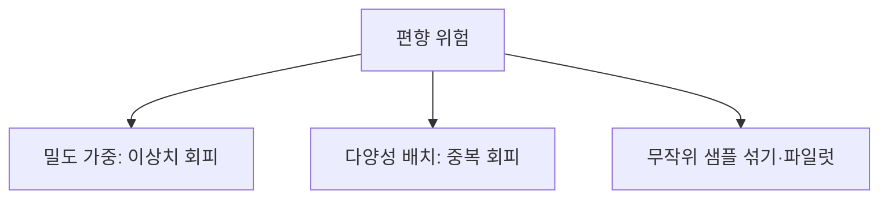

# 능동 학습의 선택 편향

> 능동 학습으로 모은 라벨 세트는 "모델이 헷갈린 것 위주"로 뽑혀 원래 데이터 분포를 대표하지 못한다. 그래서 같은 예산에서 오히려 무작위 선택보다 못하거나, 모델을 바꾸면 쓸모가 줄 수 있다.

## 쉽게 말하면
시험공부를 "틀린 문제만" 골라서 하면 약점은 빨리 메우지만 평소 자주 나오는 쉬운 유형은 잘 못 보게 된다. 문제집(라벨 세트)이 치우친다.

## 자세히
(Settles, "Active Learning Literature Survey" 3.6·4.1·6절을 직접 읽고 확인. 서베이에 "sampling bias"라는 절 제목은 없고 개념이 분산되어 있다.)
- **치우친 분포**: 능동 학습으로 만든 학습 세트는 질의를 고른 모델 종류에 묶여 있어, 자연 분포에서 i.i.d.로 뽑은 것이 아닌 **편향된 분포**다. 모델 종류를 바꾸면 덜 유용할 수 있다(4.1절).
- **부정적 결과**: Schein & Ungar(2007)는 같은 모델(로지스틱 회귀)에서도 능동 학습이 수동보다 라벨이 **더 많이** 필요한 경우를 보였고, Guo & Schuurmans(2008)는 배치 모드에서 기성 전략이 무작위보다 훨씬 나쁜 경우가 많다고 보고. 저자는 긍정 결과에 출판 편향이 있을 수 있다고 인정한다.
- **이상치 문제**: 불확실성 샘플링은 결정 경계의 이상치를 고르기 쉽다. 완화: 밀도 가중(information density, φ(x)×(풀과의 평균 유사도)^β), 클러스터링 기반.
- **배치 중복**: 상위 Q개를 그대로 뽑으면 비슷한 샘플이 겹친다. 완화: 다양성+밀도 고려 배치(Brinker 2003 등), 준모듈러 배치.
- **모델 교체**: 나이브 베이즈에서 뽑은 샘플을 결정 트리에 재사용해 잘 된 사례(Lewis & Catlett 1994)도 있고 아닌 사례(Baldridge & Osborne 2004)도 있다. **최선 모델·특징이 불확실하거나 바뀔 것 같으면 (적어도 파일럿은) 무작위 샘플링이 더 안전**하다는 권고.
- 설문(Tomanek & Olsson 2009): 대규모 주석에 능동 학습을 쓴 연구자의 91%가 기대가 (부분) 충족, 응답자 20%는 효과에 확신이 없어 쓰지 않았다.

## 그림으로 보기

## 예시
- 라벨 예산의 일부(예: 20%)는 무작위로 뽑아 검증용으로 두고 능동 선택 샘플과 비교.
- 교육 활용: "AI가 고른 데이터만 믿으면 안 되는 이유"를 사례로.

## 헷갈리는 것과 비교
| 개념 | 차이 |
|---|---|
| 능동 학습 선택 편향 | 질의 전략이 만든 치우친 라벨 세트 |
| 데이터 수집 편향 | 수집 단계의 치우침 |
| [불확실성 샘플링](#uncertainty-sampling-types) | 이 편향을 낳을 수 있는 전략 |

## 더 읽을거리
- [Active Learning Literature Survey (Settles)](https://burrsettles.com/pub/settles.activelearning.pdf) — 3.6·4.1·6절.
