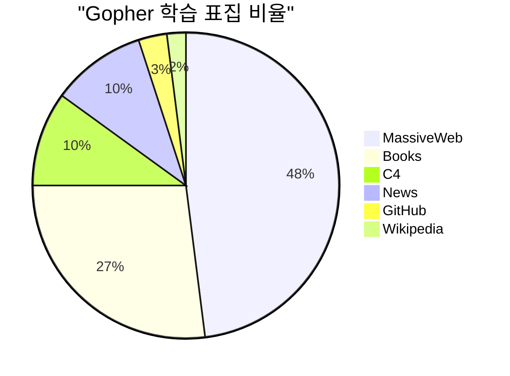

# 하위 집합 표집 비율 튜닝

> 여러 출처(웹·도서·뉴스·코드…)를 섞어 학습할 때, 데이터 크기에 비례하지 않고 출처별로 "얼마나 자주 뽑을지" 비율을 따로 정해 성능이 가장 좋게 맞추는 일이다.

## 쉽게 말하면
식단을 짤 때 냉장고에 쌓인 양이 아니라 영양 균형에 맞춰 채소·고기·곡물 비율을 정한다. 창고에 뉴스가 가장 많아도 학습에서는 웹과 책을 더 자주 먹일 수 있다.

## 자세히
(Gopher 논문 arXiv 2112.11446 표 2와 3.4절을 직접 읽고 확인.)
- **MassiveText 구성(표 2)**: 총 약 2.35B 문서·10.5TB. 이 중 300B 토큰(전체 토큰의 12.8%)만 학습에 쓰므로 하위 집합별 비율로 **부분 표집**한다.

| 하위 집합 | 크기 | 문서 | 토큰 | 표집 비율 |
|---|---|---|---|---|
| MassiveWeb | 1.9TB | 604M | 506B | 48% |
| Books | 2.1TB | 4M | 560B | 27% |
| C4 | 0.75TB | 361M | 182B | 10% |
| News | 2.7TB | 1.1B | 676B | 10% |
| GitHub | 3.1TB | 142M | 422B | 3% |
| Wikipedia | 0.001TB | 6M | 4B | 2% |

- 보이는 점: 크기가 가장 큰 GitHub·News는 비율이 낮고, 작은 Books가 27%로 높다. 저자는 비율을 **하위 작업 성능을 최대화하도록 튜닝**했다고 밝힌다(부록 A.3.1).
- 책 비중(27%)이 높아 Books3·PG-19·arXiv 같은 책·논문 언어 모델링 과제에서 성능이 좋았을 수 있다고 추정한다(GPT-3의 책 비중은 16%라고 비교).
- 큐레이션한 MassiveWeb이 C4 같은 기존 웹 코퍼스보다 하위 성능이 좋다고 보고(그림 A5).
- 튜닝 세부 실험 설계는 이번에 읽지 않았다(제안: 작은 모델 ablation으로 후보 비율을 비교, [nanotron·lighteval](#nanotron-lighteval) 방식).

## 그림으로 보기

## 예시
- 사내 모델 미세조정 데이터를 FAQ·대화·매뉴얼로 모으고, 비율을 3:1:1, 1:1:1로 바꿔 평가 점수를 비교.
- 교육 활용: "데이터가 많다 ≠ 많이 학습시킨다"를 파이 차트로 설명.

## 헷갈리는 것과 비교
| 개념 | 차이 |
|---|---|
| 표집 비율 튜닝 | 출처 간 혼합 비율 |
| [근접 중복 제거](#near-duplicate-removal) | 문서 안의 중복 제거 |
| 에폭 수 | 같은 데이터를 몇 번 반복 학습 |

## 더 읽을거리
- [Gopher (arXiv 2112.11446)](https://arxiv.org/abs/2112.11446) — 표 2, 3.4절.
