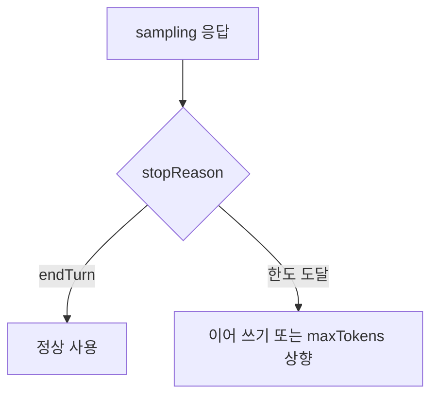

# stopReason

> 모델이 왜 생성을 멈췄는지 알려 주는 값이다. MCP sampling 응답에도 들어 있어, 예시에서는 `endTurn`이 쓰인다.

## 쉽게 말하면
책을 읽어 주던 사람이 멈췄을 때 "이야기가 끝나서"인지 "시간이 다 돼서"인지 알아야 이어 읽을지 정한다. stopReason이 그 이유표다.

## 자세히
- MCP Sampling 응답 예시(2025-06-18): `{"role":"assistant","content":{...},"model":"claude-3-sonnet-20240307","stopReason":"endTurn"}`.
- 명세 본문이 쓰는 값은 `endTurn`이다. 그 밖의 값(예: 토큰 한도, 중지 문자열)이 있다는 점은 명세의 응답 타입 정의에서 확인해야 한다(여기서는 확인 못 함).
- 일반적인 LLM API에서는 "자연스러운 종료", "최대 토큰 도달", "중지 시퀀스", "도구 호출" 같은 사유가 구분된다. 이름은 공급자마다 다르다(예: Anthropic Messages API의 `stop_reason`).
- 활용: 최대 토큰 도달로 잘렸다면 이어 달라고 다시 요청하거나 `maxTokens`를 늘리고, 정상 종료면 그대로 사용한다. 중첩 호출([서버 중첩 에이전트](#mcp-nested-agent))에서는 잘린 응답을 믿고 다음 단계로 가지 않도록 검사한다.

## 그림으로 보기

## 예시
요약이 문장 중간에서 끊겼다면 stopReason이 한도 도달 계열일 가능성이 크다. 이때 서버가 "이어서 완성해 줘"를 한 번 더 요청한다.

## 헷갈리는 것과 비교
| 개념 | 차이 |
|---|---|
| stopReason | 멈춘 이유 |
| `maxTokens` | 요청 때 거는 상한 |
| `finish_reason`(OpenAI 계열) | 같은 개념의 다른 이름 |

## 더 읽을거리
- [MCP Sampling 명세](https://modelcontextprotocol.io/specification/2025-06-18/client/sampling) — 응답 예시
