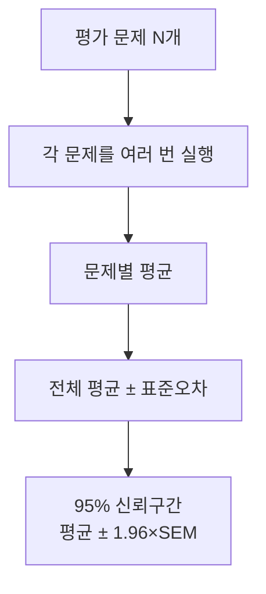
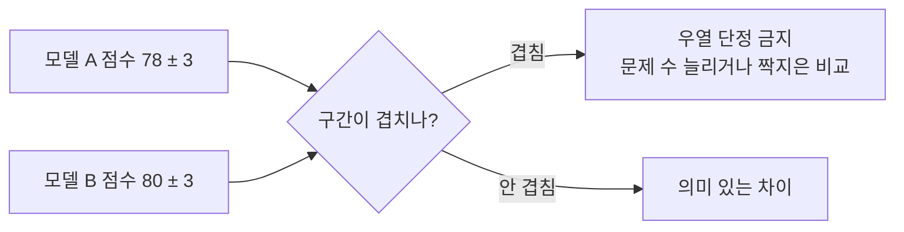

# 평가에서 반복 실행과 신뢰구간

> LLM은 같은 문제도 매번 다르게 답할 수 있으므로, 평가 점수를 한 번 돌린 숫자로 믿지 말고 여러 번 실행해 평균과 오차 범위(신뢰구간)를 함께 보고해야 한다는 원칙.

## 쉽게 말하면
농구 선수의 자유투 성공률을 10번 던져서 7번이라 해서 "70%"라고 단정하지 않는다. 그날 컨디션이 있기 때문이다. 100번, 1,000번 던져 봐야 실력이 보인다. 모델 평가도 문제 수가 적거나 한 번만 돌리면 점수 차이가 실력 차이인지 우연인지 알 수 없다.

## 자세히
**Anthropic의 통계적 접근 글(Evaluating models statistically)** 권고
1. **오차를 함께 보고**: 평가 문제를 가상의 "문제 전체 집단"에서 뽑은 표본으로 보고, 평균의 표준오차(SEM)를 점수와 함께 낸다. 95% 신뢰구간 = 평균 ± 1.96 × SEM.
2. **클러스터 표준오차**: 같은 지문을 공유하는 문제처럼 묶음이 있으면 묶음 단위로 오차를 계산해야 한다. 단순 계산은 불확실성을 과소평가하며, 유명 평가에서 클러스터 표준오차가 3배 넘게 컸다.
3. **문제 내 분산 줄이기**: 사고 사슬(CoT) 평가는 문제마다 여러 번 재생성해 문제별로 평균(예: Inspect 프레임워크의 `epochs`). CoT가 없는 평가는 정답 토큰(예: "B")의 다음 토큰 확률을 점수로 쓴다.
4. **짝지은 차이 분석**: 두 모델이 같은 문제를 푸니 문제별 점수 차이를 분석하면 문제 난이도 분산이 상쇄된다. 최전선 모델들의 문제별 점수 상관이 대략 0.3~0.7이라 분산이 크게 줄어든다.
5. **검정력 분석**: 문제 수, 오탐률, 효과 크기로 "A가 B보다 3%p 높음을 가려내려면 문제가 몇 개 필요한가"를 계산한다.

**Evan Miller "Adding Error Bars to Evals"(arXiv 2411.00640)**: 평가를 근본적으로 실험으로 보고, 문제를 보이지 않는 모집단의 표본으로 취급해 두 모델 차이 측정·평가 설계를 위한 공식을 제시한다.

**온도와 시드**: 온도가 0에 가까워도 하드웨어·배치 때문에 완전한 재현이 안 될 수 있다. 샘플링 설정(온도, top-p), 시드, 시행 횟수를 평가 기록에 남긴다. pass@k·pass^k는 반복 실행 기반 지표다([pass^k](#pass-hat-k-tau-bench)).

**실무 규칙**: ①문제 수가 수백 개 이하면 1~2점 차이는 잡음일 수 있다 ②같은 설정으로 3~5회 반복해 분산을 확인 ③모델 비교는 같은 문제로 짝지은 차이를 본다 ④구간이 겹치면 우열을 단정하지 않는다.

## 그림으로 보기

## 예시
고객 문의 분류 평가 문제 200개로 모델 A 85%, B 88%가 나왔다. 정답률 p=0.86 근처에서 표준오차는 약 √(0.86×0.14/200) ≈ 2.5%p이므로 95% 구간은 ±약 4.8%p다. 3%p 차이는 우연 범위 안이다. 문제를 800개로 늘리면 오차가 절반(약 ±2.4%p)으로 줄어 같은 3%p 차이를 가려낼 가능성이 커진다.

## 헷갈리는 것과 비교
| 개념 | 차이 |
|---|---|
| 표준오차 | 평균 추정치의 흔들림. 문제 수가 늘면 √N에 반비례해 감소 |
| 신뢰구간 | 평균 ± 1.96 × 표준오차(95%) |
| [pass@k](#pass-at-k) | 여러 번 중 한 번이라도 성공. 능력 지표 |
| [pass^k](#pass-hat-k-tau-bench) | 모두 성공. 신뢰성 지표 |
| [벤치마크 포화](#benchmark-saturation) | 만점 근처 몰림 |

## 더 읽을거리
- [A statistical approach to model evaluations (Anthropic)](https://www.anthropic.com/research/statistical-approach-to-model-evals) — 다섯 가지 권고
- [Adding Error Bars to Evals (arXiv 2411.00640)](https://arxiv.org/abs/2411.00640) — 평가 통계 공식
