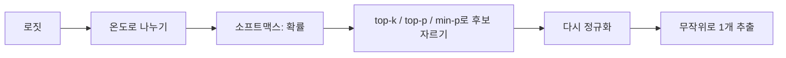
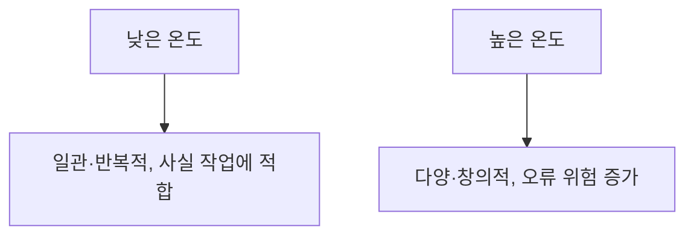

# 온도·top-p 샘플링

> LLM은 다음 토큰의 확률분포를 만든 뒤 그중 하나를 뽑는다. 온도(temperature)는 분포의 뾰족함을, top-k·top-p·min-p는 뽑을 후보의 범위를 정한다.

## 쉽게 말하면
룰렛을 돌리는 상황이다. 모델이 칸마다 "이 단어가 나올 확률"을 칠해 준다. 온도를 낮추면 가장 큰 칸이 더 커져 거의 항상 같은 답이 나오고, 높이면 칸 크기가 비슷해져 엉뚱한 답도 나온다. top-p·top-k는 아예 작은 칸을 룰렛에서 잘라 내는 일이다.

## 자세히
- **온도 T**: [로짓](#logits)을 T로 나눈 뒤 [소프트맥스](#softmax)를 적용한다(z' = z/T). T<1이면 뾰족, T=1이면 원래 분포, T>1이면 평평. T→0은 항상 최댓값을 고르는 greedy 디코딩이다.
- **top-k**: 확률 높은 k개만 남기고 다시 정규화해 뽑는다. k가 고정이라 모델이 확신하는 순간과 헷갈리는 순간을 구분하지 못한다(예: 40).
- **top-p(nucleus)**: 확률 높은 순으로 누적합이 p에 닿을 때까지의 최소 집합만 남긴다. 확신하면 후보가 적고, 불확실하면 후보가 늘어난다(예: 0.9~0.98).
- **min-p**: 1등 확률의 min_p배 이상인 토큰만 남긴다. 1등이 0.6, min_p=0.1이면 문턱은 0.06.
- **적용 순서**: Hugging Face Transformers 기준 온도 → top-k → top-p → 추출. 많은 API가 온도와 top-p 중 하나만 바꾸라고 권한다.
- **경험적 값(블로그 기준)**: 코드·추출은 0~0.3, 창작은 0.8~1.1. 모델·API마다 다르니 공식 문서를 확인한다. 최신 일부 모델은 샘플링 파라미터를 고정하기도 한다.

## 그림으로 보기

## 예시
- 정보 추출·코드 생성: temperature 0~0.2.
- 아이디어 브레인스토밍: temperature 0.9, top-p 0.95.
- 같은 질문에 답이 매번 다르다고 느낄 때: 온도를 내리거나 seed 옵션이 있는지 본다(그래도 완전 동일은 보장되지 않는다).

## 헷갈리는 것과 비교
| 개념 | 차이 |
| --- | --- |
| 온도 | 분포 모양을 바꿈(후보는 그대로) |
| top-k | 고정된 개수로 자름 |
| top-p | 누적확률로 자름(적응형) |
| min-p | 1등 대비 비율로 자름 |
| [소프트맥스](#softmax) | 온도가 작용하는 확률 변환 단계 |

## 더 읽을거리
- [LLM Sampling, Demystified (DEV)](https://dev.to/shrsv/llm-sampling-demystified-temperature-top-k-top-p-min-p-and-repetition-penalty-4pkh) — 네 방식의 공식과 권장값
