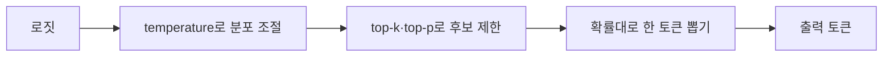
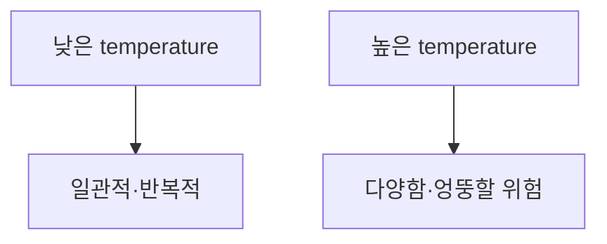

# 샘플링과 temperature

> LLM은 다음 토큰의 확률 분포를 내고, 그중 하나를 뽑아 이어 쓴다. 어떻게 뽑느냐(greedy, 샘플링, temperature, top-k, top-p)가 글의 일관성과 창의성을 정한다.

## 쉽게 말하면
룰렛이다. greedy는 항상 가장 큰 칸만 고르는 것이고, 샘플링은 칸 크기에 비례해 돌리는 것이다. temperature는 룰렛 칸의 크기 차이를 줄이거나 키우는 손잡이다.

## 자세히
Hugging Face "How to generate text" 기준:
- **Greedy search**: 매 단계 확률 최고 토큰 선택. 빠르지만 반복에 빠지기 쉽고 좋은 문장을 놓친다.
- **Beam search**: 상위 num_beams개 후보를 유지하다 전체 확률이 최고인 것을 반환. 번역처럼 출력이 예측 가능한 작업에 적합하고, 열린 생성에는 덜 맞는다.
- **Sampling**: 분포에서 무작위로 뽑아 다양하고 사람 같지만 횡설수설할 수 있다.
- **Temperature**: 소프트맥스 전에 분포를 조절. 낮으면 뾰족해져 확률 높은 말 위주, 0에 가까우면 greedy와 비슷하다. 높으면 평평해져 다양해진다.
- **Top-k**: 상위 k개 안에서만 뽑는다. 고정 k는 분포 모양에 둔감하다.
- **Top-p(nucleus)**: 누적 확률이 p를 넘는 최소 집합에서 뽑는다. 단계마다 후보 수가 적응한다. top-k와 함께 쓸 수 있다.
- 사실 질의·코드는 낮은 temperature, 아이디어 발상은 높은 값을 흔히 쓴다(경험칙). 단, 모델·API마다 기본값과 범위가 다르다. 이 값들은 [다음 토큰 예측](#next-token-prediction) 결과를 고르는 추론 단계의 설정이다.

## 그림으로 보기

## 예시
- 계약서 요약: temperature 낮게 → 같은 입력에 비슷한 답.
- 광고 문구 20개 브레인스토밍: temperature와 top-p를 높게 → 매번 다른 표현.

## 헷갈리는 것과 비교
| 개념 | 차이 |
|---|---|
| temperature | 분포 모양 자체를 조절 |
| top-k | 후보를 고정 개수로 자름 |
| top-p | 누적 확률로 후보를 자름 |
| beam search | 무작위 없이 여러 후보를 병행 탐색 |

## 더 읽을거리
- [Hugging Face: How to generate text](https://huggingface.co/blog/how-to-generate) — greedy·beam·sampling·top-k·top-p 비교.
