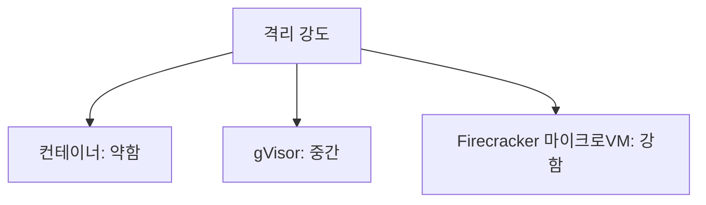

# 샌드박스

> 샌드박스는 에이전트가 만든 코드·명령을 **격리된 환경**에서 실행해, 잘못 동작해도 피해 범위(blast radius)가 그 안에 머물게 하는 안전장치다.

## 쉽게 말하면
아이에게 과학 실험을 시킬 때 거실 바닥 대신 쟁반 위에서 하게 하는 것이다. 쏟아도 쟁반 안에서 끝난다. 에이전트의 가장 흔한 위험은 악의가 아니라 자신 있게 틀린 일을 하는 것이라는 지적이 있다.

## 자세히
- **일반 컨테이너(Docker)는 호스트 커널을 공유**해 신뢰할 수 없는 코드에는 부족하다는 의견이 대세. 컨테이너 탈출 사례가 보고됐다고 하는 자료도 있다(블로그 기준).
- **gVisor**: 사용자 공간 커널(Sentry)이 컨테이너와 호스트 커널 사이에 끼어든다. 최소 안전선으로 평가되며 Modal이 사용. GPU 통과 가능.
- **Firecracker 마이크로VM**: 하드웨어 수준 격리, 빠른 기동(자료마다 125ms~수 초로 편차). E2B가 사용. 규제 데이터에 강하다고 평가되나 GPU 통과는 안 됨.
- **추가 계층**: 네트워크 송신(egress) 정책, 파일 시스템 읽기 전용·범위 제한, [최소 권한](#least-privilege-agents).
- 2026년 중반 기준 대부분 도구에서 샌드박스는 선택 사항이고 기본 활성은 OpenAI Codex뿐이라는 보고가 있다(블로그 1건, 확인 필요). 성능 수치는 자료마다 달라 신뢰도가 낮다.

## 그림으로 보기

## 예시
- 코딩 에이전트에게 `rm -rf` 가 가능한 환경을 주지 않고, 작업 폴더만 마운트한 일회용 VM에서 실행.
- 평가 때 에이전트가 정답 파일을 몰래 읽지 못하게 격리([평가용 격리 환경](#eval-sandbox)).

## 헷갈리는 것과 비교
| 개념 | 차이 |
|---|---|
| 샌드박스 | 실행 환경을 가둠(물리적 격리) |
| [권한 관리](#access-control) | 누가 무엇을 할 수 있나(논리적 허용) |
| [프롬프트 인젝션](#prompt-injection) | 공격 기법. 샌드박스는 피해를 줄이는 방어층 |
| [가드레일](#stop-conditions) | 입출력·반복 통제 |

## 더 읽을거리
- [AI Agent Sandboxes (Morph)](https://www.morphllm.com/ai-agent-sandbox) — 방식 비교(벤더 글)
- [Sandboxing and execution isolation (Stride)](https://www.stride.build/blog/sandboxing-execution-isolation-ai-agents) — 피해 범위 관점
- [What every dev should know about AI sandboxes](https://read.engineerscodex.com/p/every-dev-should-know-about-ai-sandboxes) — 입문 해설
