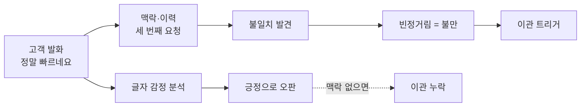

# 빈정거림 탐지 (Sarcasm Detection)

> 문장의 **글자 그대로의 뜻과 화자의 실제 의도·감정이 반대**인 표현("정말 친절하시네요")을 알아내는 자연어 처리 과제. 감정 분석이 가장 약한 대표 사례이며, 상담 AI가 화난 고객을 만족한 고객으로 오판하는 원인이 된다.

## 쉽게 말하면
"와, 세 번째 환불 요청에도 정말 빠르네요"는 글자만 보면 칭찬이다. 하지만 상황을 알면 불만이다. 감정 분석기는 "빠르네요"를 긍정으로 읽기 쉽고, 맥락을 아는 사람만 빈정거림을 안다.

## 자세히
출처: SarcasmBench 논문(arXiv 2408.11319 v2, HTML 본문 확인), "Was that Sarcasm?" 문헌 조사(arXiv 2412.00425, PDF를 텍스트로 변환해 서론·2.1절 확인), 검색 요약, 2026-11-18. 두 번째 글은 학생 팀의 문헌 조사라 권위가 높지 않다. 한국어 결과는 확인하지 못했다.
- **정의**: SarcasmBench는 미묘한 언어 현상으로, 과장·비유 등을 써서 글자 뜻이 화자의 진짜 감정·의도와 반대인 표현이라고 설명한다. 문헌 조사는 부정 표지 없는 부정(Giora), 텍스트와 맥락 사이의 상황적 불일치(Wilson)라는 관점을 소개한다.
- **핵심 신호**: 감정 대비("I love being ignored"처럼 긍정어와 부정 상황의 충돌)와 맥락 불일치. 같은 문장도 대화 이력·영상·억양 없이는 판정이 어렵다.
- **사람도 어렵다**: 문헌 조사는 사람의 평균 정확도가 81.6%라고 인용한다(원 출처 [4]를 직접 확인하지 못함).
- **LLM 벤치마크(SarcasmBench)**: 6개 데이터셋(IAC-V1, IAC-V2, Ghosh, iSarcasmEval, Riloff, SemEval 2018 Task 3), LLM 11종과 지도학습 사전학습 모델 8종 비교. 지도학습 PLM이 프롬프트형 LLM을 앞섰다 — DC-Net-RoBERTa 평균 F1 71.5, 최고 제로샷 LLM(GPT-4 Turbo) 65.0, 퓨샷 입출력 69.7. 사고 사슬(CoT)은 오히려 낮아(GPT-4 Turbo 평균 F1 64.4) 저자들은 빈정거림이 단계적 추론보다 총체적 이해라고 해석한다.
- **감정 분석과의 관계**: 논문은 감정 분석 같은 과제는 LLM에게 대체로 풀린 것으로 간주되지만, 빈정거림은 더 높은 추상 수준이라 그 성공이 이어지지 않을 수 있다고 쓴다.
- **상담 적용(제안)**: ①"감정 임계값" 자동 이관([감정 트리거](#sentiment-trigger))은 빈정거림을 놓칠 수 있으므로 반복 문의·재방문·이관 요청 같은 **행동 신호**를 병행 ②빈정거림 표본을 따로 라벨링해 자사 데이터로 재현율 측정 ③음성은 억양·텍스트 외 신호가 필요하다.
- **한계**: 위 수치는 영어 중심 공개 데이터셋이고 상담 대화·한국어에는 그대로 적용할 수 없다.

## 그림으로 보기

## 예시
- 고객: "대단하시네요, 3일째 같은 답변이라니." → 감정 분석은 "대단"에 긍정 점수를 줄 수 있다. 같은 고객의 재문의 횟수, "상담원 연결" 요청, 직전 평가 점수를 함께 보면 이관해야 할 건으로 분류된다.
- 교육 활용: 상담 AI 직무 교육에서 감정 점수만 보지 말고 행동 신호를 같이 보는 이관 규칙을 직접 설계하는 실습.

## 헷갈리는 것과 비교
| 개념 | 차이 |
|---|---|
| 감정 분석 | 글의 긍정·부정 극성 판정 |
| 빈정거림 탐지 | 글자 극성과 실제 의도의 반대 여부 판정 |
| [감정 트리거](#sentiment-trigger) | 감정 점수로 이관하는 규칙, 빈정거림에 취약 |
| [조용한 이탈 신호](#quiet-churn-signal) | 공손하지만 떠나는 고객의 행동 신호 |

## 더 읽을거리
- [SarcasmBench (arXiv 2408.11319)](https://arxiv.org/html/2408.11319v2) — LLM 11종의 빈정거림 이해 평가
- [Was that Sarcasm? 문헌 조사 (arXiv 2412.00425)](https://arxiv.org/abs/2412.00425) — 정의·접근·데이터셋 개관(학생 조사)
