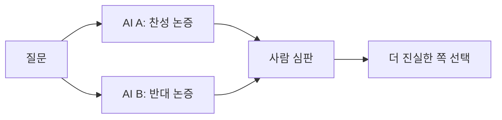
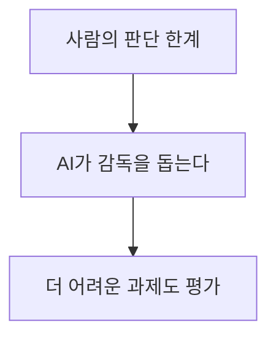

# 확장 가능한 감독

> **확장 가능한 감독(scalable oversight)** 은 사람이 직접 판단하기 어려울 만큼 능력이 높은 AI를 어떻게 평가·지도할지 연구하는 분야다. 토론, 재귀적 보상 모델링 등이 후보다.

## 쉽게 말하면
논문 심사위원이 모든 분야를 다 알 수는 없다. 그래서 두 전문가가 서로 반박하게 하고, 심사위원은 어느 쪽이 더 설득력 있는지만 판단한다. AI가 사람보다 똑똑해져도 사람이 감독할 수 있는 구조를 만들자는 아이디어다.

## 자세히
- **AI 안전을 위한 토론**(Irving 외, arXiv 1805.00899 초록 확인): 두 AI가 제로섬 게임으로 반대 입장을 주장하고 **사람 심판**이 더 진실하고 유용한 쪽을 고른다.
  - MNIST 실험: 희소 분류기를 설득하는 토론으로 정확도가 6픽셀에서 59.4%→88.9%, 4픽셀에서 48.2%→85.2%.
  - 복잡도 유추 주장: 최적 플레이·다항 시간 심판이면 토론은 PSPACE 질문까지 답할 수 있지만, 직접 판단은 NP 수준. 실제 효과는 사람·과제에 대한 실증 문제로 남는다고 저자들이 밝혔다.
- 다른 접근(재귀 보상 모델링, 약한→강한 일반화 등)은 이 글에서 직접 확인하지 않았다. 새 가지에서 다룬다.
- 핵심 질문: 평가자가 정답을 모를 때 신뢰할 신호를 어떻게 얻는가.

## 그림으로 보기

## 예시
- 긴 코드 변경의 안전성을 사람이 다 읽을 수 없을 때, 한 AI가 취약점을 지적하고 다른 AI가 반박하며 사람은 핵심 쟁점만 본다.

## 헷갈리는 것과 비교
| 개념 | 차이 |
|---|---|
| 확장 가능한 감독 | 초인적 AI를 감독하는 문제 영역 |
| 토론 | 그 해법 후보 중 하나 |
| RLHF | 사람이 직접 선호를 판단 |
| [비판·수정 루프](#critique-revision) | 자기 답을 AI가 개선 |

## 더 읽을거리
- [AI safety via debate](https://arxiv.org/abs/1805.00899) — 토론 제안 논문.
