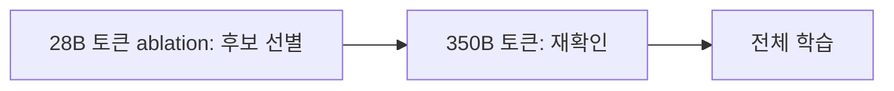
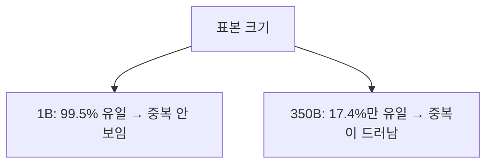

# 작은 규모 결과의 큰 규모 전이

> 작은 모델·적은 토큰으로 한 데이터 실험(ablation)의 결론이 **더 큰 규모에서도 유지되는지는 별도로 확인해야 한다.** 특히 중복 제거 같은 효과는 작은 표본에서는 아예 보이지 않을 수 있다.

## 쉽게 말하면
작은 시식 접시로 맛을 보고 큰 솥 요리를 결정하면 맞는 경우가 많지만, 솥이 커져야만 드러나는 문제(예: 같은 재료가 여러 번 들어가는 중복)는 접시로는 안 보인다.

## 자세히
(FineWeb 논문, arXiv 2406.17557 PDF 본문과 부록 E.2를 직접 읽고 계산)
- **FineWeb의 규모 구분**: 필터 ablation은 약 **280억 토큰**(1.71B 모델, 대략 Chinchilla 최적 학습량), 일부 중복 제거 ablation과 "단계별 필터링의 누적 상대 개선 확인" 실험은 **3,500억 토큰**.
- **교육 필터 확인**: 임계값 비교는 28B 토큰 실험이었고, 선택한 FineWeb-Edu는 1.71B·**350B 토큰**의 더 큰 실험으로 효과를 재확인했다. MMLU 33%→37%, ARC 46%→57%([임계값](#classifier-threshold-tradeoff)).
- **중복 제거는 작은 규모에서 안 보임**: 부록 E.2는 "중복 제거의 효과는 28B 같은 작은 조각에서는 항상 보이지 않는다"고 쓴다. 시뮬레이션(그림 14): 20T 토큰 데이터에 스냅샷 100개가 서로 **완전히 같은 사본**이라는 극단 조건에서 표본 크기별 문서 중복 분포를 비교했다. 1B 표본은 거의 모든 문서가 유일(#중복=1)하다.
- **직접 계산(같은 가정)**: 문서가 표본에 뽑혔을 때 **다른 사본이 함께 뽑히지 않을 확률** = (1−f)^99, f=표본/20T. 표본 1B → 99.5%, 10B → 95.2%, 100B → 60.9%, **350B → 17.4%**, 1T → 0.6%. 280억 토큰 근처(f≈0.0014)에서는 약 87%가 유일이라 중복 제거로 지울 것이 거의 없다. 따라서 작은 ablation으로는 중복 제거 이득을 과소평가하게 된다.
- **전역 vs 스냅샷별 제거**도 큰 규모(350B 표본)에서 비교했고 결론은 직관과 달랐다([중복 군집 크기](#duplicate-cluster-size)).
- 실무(제안): ① 작은 규모에서 후보를 좁히고 ② 최종 후보는 한 단계 큰 규모로 확인 ③ 규모에 의존하는 처리(중복 제거, 희귀 데이터 효과)는 처음부터 큰 표본에서 시험한다.

## 그림으로 보기

## 예시
- 필터 3개를 280억 토큰으로 비교해 후보를 고른 뒤, 최종 2개를 3,500억 토큰으로 학습해 순위가 유지되는지 확인.
- 교육: "작은 실험의 한계"를 다룰 때 중복 제거 사례가 좋은 반례.

## 헷갈리는 것과 비교
| 개념 | 차이 |
|---|---|
| 규모 전이 | 작은 실험 결론이 큰 규모에서도 맞는가 |
| 스케일링 법칙 | 규모에 따른 성능의 경향성 |
| 시드 평균 | 같은 규모의 잡음 감소 |

## 더 읽을거리
- [The FineWeb Datasets (arXiv 2406.17557)](https://arxiv.org/abs/2406.17557) — 부록 E.2와 Figure 14(PDF 본문 읽음).
