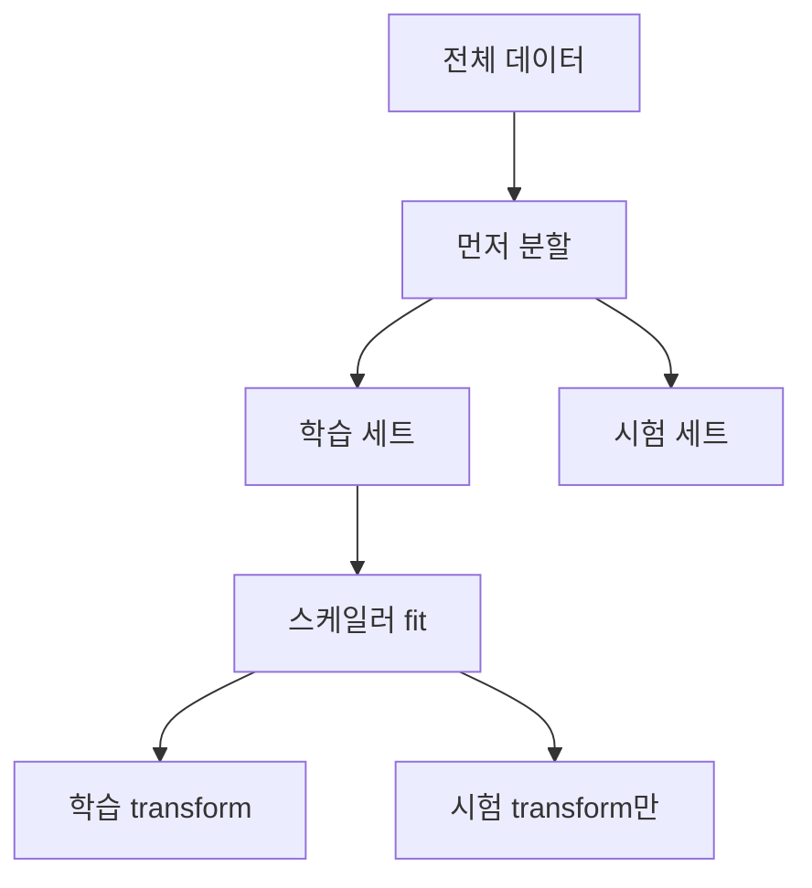

# 스케일러 누수

> 스케일러 누수는 표준화(평균 0·분산 1)나 정규화에 쓰는 평균·분산·최솟값·최댓값을 시험 데이터까지 포함한 전체 데이터에서 계산하는 실수다. 모델이 시험 데이터의 정보를 간접적으로 본 셈이라 성능이 과대평가된다.

## 쉽게 말하면
시험 채점 기준(평균과 표준편차)을 정하려고 아직 안 본 시험 답안지까지 미리 읽는 것과 같다. 기준에 미래 답안의 정보가 스며들어 공정한 평가가 아니다. 점수 환산표는 연습 문제로만 만들어야 한다.

## 자세히
- **원칙(scikit-learn Common pitfalls, 열람)**: 데이터 누수는 예측 시점에 알 수 없는 정보를 모델 구축에 쓰는 것으로, 교차검증 점수까지 부풀리고 새 데이터에서는 성능이 떨어진다. 일반 규칙은 "시험 데이터에 `fit`을 호출하지 말라"이다. 변환은 학습 데이터에서만 학습하고 시험 데이터에는 적용만 한다. 평균으로 정규화한다면 그 평균은 전체가 아니라 학습 부분에서 구해야 한다.
- **잘못된 순서와 맞는 순서(문서의 지침을 코드로 옮긴 예. 문서에 별도 StandardScaler 예제는 없고 일반 원칙의 적용으로 설명)**
```python
# 누수: 스케일러가 시험 데이터를 봄
X_all = StandardScaler().fit_transform(X)
X_train, X_test, y_train, y_test = train_test_split(X_all, y, random_state=42)

# 올바름: 먼저 나누고 학습 데이터로만 fit
X_train, X_test, y_train, y_test = train_test_split(X, y, random_state=42)
scaler = StandardScaler().fit(X_train)
X_train_s, X_test_s = scaler.transform(X_train), scaler.transform(X_test)
```
- **Pipeline으로 예방(같은 문서)**: `make_pipeline`으로 묶으면 각 단계의 `fit`이 학습 데이터에서만 호출된다. `cross_val_score`에 파이프라인을 넣으면 폴드마다 전처리를 다시 학습해 검증 폴드가 변환에 영향을 주지 않는다. 문서의 특성 선택 누수 예는 무작위 데이터(특성 1만 개, 표본 200개)에서 누수가 있으면 정확도 0.76이 나오고 올바른 방식은 0.5 수준이라고 보여 준다.
- **직접 해 본 작은 실험(순수 파이썬, 시드 3)**: 학습 800개는 N(100,10), 시험 200개는 시간이 지나 평균이 130으로 이동했다고 가정한다. 학습 데이터만으로 구한 통계는 평균 99.5·표준편차 9.7이어서 시험 값의 평균 z점수는 +3.19로 크게 튀어 분포 변화가 드러난다. 전체로 구한 통계(평균 105.7·표준편차 15.8)를 쓰면 시험 평균 z가 +1.56으로 줄어 변화가 덜 심각해 보이고 학습 데이터의 z도 −0.39로 치우친다. 이 합성 실험은 누수가 이동을 가리는 방식을 보여 줄 뿐이며 모델 정확도 변화를 측정한 것은 아니다.
- **실무에서의 영향(해석)**: 표준화 누수의 영향은 보통 크지 않지만 표본이 작거나 분포가 변하는 시계열·운영 데이터에서는 커질 수 있다. 눈에 띄지 않게 점수를 올려서 더 위험하다.
- **시계열(해석)**: 시간 순서로 분할하고 과거 데이터로만 통계를 구한다.

## 그림으로 보기



## 예시
- 월별 이탈 예측 모델: 6~11월로 평균·표준편차를 구하고 12월 데이터는 그 값으로만 표준화한다. 12월에 분포가 이동했다면 z점수가 커져 경고 신호가 된다.
- 교육 활용: 같은 데이터를 누수 방식과 올바른 방식으로 나눠 점수와 z 분포 차이를 비교하는 실습.

## 헷갈리는 것과 비교
| 개념 | 차이 |
| --- | --- |
| [전처리 누수 파이프라인](#preprocessing-leakage-pipeline) | 상위 주제. 스케일러는 그 한 사례 |
| [결측 대치 누수](#imputation-leakage) | 평균·중앙값으로 결측을 채울 때의 같은 문제 |
| 타깃 누수 | 정답 정보가 특성에 섞임. 스케일러 누수는 간접 통계 누수 |

## 더 읽을거리
- [scikit-learn: Common pitfalls — Data leakage](https://scikit-learn.org/stable/common_pitfalls.html) — 누수 원칙, Pipeline, 교차검증
