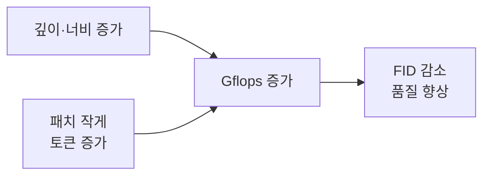
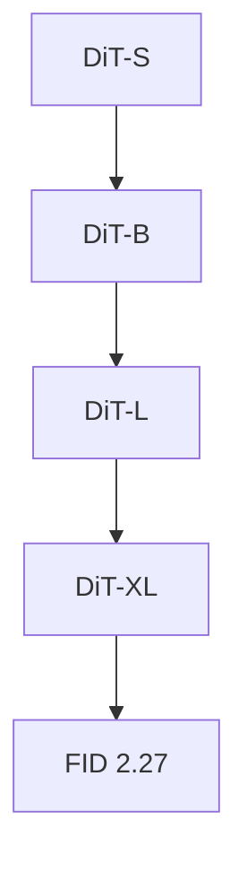

# 확산 모델 스케일링

> 확산 트랜스포머(DiT)에서는 모델의 연산량(Gflops)을 키울수록 이미지 품질(FID)이 꾸준히 좋아지는 경향이 확인되었다.

## 쉽게 말하면
요리사를 더 숙련되게 하거나 조리 시간을 늘릴수록 요리가 좋아지는 것과 같다. 중요한 것은 사람 수(파라미터)보다 실제 들이는 계산량이다.

## 자세히
Peebles & Xie, *Scalable Diffusion Models with Transformers*(ICCV 2023) 기준:
- 순전파 연산량(Gflops)과 FID-50K 사이에 강한 음의 상관이 있다 → 연산량이 품질의 핵심 동인이라고 해석.
- 키우는 방법: 트랜스포머 깊이·너비를 늘리거나, 입력 토큰 수를 늘린다(패치 크기를 작게: DiT-XL/2의 `/2`가 패치 크기).
- 파라미터 수보다 Gflops가 중요하다: Gflops가 비슷하면 FID도 비슷(예: DiT-S/2와 DiT-B/4).
- 최대 모델 DiT-XL/2는 ImageNet 256x256에서 FID 2.27(당시 SOTA).
- 큰 모델이 더 계산 효율적: 작은 모델을 오래 학습해도 큰 모델을 적게 학습한 것을 따라잡지 못한다.
- 한계: ImageNet 클래스 조건 생성 기준 결과이며, 텍스트 조건·비디오까지 같은 법칙이 정확히 성립하는지는 별도 확인이 필요하다.

## 그림으로 보기

## 예시
모델을 고를 때: "파라미터 수가 같아도 패치가 작은 모델이 더 느리고 더 좋다"는 이유가 토큰 수(=Gflops) 때문이다.

## 헷갈리는 것과 비교
| 개념 | 차이 |
|---|---|
| 확산 스케일링 | Gflops-FID 상관 |
| LLM 스케일링 법칙 | 손실이 파라미터·데이터·연산과 멱법칙 |
| [DiT](#dit-diffusion-transformer) | 스케일링을 보인 구조 |

## 더 읽을거리
- [DiT 논문(arXiv 2212.09748)](https://arxiv.org/pdf/2212.09748) — 원문.
- [HF 논문 페이지](https://huggingface.co/papers/2212.09748) — 요약.
