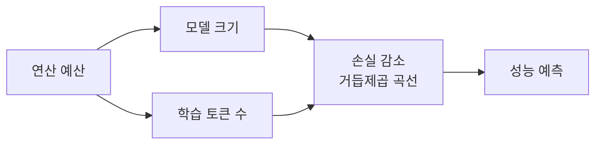
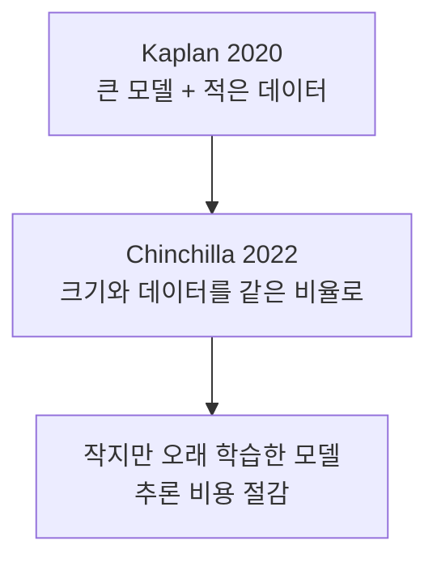

# 스케일링 법칙 (Scaling Laws)

> 모델 크기·데이터양·학습 연산량을 늘리면 언어 모델의 손실(오차)이 거듭제곱 꼴로 예측 가능하게 줄어든다는 경험 법칙이다. "얼마를 투자하면 얼마나 좋아지나"를 학습 전에 어림하게 해 준다.

## 쉽게 말하면
마라톤 훈련에서 주행 거리를 늘리면 기록이 꾸준히 좋아지지만 점점 둔화되는 것과 비슷하다. 연구자들은 그 둔화 곡선이 놀랄 만큼 규칙적임을 발견했고, 그래서 큰 모델을 실제로 학습하기 전에 결과를 예측해 예산을 짠다.

## 자세히
- **Kaplan 외(2020, OpenAI)**: 교차 엔트로피 손실이 모델 크기·데이터셋 크기·연산량과 거듭제곱 관계를 보이고, 일부 추세는 7자릿수 이상 이어진다고 보고했다. 신경망 폭·깊이 같은 구조 세부는 영향이 작다고 봤고, 연산 효율이 최고인 방법은 "아주 큰 모델을 상대적으로 적은 데이터로 수렴 전에 멈추는 것"이라고 결론지었다.
- **Hoffmann 외(2022, DeepMind, "Chinchilla")**: 400여 개 모델(70M~16B+, 5~500B 토큰)을 분석해 기존 대형 모델이 **학습 데이터가 부족(undertrained)**하다고 주장했다. 연산 최적점에서는 모델 크기를 두 배로 하면 토큰도 두 배로 늘려야 한다. 같은 연산 예산으로 Gopher(280B) 대신 70B 모델을 4배 많은 데이터로 학습한 Chinchilla가 GPT-3 등을 앞섰고 MMLU 평균 67.5%를 기록했다.
- **의미**: 크기만 키우는 경쟁에서 "데이터와 균형"으로 관점이 바뀌었다. 작은 모델은 추론 비용도 싸다.
- **한계**: 손실이 줄어도 특정 능력이 언제 생기는지는 따로 평가해야 한다. 고품질 데이터가 고갈되고, 추론 시간 연산을 늘리는 방식(추론 모델)이 새 축으로 논의되는 중이다(이 부분은 일반 동향이며 위 논문들의 주장은 아니다).

## 그림으로 보기

## 예시
- "예산이 정해졌을 때 70B 모델을 오래 학습할까, 280B를 짧게 학습할까"를 사전에 계산하는 데 쓴다.
- 교육 장면: 모델이 커질수록 똑똑해진다는 말을 "데이터와 연산이 함께 늘 때"로 정정해 설명한다.

## 헷갈리는 것과 비교
| 개념 | 차이 |
|---|---|
| 스케일링 법칙 | 학습 전 손실 예측용 경험칙 |
| [사전학습](#pretraining) | 스케일링이 적용되는 학습 단계 |
| [오픈 가중치](#open-weights) | 작지만 많이 학습한 모델이 공개되는 흐름과 연결 |
| 창발 능력 | 규모에서 갑자기 나타난다는 능력(논쟁 중), 손실 곡선과 별개 |

## 더 읽을거리
- [Scaling Laws for Neural Language Models (Kaplan 외, 2020)](https://arxiv.org/abs/2001.08361) — 거듭제곱 법칙 원논문.
- [Training Compute-Optimal Large Language Models (Hoffmann 외, 2022)](https://arxiv.org/abs/2203.15556) — Chinchilla.
