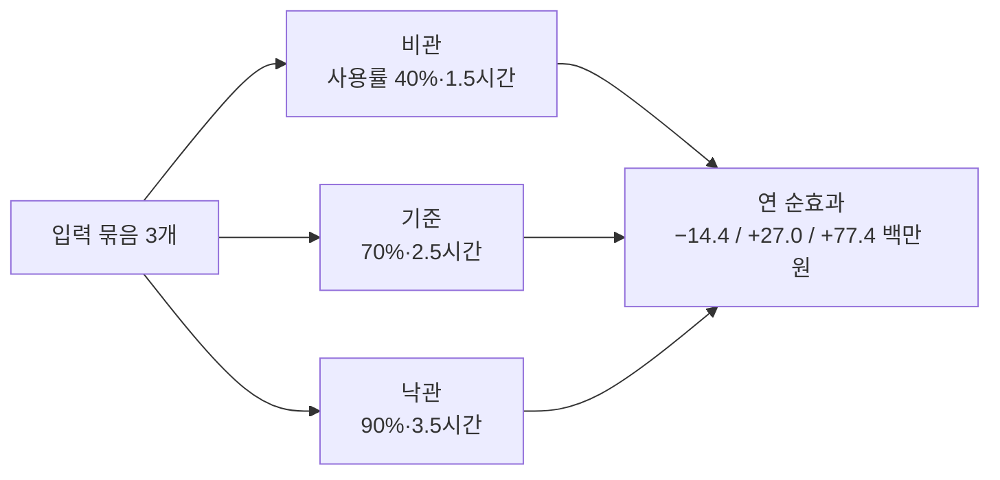
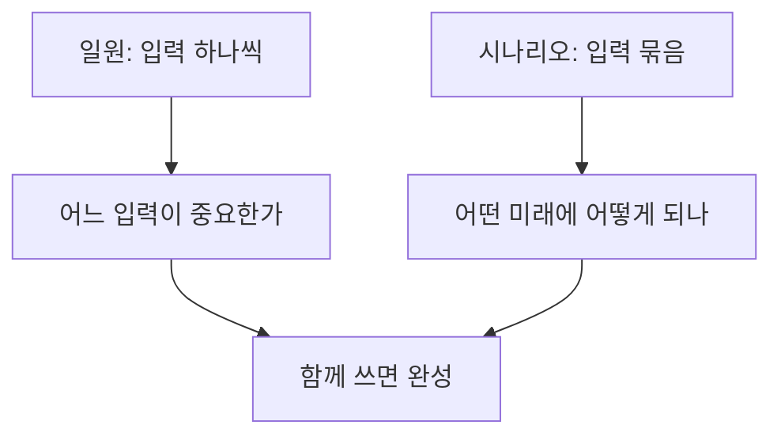

# 시나리오 분석

> 시나리오 분석은 서로 연관된 여러 입력을 한꺼번에 묶어 "비관·기준·낙관" 같은 일관된 미래 상황 몇 개를 만들고, 각 상황에서 ROI·현금흐름이 어떻게 달라지는지 비교하는 방법이다. 한 번에 한 입력만 바꾸는 [일원 민감도 분석](#one-way-sensitivity)과 대비된다.

## 쉽게 말하면
소풍 계획을 세울 때 "비 오고 기온도 낮은 날", "평범한 날", "맑고 따뜻한 날" 세 가지 하루를 통째로 가정해 준비물을 정하는 것이다. 비만 따로, 기온만 따로 바꾸는 것보다 현실적인 묶음이다.

## 자세히
- **정의(Corporate Finance Institute, 열람)**: 가능한 미래 사건과 그로 인한 결과를 검토하는 것으로, 유리한 조건과 불리한 조건에서 사업의 가치나 현금흐름이 어떻게 변하는지 추정한다. 핵심 시나리오는 기준(경영진 가정 기반의 평균 결과), 최악(그럴듯한 가장 가혹한 결과), 최선(이상적 예측)이다. 그 글의 NPV 예에서는 최악에 높은 할인율·낮은 성장, 최선에 낮은 할인율·높은 성장을 쓴다.
- **모델에 만드는 순서(같은 글)**: 바꿀 가정을 나열 → 시나리오마다 복사 → 값 입력 → 모든 시나리오를 같은 배치로 유지 → "현재 시나리오" 영역 → CHOOSE 같은 함수로 전환 → 모델에 연결.
- **민감도와의 차이(CFI 비교 글, 열람)**: 민감도는 한 입력씩, 시나리오는 여러 입력을 함께 바꿔 가능한 미래를 모델링한다. 한 입력이 주된 불확실성이면 민감도, 여러 변수가 동시에 움직이거나 상호작용하면 시나리오가 맞다는 것은 글에 명시되지 않은 추론이다. 두 방법을 함께 쓰라는 안내가 많다(검색 요약).
- **한계(CFI)**: 시간이 걸리고 숙련이 필요하며, 실제 결과는 모델에 없는 일일 수 있고, 모든 시나리오를 만들 수 없고 확률을 매기기 어렵다.
- **가상 예시(직접 계산)**: AI 도구 100명, 연 순효과(백만 원) = 36 × 사용률 × 월 절감시간 − 36. 사용률과 절감 시간은 함께 움직이므로 묶는다. 비관(사용률 40%·1.5시간) −14.4, 기준(70%·2.5시간) +27.0, 낙관(90%·3.5시간) +77.4. [이원 분석](#two-way-sensitivity)의 격자에서 세 지점을 골라 이야기를 붙인 것이다. 수치는 설명용 가상값이다.
- **실무 팁(해석)**: 시나리오마다 이름과 이야기를 붙이고(예: "현업이 쓰지 않는 경우"), 시나리오가 어떤 가정 묶음인지 표로 남긴다.

## 그림으로 보기

## 예시
- 상담 AI 도입 보고서: 비관·기준·낙관 3개 시나리오의 연 순효과와 회수 기간을 표 하나로 제시하고, 비관에서도 손실 한도가 감당 가능한지 본다.
- 교육 활용: 가정 묶음에 이름을 붙이는 연습을 통해 숫자가 아닌 이야기로 불확실성을 설명하게 한다.

## 헷갈리는 것과 비교
| 개념 | 차이 |
| --- | --- |
| [일원 민감도 분석](#one-way-sensitivity) | 한 입력씩. 시나리오는 입력 묶음 |
| [이원 민감도 분석](#two-way-sensitivity) | 두 입력의 모든 조합. 시나리오는 선택한 몇 개의 이야기 |
| [몬테카를로 ROI](#monte-carlo-roi) | 분포에서 수천 번 추출. 시나리오는 이산적 소수 |

## 더 읽을거리
- [CFI: Scenario Analysis](https://corporatefinanceinstitute.com/resources/financial-modeling/scenario-analysis/) — 기준·최악·최선과 모델 구축 순서
- [CFI: Scenario Analysis vs. Sensitivity Analysis](https://corporatefinanceinstitute.com/resources/financial-modeling/scenario-analysis-vs-sensitivity-analysis/) — 두 방법의 차이
