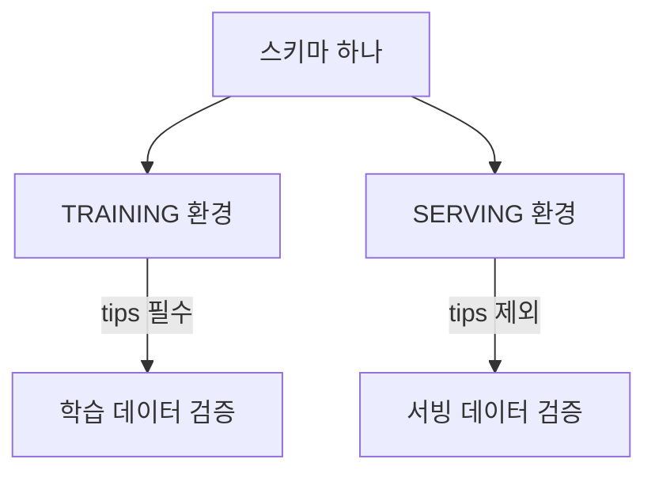
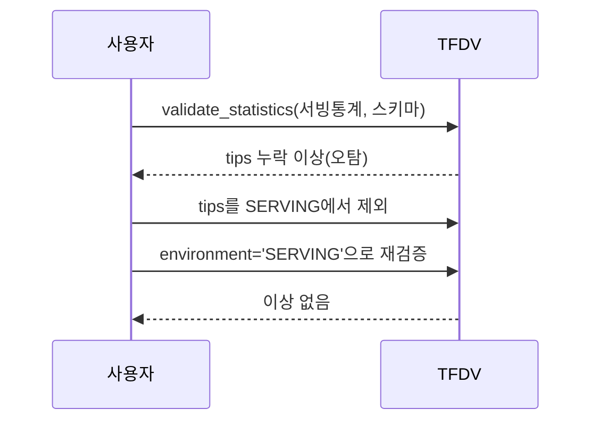

# 스키마 환경

> 하나의 스키마 안에서 **"학습(TRAINING)" "서빙(SERVING)"처럼 용도별로 요구 피처를 다르게 지정**하는 TFDV 기능이다. 같은 스키마로 검증하되 환경마다 필요한 열이 다른 경우의 오탐을 없앤다.

## 쉽게 말하면
시험지 양식이 하나인데, "시험 전"에는 정답란이 있어야 하고 "시험 중 배포용"에는 정답란이 없어야 한다고 하자. 양식 하나에 "정답란은 시험 전에만 필수"라고 적어 두면 배포용에서 정답란이 비어 있다고 경고하지 않는다.

## 자세히
- **문제**: 기본적으로 TFDV는 파이프라인의 모든 데이터셋이 단일 스키마를 따른다고 가정한다. 하지만 라벨 피처는 학습 땐 필수이지만 서빙 땐 없다. 환경 지정이 없으면 서빙 통계 검증에서 이상으로 뜬다(공식 문서 예: 택시 데이터의 `tips`).
- **스키마 필드 3개**: `default_environment`(스키마 전체의 기본 환경 목록), 피처별 `in_environment`, `not_in_environment`.
- **설정 방법(공식 예)**:
  1. `schema.default_environment.append('TRAINING')`, `schema.default_environment.append('SERVING')`
  2. `tfdv.get_feature(schema, 'tips').not_in_environment.append('SERVING')`
  3. 검증 시 `tfdv.validate_statistics(serving_stats, schema, environment='SERVING')`
- 스키마 자체는 비교적 정적이라(문서 표현) 여러 데이터셋이 같은 스키마를 공유하고, 환경은 그 공유를 깨지 않고 예외만 표현하는 수단이다.
- 주의: 환경을 남발하면 "이 열은 서빙에 없어도 된다"는 예외가 쌓여 진짜 누락을 못 잡을 수 있다. 예외는 라벨·타깃처럼 설명 가능한 것만 둔다.

## 그림으로 보기

## 예시
- 추천 모델: `clicked`(라벨)는 학습엔 있고 실시간 요청엔 없다 → `not_in_environment: SERVING`.
- 교육 소재: "같은 규칙표를 쓰되 상황별 예외 표시"를 설명할 때 좋은 비유.

## 헷갈리는 것과 비교
| 개념 | 차이 |
|---|---|
| 스키마 환경 | 용도별 필수 피처 차이를 스키마에 표현 |
| [skew·drift 비교기](#skew-drift-comparator) | 학습/서빙 *분포* 차이를 탐지 |
| [TFDV 이상 유형](#tfdv-anomaly-types) | 위반이 어떤 종류인지 라벨 |
| [스키마 자동 추론](#schema-inference) | 초안 스키마를 통계로 생성 |

## 더 읽을거리
- [TFDV 시작하기 — Schema Environments](https://www.tensorflow.org/tfx/data_validation/get_started) — 환경 설정 코드 예시.
