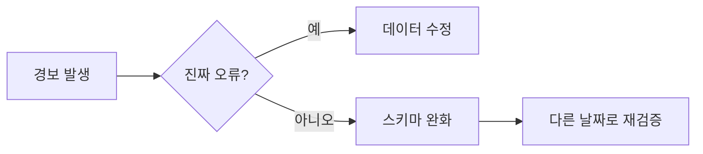

# 스키마 오탐 줄이기

> 자동 추론한 스키마가 **정상 데이터를 이상으로 잘못 경보**하지 않도록, 여러 날짜의 데이터로 시험하며 너무 엄격한 규칙을 풀어 주는 작업이다.

## 쉽게 말하면
화재 경보기가 토스트만 구워도 울리면 사람들은 경보를 끈다. 스키마도 마찬가지로, 오탐이 많으면 진짜 경보도 무시된다. 그래서 알림 기준을 현실에 맞게 조정한다.

## 자세히
(TFDV 공식 Get started 문서 기준. "오탐"이라는 용어와 조정 절차 자체는 문서에 없고, 문서의 도구로 할 수 있는 조정 방법을 정리했다.)
- **출발점**: `infer_schema`는 보수적이지만 한 데이터셋에서 만든 것이므로 **검토하고 다듬으라고** 문서가 강하게 권한다.
- **도메인 확장**: 범주 값이 새로 나와 경보가 났는데 정상이면 스키마에 값을 추가한다. 문서 예: `payment_type`에 `Prcard`가 <1% 나와 "Unexpected string values" → `tfdv.get_domain(schema,'payment_type').value.append('Prcard')`. 진짜 오류면 **데이터를 고친다**.
- **존재 비율 완화**: `tfdv.get_feature(schema,'payment_type').presence.min_fraction = 0.5`처럼 "최소 50% 채워짐"으로 완화.
- **환경(environment)**: 학습엔 있고 서빙엔 없는 라벨(`tips` 등)은 환경을 나눠 오탐을 없앤다([스키마 환경](#schema-environments)).
- **임계값**: skew/drift는 L∞ 임계(문서 예 0.01) 또는 Jensen-Shannon을 쓰며, 임계가 너무 낮으면 경보가 잦다.
- **제안(문서 밖)**: 여러 날짜 데이터에 같은 스키마를 돌려 보고, 정상 변동에만 울리는 규칙을 완화한다.

## 그림으로 보기

## 예시
- 경보 "Examples contain values missing from the schema: Prcard (<1%)" → 신규 결제수단이면 도메인에 추가.
- 임계값을 0.01에서 올리며 정상일 때 경보가 사라지는 지점을 찾는다.

## 헷갈리는 것과 비교
| 개념 | 차이 |
|---|---|
| 오탐 줄이기 | 정상인데 울리는 규칙을 푼다 |
| 미탐 줄이기 | 놓치는 오류를 잡도록 조인다 |
| [스키마 신규 컬럼 이상](#schema-new-column-anomaly) | 새 피처가 나타났을 때의 경보 |

## 더 읽을거리
- [TFDV Get started](https://www.tensorflow.org/tfx/data_validation/get_started) — 도메인·presence·환경·임계값 예(직접 읽음).
