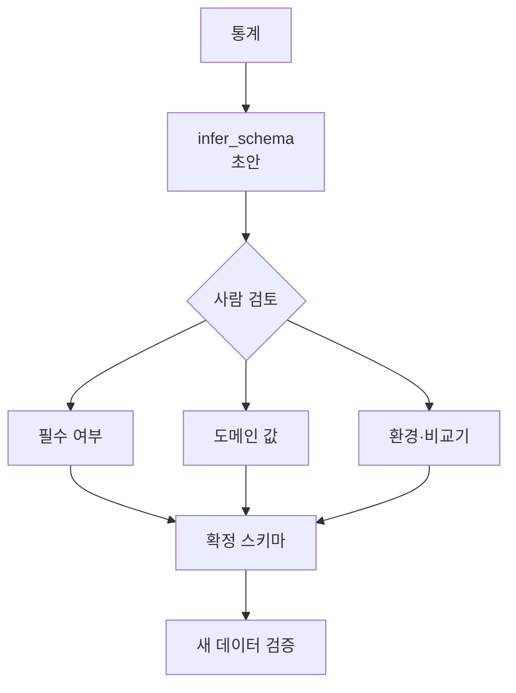
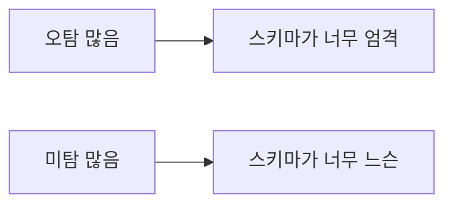

# 추론 스키마 검토 요령

> `tfdv.infer_schema`가 만든 **스키마 초안은 반드시 사람이 검토·수정**해야 한다. TFDV 공식 문서도 "review the inferred schema and refine it"을 강하게 권한다.

## 쉽게 말하면
내비게이션이 처음 그려 준 경로를 그대로 믿지 않고 "여기는 공사 중인 걸 나는 안다"며 고치는 것과 같다. 기계는 본 데이터만 알고, 도메인 지식(이 값은 앞으로 늘어난다, 이 열은 꼭 있어야 한다)은 사람만 안다.

## 자세히
- **왜 필요한가(공식 문서)**: TFDV는 과적합을 피하려 *보수적 휴리스틱*으로 안정적 속성만 추론하지만, 도메인 지식은 놓칠 수 있다. 스키마는 비교적 정적이라 한 번 잘못 잡으면 오래 영향을 준다.
- **점검 체크포인트**
  1. **필수 여부(presence)**: 우연히 모든 행에 있었던 열이 정말 필수인가? `presence.min_fraction`을 `tfdv.get_feature(schema,'payment_type').presence.min_fraction = 0.5`처럼 조정.
  2. **도메인(허용 값 집합)**: 샘플에서 안 나온 정상 값이 빠지지 않았나? `tfdv.get_domain(schema,'payment_type').value.append('Prcard')`.
  3. **값 개수·형태**: 기본 `infer_feature_shape`는 `value_count.min == max`일 때 모양을 추론한다. 가변 길이를 고정으로 오인하면 `infer_feature_shape=False`.
  4. **환경**: 학습 전용 열은 [스키마 환경](#schema-environments)으로 분리.
  5. **비교기**: drift/skew 임계값을 피처별로 추가([비교기](#skew-drift-comparator)).
- 스키마는 `Schema` 프로토콜 버퍼라 코드로 편집하고 버전 관리(git)할 수 있다. 변경 사유를 커밋 메시지에 남긴다.
- 검토 후에는 서로 다른 날짜 데이터로 `validate_statistics`를 돌려 오탐이 많은지 시험한다.

## 그림으로 보기

## 예시
- 첫 주 데이터에 월요일 결제 수단만 있어 도메인이 좁게 잡힘 → 다른 주 데이터를 보고 값 추가.
- 교육: "AI 초안을 사람이 검토"의 표본 사례로 사용.

## 헷갈리는 것과 비교
| 개념 | 차이 |
|---|---|
| [스키마 자동 추론](#schema-inference) | 초안 생성 |
| 추론 스키마 검토 | 초안을 사람이 다듬는 단계 |
| [TFDV 이상 유형](#tfdv-anomaly-types) | 확정 스키마로 검증할 때 나오는 결과 |

## 더 읽을거리
- [TFDV 시작하기 — Inferring a schema](https://www.tensorflow.org/tfx/data_validation/get_started) — 초안 생성과 수정 예시 코드.
