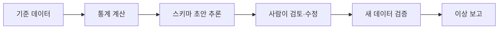
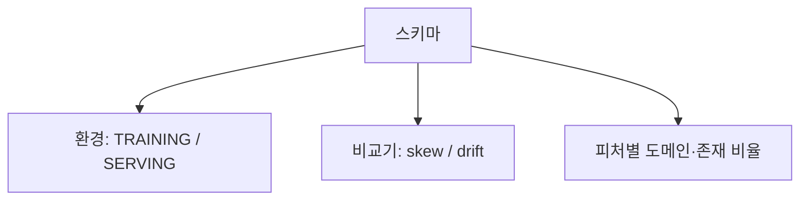

# 스키마 자동 추론

> 데이터의 통계(어떤 컬럼이 있고, 타입·값 개수·값 범위가 어떤지)에서 "올바른 데이터의 기대치"인 스키마의 초안을 자동으로 만드는 일이다. 초안은 반드시 사람이 검토·수정한다.

## 쉽게 말하면
새로 온 엑셀 파일들을 보고 "이 시트는 이름 칸이 항상 채워져 있고, 결제 방식은 카드/현금 둘 중 하나네"라고 규칙 초안을 적어 보는 것과 같다. 모든 규칙을 직접 쓰기 귀찮으니 기계가 먼저 받아 적고, 사람이 업무 지식으로 고친다.

## 자세히
(TensorFlow Data Validation, TFDV 공식 시작 가이드를 직접 열어 확인.)
- **흐름**: 통계 계산 → 스키마 추론 → 이상 탐지.
  - `stats = tfdv.generate_statistics_from_tfrecord(data_location=path)`, CSV·pandas DataFrame(`generate_statistics_from_dataframe`)도 지원.
  - `schema = tfdv.infer_schema(stats)`
  - `anomalies = tfdv.validate_statistics(statistics=other_stats, schema=schema)`
- **스키마가 담는 것**: 있어야 할 피처, 타입, 예시당 값 개수, 전체 예시에서의 존재 비율, 피처별 허용 값 범위(도메인). 스키마는 비교적 정적이고, 통계는 데이터 세트마다 달라진다.
- **보수적 휴리스틱**: 특정 데이터에 과적합되지 않게 안정적인 성질만 추론한다. 가이드는 추론된 스키마를 **검토하고 다듬을 것을 강하게 권한다**.
- 기본으로 `value_count.min == max`이면 피처 모양(shape)을 추론한다(`infer_feature_shape=False`로 끔).
- **수정 예**: `tfdv.get_feature(schema,'payment_type').presence.min_fraction = 0.5`, 도메인에 값 추가 `tfdv.get_domain(schema,'payment_type').value.append('Prcard')`.
- **환경(environment)**: 라벨은 학습에만 있고 서빙에는 없을 때, `default_environment`와 `not_in_environment`로 'TRAINING'/'SERVING'을 구분해 오탐을 막는다.
- **편향·드리프트 비교기**: 스키마에 `skew_comparator`·`drift_comparator`를 넣어 학습 대 서빙, 날짜 간 분포 차이를 임계값(L∞ 노름은 범주형, 젠슨-섀넌 발산은 수치·범주형)으로 감시한다. 관련 개념: [학습-서빙 편향](#training-serving-skew), [데이터 드리프트](#data-drift), [젠슨-섀넌 발산](#jensen-shannon).
- 한계: 추론은 "지금까지 본 데이터"의 요약이다. 처음 본 데이터에 이미 오류가 섞여 있으면 그 오류가 규칙이 된다. 그래서 검토가 필수다(제안).

## 그림으로 보기



## 예시
```python
import tensorflow_data_validation as tfdv
stats = tfdv.generate_statistics_from_dataframe(df_train)
schema = tfdv.infer_schema(stats)
tfdv.get_feature(schema, "payment_type").presence.min_fraction = 0.5
anoms = tfdv.validate_statistics(tfdv.generate_statistics_from_dataframe(df_new), schema)
tfdv.display_anomalies(anoms)
```
- 가이드의 예: 도메인에 없는 값 "Prcard"가 1% 미만 나오면 "Unexpected string values" 이상이 뜬다. 정상이면 도메인에 추가, 오류면 데이터를 고친다.

## 헷갈리는 것과 비교
| 개념 | 차이 |
|---|---|
| 스키마 추론 | 통계로 기대치 초안 생성 |
| [스키마 진화](#schema-evolution) | 이미 있는 스키마를 안전하게 바꿔 가는 일 |
| [TFDV](#tfdv) | 이 기능을 제공하는 도구 |
| 데이터 검증 | 확정된 스키마에 새 데이터를 맞춰 보는 일 |

## 더 읽을거리
- [TensorFlow Data Validation 시작하기](https://www.tensorflow.org/tfx/data_validation/get_started) — infer_schema·환경·skew/drift 비교기(열어 확인).
