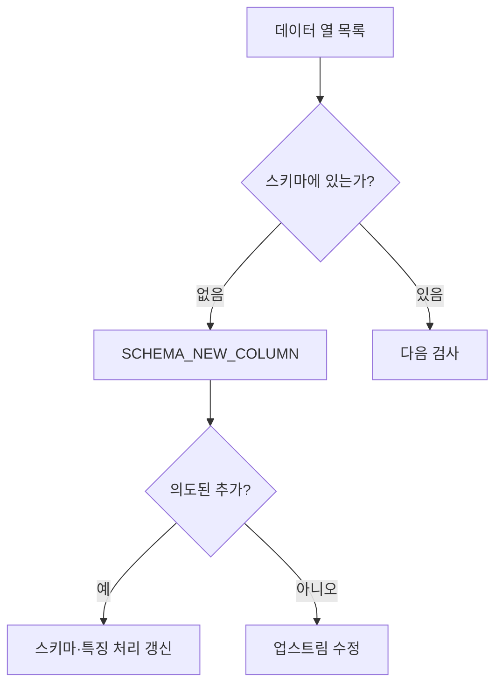
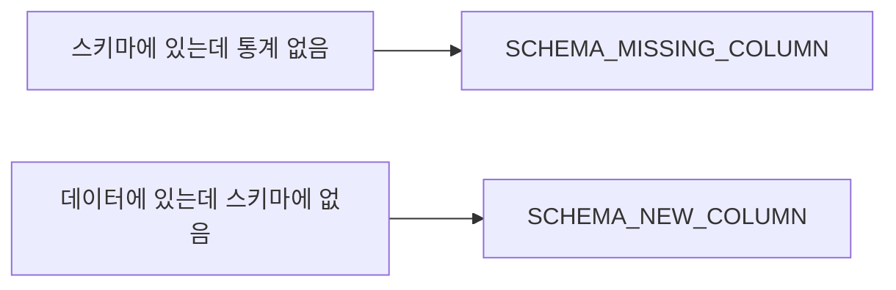

# 새 열 이상(SCHEMA_NEW_COLUMN)

> TFDV가 검증하는 데이터에 **스키마에 정의되지 않은 열이 새로 나타났을 때** 보고하는 이상 유형이다. 업스트림이 열을 추가했거나 열 이름이 바뀌었을 때 가장 먼저 드러난다.

## 쉽게 말하면
출석부에 없는 이름이 시험지에 등장한 것이다. 새로 전학 온 학생일 수도 있고, 이름을 잘못 쓴 것일 수도 있다. 어느 쪽인지 확인하기 전에는 이름이 나왔다는 사실 자체를 알려 주는 것이 이 경보의 역할이다.

## 자세히
(TensorFlow Metadata의 `anomalies.proto` 원문과 TFDV 시작 가이드를 직접 읽었다. 대응 방법은 문서가 정한 절차가 아니라 이 지도의 일반 원칙이다.)
- **정의(anomalies.proto)**: `AnomalyInfo.Type`의 값 `SCHEMA_NEW_COLUMN = 36`이며 코멘트는 "There is a new column that is not in the schema." 즉 데이터에는 있는데 스키마에는 없는 열이다.
- **같은 "스키마" 범주의 이웃 유형(proto)**: `SCHEMA_MISSING_COLUMN`(35, 열에 대한 통계가 없음), `SCHEMA_TRAINING_SERVING_SKEW`(37, 학습·서빙 편향 감지). 새 열은 **데이터에 더 있는** 경우이고 누락 열은 **데이터에 없는** 경우다.
- **다른 이상 유형과의 구분**: 열 단위 스키마 불일치(새 열)와 값 단위 불일치는 다른 이상이다. 예컨대 `ENUM_TYPE_UNEXPECTED_STRING_VALUES`(14)는 열은 있지만 허용 값 밖의 문자열이 나온 경우, `FLOAT_TYPE_HAS_NAN`(53)은 NaN이 섞인 경우다.
- **발생 원인 후보(일반 원칙)**: 업스트림이 열을 추가, 열 이름 변경(옛 이름은 누락 + 새 이름은 새 열로 동시에 보일 수 있음), 중첩 필드 평탄화 방식 변경, 임시·디버그 열이 운영 데이터에 유출.
- **대응(제안)**: ① 새 열이 의도된 것인지 업스트림에 확인 ② 의도됐고 모델이 쓸 것이면 스키마에 추가하고 특징 처리·인코딩을 갱신 ③ 모델이 쓰지 않을 열이면 스키마에 추가하되 모델 입력에서는 제외하거나, 파이프라인 앞단에서 걸러내 ④ 의도되지 않았다면 업스트림을 고친다. 판단 틀은 [스키마 고칠까 데이터 고칠까](#schema-vs-data-fix-decision)와 같다.
- **라벨 열과의 관계(TFDV 문서)**: 학습에만 있는 열은 [스키마 환경](#schema-environments)으로 처리해야 하며, 환경을 지정하지 않아 생기는 누락 이상과 새 열 이상을 혼동하지 않는다. 서빙 데이터에 라벨이 새 열로 나타나면 누수 신호일 수 있다.

## 그림으로 보기

## 예시
- 결제 데이터에 `promo_code` 열이 새로 추가되어 배포 후 검증에서 새 열 이상이 보고 → 결제팀에 확인, 모델에 쓰지 않을 열이라면 스키마에 등록하되 입력 특징에서는 제외.
- 교육 소재: 열 이름이 바뀌면 누락 이상과 새 열 이상이 쌍으로 나타나는 현상 관찰.

## 헷갈리는 것과 비교
| 이상 유형 | 의미 |
|---|---|
| SCHEMA_NEW_COLUMN | 데이터에 있으나 스키마에 없는 열 |
| SCHEMA_MISSING_COLUMN | 스키마에 있으나 통계(데이터)가 없는 열 |
| ENUM_TYPE_UNEXPECTED_STRING_VALUES | 열은 있으나 허용 밖 문자열 값 |
| [라벨 열 처리](#label-column-handling) | 학습 전용 열 때문에 생기는 누락 처리 |

## 더 읽을거리
- [anomalies.proto (TensorFlow Metadata)](https://raw.githubusercontent.com/tensorflow/metadata/master/tensorflow_metadata/proto/v0/anomalies.proto) — SCHEMA_NEW_COLUMN 정의와 이상 유형 전체 목록(직접 읽음).
- [Get started with TensorFlow Data Validation](https://www.tensorflow.org/tfx/data_validation/get_started) — 스키마 검증과 환경(직접 읽음).
