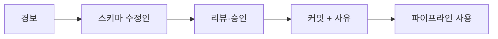

# 스키마 버전 관리

> 스키마를 **파일로 저장하고 변경 이력과 사유를 남겨**, 언제 왜 규칙이 바뀌었는지 추적할 수 있게 하는 관행이다.

## 쉽게 말하면
계약서를 고칠 때 덮어쓰기만 하면 "누가 언제 이 조항을 바꿨지?"를 알 수 없다. 개정 이력을 남겨 두듯, 데이터 규칙도 변경 기록이 있어야 사고 원인을 추적한다.

## 자세히
(TFDV 공식 문서를 읽었다. 문서는 **git 사용을 직접 언급하지 않는다**. 아래 사실과 제안을 구분한다.)
- **사실(문서)**: 스키마는 **Schema protocol buffer**로 저장되고 표준 protobuf API 또는 유틸리티로 수정한다. 스키마는 "상당히 정적"이어서 여러 데이터셋이 같은 스키마를 따를 수 있고, 통계는 데이터셋마다 달라진다.
- **사실(문서)**: 경보가 정상이면 스키마를 고치고(도메인 추가 등), 오류면 데이터를 고친다 — 즉 스키마 변경이 곧 의사결정이다.
- **제안(문서 밖)**: protobuf 텍스트 파일로 내보내 git 저장소에 두고, 변경 커밋 메시지에 "어떤 경보 때문에, 누가 승인"을 적는다. 코드 리뷰처럼 PR로 사람 검토를 거친다.
- 이유: 스키마가 조용히 느슨해지면 오류가 통과하고, 조이면 오탐이 늘기 때문에 변경 자체를 감사 가능하게 둔다.

## 그림으로 보기

## 예시
- 커밋 메시지 예: `schema: payment_type 도메인에 Prcard 추가 (신규 결제수단, 2026-11-23 경보 대응)`.

## 헷갈리는 것과 비교
| 개념 | 차이 |
|---|---|
| 스키마 버전 관리 | 규칙 정의의 변경 이력 |
| 데이터 버전 관리 | 데이터 자체의 스냅숏 |
| [사람 검토](#schema-human-review) | 변경 전 확인 단계 |

## 더 읽을거리
- [TFDV Get started](https://www.tensorflow.org/tfx/data_validation/get_started) — 스키마가 protobuf로 저장·수정됨(직접 읽음).
