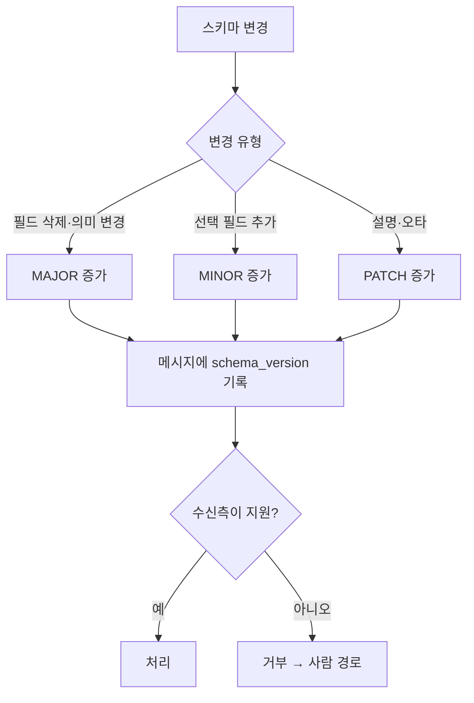

# 스키마 버전 관리

> AI와 사람, 또는 서로 다른 시스템이 주고받는 **이관 데이터의 형식(스키마)에 버전을 붙여 기록하고, 양쪽이 같은 버전을 쓰는지 확인하는 것**. 필드 이름이나 뜻이 조용히 바뀌어 받는 쪽이 틀리게 읽는 사고를 막는다.

## 쉽게 말하면
설문지 양식이 바뀌었는데 입력 담당자가 예전 칸에 새 내용을 넣으면 숫자가 엉뚱한 곳에 들어간다. 양식 번호를 적어 두고 받는 쪽이 번호를 확인하면 이런 조용한 오독을 막을 수 있다.

## 자세히
출처: Semantic Versioning 2.0.0 명세 검색 요약(semver.org, 2026-11-18). 스키마에의 적용은 제안이며, JSON 스키마 진화(호환성 판단 규칙)는 이번 조사에서 확인하지 못했다.
- **SemVer 규칙(명세)**: `MAJOR.MINOR.PATCH`. **호환되지 않는 변경은 MAJOR**, 하위 호환 기능 추가는 MINOR, 하위 호환 버그 수정은 PATCH를 올린다. MAJOR를 올리면 MINOR·PATCH는 0으로 되돌린다. 1.0.0-alpha 같은 사전 릴리스는 정식 릴리스보다 낮은 우선순위다.
- **전제**: SemVer는 공개 API가 정의된 프로젝트에 의미가 있다. 스키마에서는 소비하는 쪽이 "공개 API" 역할을 한다(해석). 관례일 뿐 강제력은 없고, 호출자가 의존하는 동작이 문서화된 API 밖에 있을 수 있다.
- **잘못 낸 호환 깨짐**: MINOR로 깨는 변경을 냈다면 문제를 고치고 호환을 복원하는 새 MINOR를 낸다는 것이 명세 FAQ의 권고(검색 요약).
- **스키마에 적용(제안)**: 이관 메시지에 `schema_version`(예: 2.1.0)을 포함. 필드 삭제·이름 변경·의미 변경·필수 필드 추가는 MAJOR, 선택 필드 추가는 MINOR, 설명·오타 수정은 PATCH로 규칙을 정한다(이 분류는 제안이며 확인된 표준이 아니다).
- **협상(제안)**: 보내는 쪽이 지원 버전 목록을, 받는 쪽이 이해하는 버전을 선언하고 가장 높은 공통 MAJOR로 합의. 모르는 MAJOR는 거부하고 사람 경로로 보낸다(조용한 오독 금지).
- **조용한 오독 예**: `priority`가 "1=가장 높음"에서 "1=가장 낮음"으로 의미만 바뀌면 필드는 그대로라 오류 없이 긴급 건이 뒤로 밀린다. 의미 변경은 MAJOR로 보고 이전 버전 값과 자동 변환 금지.
- **운영**: 변경 이력(changelog), 호환성 테스트(이전 버전 샘플로 수신 검증), 더 이상 쓰지 않는 버전의 종료 일정.
- **한계**: 버전 번호가 있어도 팀이 규칙대로 올리지 않으면 무의미하다. 자동 검증(스키마 린트, 계약 테스트)이 필요하다.

## 그림으로 보기


## 예시
```json
{"schema_version": "2.1.0", "priority": 1, "priority_scale": "1=highest",
 "summary": "환불 문의, 주문 12345", "customer_id": "c-001"}
```
교육 활용: 이관 데이터 필드 5개를 놓고 "이름 변경, 필드 추가, 단위 변경"이 각각 어떤 버전 증가에 해당하는지 토론하는 실습.

## 헷갈리는 것과 비교
| 개념 | 차이 |
|---|---|
| 스키마 버전 | 데이터 형식의 변경 단계 표시 |
| 앱 버전 | 제품 릴리스 번호 |
| 계약 테스트 | 양쪽 구현이 스키마를 지키는지 자동 검증 |
| 조용한 오독 | 버전·의미 불일치로 오류 없이 틀리게 읽음 |

## 더 읽을거리
- [Semantic Versioning 2.0.0](https://semver.org/) — MAJOR·MINOR·PATCH 규칙과 FAQ
