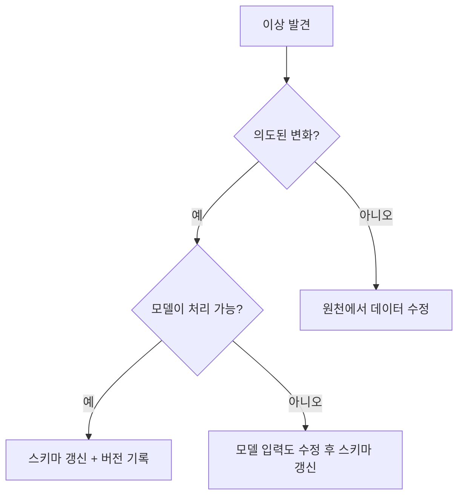
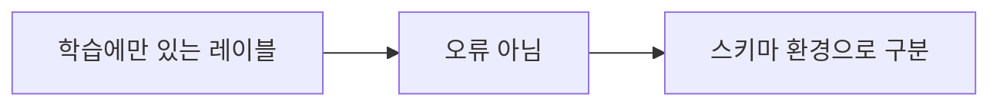

# 스키마 고칠까 데이터 고칠까

> 데이터 검증에서 이상이 발견됐을 때, **스키마(기대치)를 바꿔 새 상태를 받아들일지, 원본 데이터를 고칠지** 정하는 판단이다. 잘못 정하면 진짜 오류를 허용하거나, 정당한 변화를 계속 오류로 막는다.

## 쉽게 말하면
출석부에 없던 이름이 시험지에 나왔다. 전학생이 새로 왔다면 출석부(스키마)를 고쳐야 하고, 이름을 잘못 쓴 것이라면 시험지(데이터)를 고쳐야 한다. 어느 쪽인지 확인하지 않고 둘 중 하나로 일괄 처리하면 틀린다.

## 자세히
(TFDV 공식 시작 가이드를 직접 읽었다. 판단 기준 목록은 문서의 두 문장에서 확장한 이 지도의 일반 원칙이며, 문서가 정식 의사결정 절차를 규정한 것은 아니다.)
- **문서의 처방(TFDV)**: `payment_type`에 스키마 밖의 값 `Prcard`가 일부 행에서 발견됐을 때 — "이것이 **예상된 것**이라면 스키마를 갱신(`tfdv.get_domain(schema, 'payment_type').value.append('Prcard')`)하고, **진짜 데이터 오류**를 가리킨다면 학습에 쓰기 전에 **기반 데이터를 고쳐야** 한다."
- **스큐 이상의 경우(문서)**: 서빙 데이터에 `Cash` 값이 훨씬 많아 L-infinity 거리가 0.0435984로 임계값 0.01을 넘으면 이상이 나온다. 문서는 이것이 진짜 train/serving 편향이면 모델 성능에 **직접 영향**을 줄 수 있어 추가 조사가 필요하다고 적는다.
- **스키마 환경(문서)**: 레이블 특징은 학습에는 필요하지만 서빙에는 없다. 이 경우는 오류가 아니므로 데이터가 아닌 **스키마를 환경별로 구분**해 해결한다(`tips`를 SERVING 환경에서 제외). 예제도 "이상이 아니라 스키마 표현의 문제"의 사례다.
- **판단 기준(일반 원칙, 제안)**
  1. **원인 확인**: 이상 예제를 꺼내 보고([예제 단위 검증](#anomaly-example-level-validation)) 업스트림 변경·신규 범주·버그 중 무엇인지 본다.
  2. **의도된 변화인가**: 제품이 새 값을 도입했거나 새 코드가 추가됐다면 스키마 갱신 후보.
  3. **모델이 새 값을 처리할 수 있나**: 새 범주를 받아들이면 모델 입력(인코딩)도 바꿔야 하는지 확인. 스키마만 고치고 모델은 모르는 값을 만나는 사고가 날 수 있다.
  4. **오류라면 어디서 고치나**: 원천(생산자)에서 고치는 것이 근본 해결이고, 수신 쪽에서 땜질하면 재발한다. 앞서 본 [공급사 계약](#supplier-quality-annex)·데이터 계약이 이때 쓰인다.
  5. **기록**: 스키마 변경은 버전 관리하고 사유를 남긴다.
- **함정(해석)**: 경보가 귀찮아서 스키마를 계속 넓히면 검증이 무의미해진다("스키마 침식"). 반대로 정당한 신규 값을 오류로 계속 막으면 팀이 검증을 끈다.

## 그림으로 보기

## 예시
- 새 결제 수단 `Prcard`가 등장: 결제팀에 확인해 실제 신규 수단이면 스키마에 추가하고 모델 인코딩도 갱신, 오타·시스템 오류면 원천 수정.
- 교육 소재: 이상 경보 10건을 보고 "스키마 vs 데이터" 분류 연습.

## 헷갈리는 것과 비교
| 개념 | 차이 |
|---|---|
| 스키마 갱신 | 기대치를 현실에 맞춤 |
| 데이터 수정 | 현실(데이터)을 기대치에 맞춤 |
| 스키마 환경 | 같은 데이터 유형의 환경별 기대 차이를 표현 |
| [예제 단위 검증](#anomaly-example-level-validation) | 판단 전에 이상 예제를 확인하는 방법 |

## 더 읽을거리
- [Get started with TensorFlow Data Validation](https://www.tensorflow.org/tfx/data_validation/get_started) — 스키마 갱신 vs 데이터 수정 문장, 스큐 예, 스키마 환경(직접 읽음).
