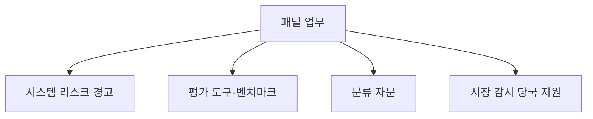

# AI 과학 패널

> EU AI Act 68조가 두는 독립 전문가 패널. 집행위 AI Office를 자문·지원하며, 특히 범용 AI 모델의 시스템 리스크를 AI Office에 "경보"하고 평가 도구·벤치마크 개발을 돕는다.

## 쉽게 말하면
감독 기관이 모든 기술을 다 알 수 없으니 독립적인 학자·전문가 자문단을 두고, 위험 징후가 보이면 감독 기관에 알리게 하는 구조다. 외부 눈이 달린 조기 경보 장치다.

## 자세히
출처는 artificialintelligenceact.eu의 68조·90조(열람). 법률 자문이 아니다.
- **설치·구성(68조 1~2항)**: 집행위가 이행법으로 설치한다. 전문가는 AI 과학·기술 전문성이 있어야 하고 (a) 특별한 AI 전문성, (b) AI 시스템·범용 AI 모델 제공자로부터의 독립성, (c) 성실·정확·객관적으로 일할 능력을 보여야 한다. 규모는 집행위가 AI Board와 협의해 정하고 성별·지역 대표성을 공정하게 맞춘다.
- **업무(68조 3항)**: AI Office를 자문·지원한다. 범용 AI 모델·시스템의 집행 지원으로서 (i) 90조에 따라 EU 차원의 시스템 리스크 가능성을 AI Office에 경고, (ii) 벤치마크를 포함한 평가 도구·방법론 개발, (iii) 범용 AI 모델의 시스템 리스크 분류 자문, (iv) 다른 모델·시스템의 분류 자문, (v) 도구·템플릿 개발 지원. 또 요청 시 시장 감시 당국 지원, 74조 11항 국경 간 시장 감시 지원, 81조 연합 안전장치 절차에서 AI Office 지원.
- **독립성(68조 4항)**: 전문가는 공정·객관적으로 활동하고 기밀을 지키며 지시를 구하거나 받지 않는다. 이해관계 선언서를 내고 공개되며, AI Office는 이해충돌을 적극 관리·예방하는 체계를 둔다.
- **경보(68조 5항, 90조)**: 패널은 AI Office에 "자격 경보(qualified alert)"를 낼 수 있다. 90조 1항의 조건은 (a) 범용 AI 모델이 EU 차원의 구체적이고 식별 가능한 위험을 낳는다고 의심되거나 (b) 모델이 51조 조건을 충족한다고 의심되는 경우다. 경보는 이유를 붙여야 하고 최소한 제공자 연락처, 관련 사실과 경보 이유 설명, 기타 유용한 정보를 포함한다(90조 3항). 경보를 받은 집행위(AI Office를 통해)는 91~94조의 권한을 행사해 평가할 수 있으며 먼저 AI Board에 알려야 한다(90조 2항).
- **시기와 한계**: 90조는 2026-08-02부터 적용된다고 페이지에 적혀 있다. 조문에 경보 발령이나 집행위 평가의 고정 기한은 없다. 패널 수수료는 68조에 없고 회원국의 전문가 풀 접근은 69조에서 다루나 이번에 열지 않았다.
- **연결**: 경보는 [시스템 리스크 모델](#systemic-risk-model)의 지정 경로(51조 1항 b)로 이어질 수 있다.

## 그림으로 보기

## 예시
- 패널이 특정 범용 모델에 구체적 EU 차원 위험이 있다고 의심하면 제공자 연락처·사실·이유를 담은 경보를 AI Office에 낸다(조문 구조에 따른 설명 예).
- 교육 실습: 자격 경보에 담겨야 할 세 요소를 가상 사례로 채워 본다.

## 헷갈리는 것과 비교
| 개념 | 차이 |
|---|---|
| 과학 패널 | 독립 전문가, 자문·경보 |
| [AI Board](#ai-board) | 회원국 대표 협의체 |
| AI Office | 집행위 내 집행 조직 |
| 자격 경보 | 패널이 AI Office에 내는 이유 있는 경보 |

## 더 읽을거리
- [AI Act Article 68](https://artificialintelligenceact.eu/article/68/) — 패널(열람)
- [AI Act Article 90](https://artificialintelligenceact.eu/article/90/) — 자격 경보(열람)
