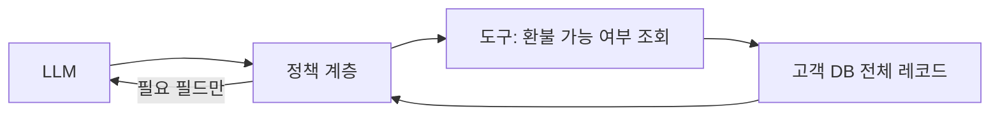
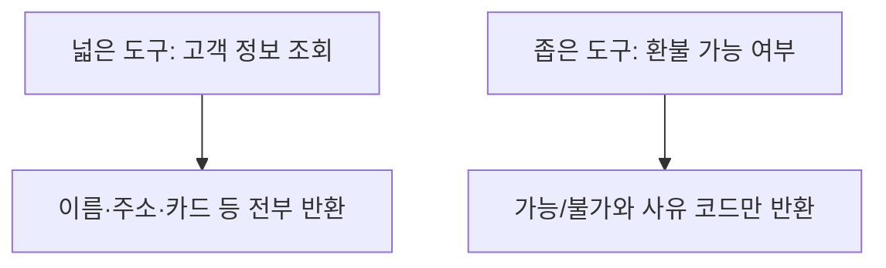

# 범위 제한 도구 인터페이스

> 에이전트에게 주는 도구를 "그 작업에 필요한 필드와 권한만" 돌려주도록 좁게 설계하는 방식이다. 접근 권한을 막는 것만으로는 부족하고, 도구가 돌려주는 **응답의 모양** 자체를 작업별로 줄여야 데이터가 모델에 과하게 흘러가지 않는다.

## 쉽게 말하면
도서관 사서에게 "대출 가능 여부만 알려 줘"라고 시키면 가능/불가만 답한다. "회원 카드 열어서 보여 줘"라고 하면 주소·전화번호까지 같이 보인다. 후자 같은 도구는 한 번 호출로 필요 이상을 모델에 넘긴다. 도구를 작업별로 쪼개고 필요한 칸만 답하게 하는 것이 범위 제한이다.

## 자세히
(실무자·보안 업체 글 기반 설계 지침이다. MCP 공식 명세에 응답 필드 필터링 규정은 확인되지 않았다.)
- **도구 단위 범위(권한)**: 에이전트마다 자기 기능에 맞는 OAuth 범위를 따로 주고, 서버가 제공하는 도구와 그 에이전트가 호출 가능한 도구를 구분해 허용 목록(allowlist)으로 둔다. 쓰기·삭제·전송 도구엔 단기·작업 범위 토큰을 쓴다(Waxell 글 확인).
- **필드 단위 범위(응답)**: 도구와 모델 사이에 정책 계층을 두어 필드를 분류하고 작업에 불필요한 것은 제거한다. 도구별 출력 스키마에 민감도 라벨을 붙이고, 모델이 보기 전에 결정적(규칙 기반) 가림을 적용한다. 한 도구가 소비자별로 필요 데이터가 다르면 호출마다 한 종류의 데이터만 돌려주도록 도구를 쪼갠다(검색 결과에서 요약된 실무자 글, 본문 미열람).
- **읽기·쓰기 분리**, 권한 합치기 회피: MCP Security Standard의 최소 권한 통제 항목이 권고한다(검색 결과 기준).
- **현실 수치(출처 분석 주장)**: Astrix Security의 5,200여 개 오픈소스 MCP 서버 분석(2025)에서 절반 이상이 장기 고정 비밀키를 쓰고 OAuth 같은 현대 인증은 9% 미만이라고 Waxell 글이 인용한다. 하나의 넓은 토큰이 도구 전체를 여는 경우가 흔하다고 한다.
- **사고 사례(2차 보도 인용)**: Asana MCP가 출시 후 한 달 넘게 서로 다른 조직의 프로젝트명·태스크 설명을 노출했다는 보도(BleepingComputer 인용).

## 그림으로 보기

## 예시
- 이관 요약 도구: `get_customer(id)` 대신 `get_refund_eligibility(order_id)` → `{eligible: true, reason: "7일 이내"}`만 반환.
- 에이전트별 허용 목록: 상담 에이전트는 읽기 도구만, 환불 에이전트만 `issue_refund`(단기 토큰).

## 헷갈리는 것과 비교
| 개념 | 차이 |
|---|---|
| 도구 권한 범위 | 어떤 도구를 호출할 수 있나 |
| 응답 필드 범위 | 호출 결과에서 어떤 칸을 돌려주나 |
| [PII 가림 방식](#pii-redaction-types) | 이미 가져온 데이터를 가리는 기법 |
| [이관 시 개인정보 최소화](#pii-minimization-handoff) | 이 설계가 따르는 원칙 |

## 더 읽을거리
- [Waxell: MCP 최소 권한](https://www.waxell.ai/blog/mcp-least-privilege) — 에이전트별 자격·허용 목록·단기 토큰(직접 열어 확인, 필드 최소화는 직접 다루지 않음).
- [MCP Security Standard: MCP-AUTHZ-03 최소 권한](https://github.blesdmm.dns-dynamic.net/mcp-security-standard/mcp-server-security-standard/blob/main/v0.1/controls/MCP-AUTHZ-03-least-privilege.md) — 통제 항목(검색 결과 기준, 본문 미열람).
