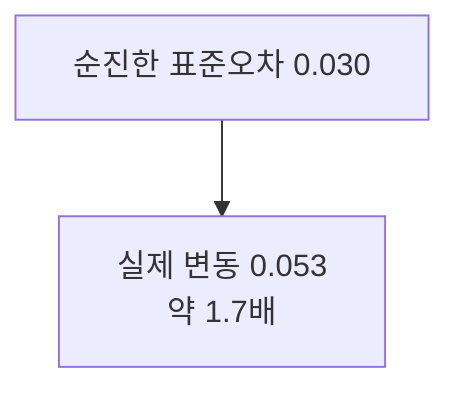

# 점수 비독립성

> 교차검증의 폴드별 점수는 학습 데이터가 서로 크게 겹치고 같은 분할을 공유해 독립이 아니다. 그래서 폴드 점수의 표준편차를 √K로 나눈 "표준오차"는 실제 불확실성보다 작게 나와 낙관적이다.

## 쉽게 말하면
같은 교과서로 공부한 학생 10명의 시험 점수를 "독립된 10개의 증거"로 치면 안 된다. 학생들이 거의 같은 내용을 공부했기 때문에 한 명이 틀린 문제는 다른 학생도 틀리기 쉽다. 증거가 10개처럼 보여도 실제로는 훨씬 적다.

## 자세히
- **겹침의 크기**: K겹에서 두 폴드의 학습 세트가 겹치는 비율은 (K−2)/(K−1)이다. 10겹이면 89%(계산). 학습 데이터가 거의 같으니 모델도 비슷하고 오류도 비슷하게 난다.
- **같은 어려움**: 어려운 시험 조각은 모든 모델에게 어렵다. scikit-learn 예제 문서(열람)는 반복 교차검증 점수에서 모델 간 상관이 최대 0.88이라 보였고, 독립을 가정한 검정은 분산을 과소추정한다고 설명한다.
- **직접 해 본 실험(합성 분류 데이터 100개 표본, 로지스틱 회귀, 10겹, 새 데이터 300번)**: 매번 폴드 점수 표준편차÷√10으로 구한 순진한 표준오차의 평균은 0.0304였다. 반면 새 데이터를 뽑을 때마다 달라지는 10겹 평균 정확도의 실제 표준편차는 0.0529로, 순진한 값의 약 1.74배였다. 순진한 방식이 불확실성을 약 4할 낮게 본 셈이다(이 설정에서만의 결과).
- **원논문 주장(미열람)**: Bengio & Grandvalet(2004, JMLR)는 K겹 분산을 편향 없이 추정하는 방법이 일반적으로 없다고 보인다고 알려져 있다. PDF를 읽지 못해 내용은 확인하지 못했다.
- **대처(해석)**: ① 폴드 편차를 신뢰구간으로 쓰지 않는다 ② 모델 비교는 [보정 재표집 t-검정](#corrected-resampled-ttest)이나 새 시험 세트로 ③ 반복해도 데이터 크기에서 오는 불확실성은 줄지 않는다([RepeatedKFold](#repeated-kfold)).

## 그림으로 보기

## 예시
- 보고서에 "정확도 0.91±0.01"이라고 적었는데 새 데이터에서 0.85가 나온 경우: 폴드 편차를 불확실성으로 오해한 전형적 사례.
- 교육 활용: 새 합성 데이터를 여러 번 뽑아 "폴드 편차"와 "진짜 흔들림"을 비교하는 실습.

## 헷갈리는 것과 비교
| 개념 | 차이 |
| --- | --- |
| 폴드 점수 표준편차 | 폴드 간 변동(독립 아님) |
| 새 데이터에 대한 실제 변동 | 더 큼 |
| [교차검증 점수 보고법](#cv-score-reporting) | 무엇을 적을지 |
| [교차검증으로 모델 비교](#model-comparison-cv) | 보정 검정 |

## 더 읽을거리
- [scikit-learn: Statistical comparison of models using grid search](https://scikit-learn.org/stable/auto_examples/model_selection/plot_grid_search_stats.html) — 점수 상관과 보정 검정
