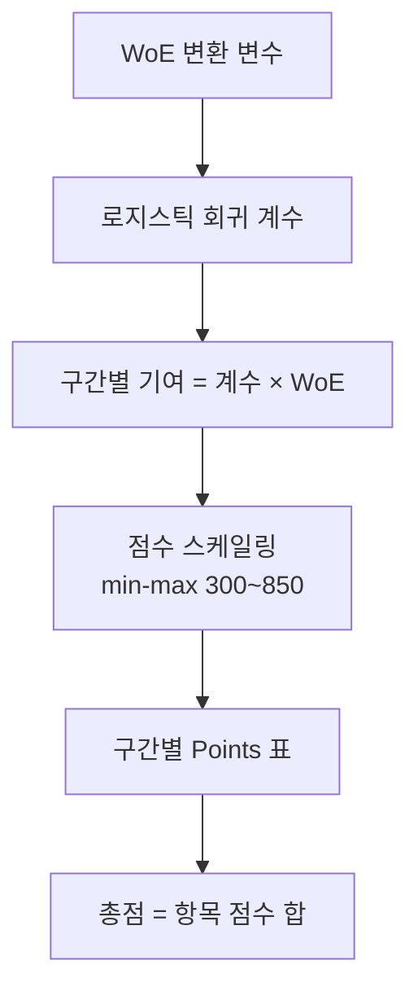

# 스코어카드 점수화

> 로지스틱 회귀 계수와 WoE로 "구간마다 몇 점"인 점수표를 만들고, 사람이 이해하기 쉬운 점수 범위(예: 300~850)에 맞추는 단계.

## 쉽게 말하면
의사가 복잡한 수치 대신 "혈압 높음 +2점, 흡연 +3점, 합계 5점 이상이면 주의" 같은 점수표를 쓰는 것과 같다. 스코어카드는 모형의 계산을 항목별 가산 점수로 풀어 보여 준다.

## 자세히
출처: OptBinning 스코어카드 튜토리얼(본문 확인). 아래 PDO 공식은 업계 통례로 알려진 것이며 이 튜토리얼에는 나오지 않는다(주장 수준, 도구마다 다름).
- **구조**: 변수를 구간화해 WoE로 바꾸고, 로지스틱 회귀 계수를 곱해 구간별 기여를 얻는다. 한 변수 안에서 계수는 같고 WoE는 구간마다 달라 점수가 갈린다(튜토리얼 표의 ExternalRiskEstimate 계수 −0.326343).
- **OptBinning 방식**: `scaling_method="min_max"`와 `{"min": 300, "max": 850}`을 주면 변수별 최소·최대 점수를 합쳐 전체가 300~850이 되도록 스케일한다. 튜토리얼은 합산으로 min 300, max 850을 검증한다.
- **통례의 PDO 방식(참고)**: `Factor = PDO / ln 2`, `점수 = Offset + Factor × ln(odds)`. PDO는 "odds가 2배 될 때 변하는 점수"다. 이는 OptBinning 문서에서 확인한 것이 아니다.
- **표 출력**: `style="summary"`는 Variable, Bin, Points. `style="detailed"`는 Count, 사건률, WoE, IV, JS, Coefficient, Points까지 준다.
- **장점**: 감사·설명 용이([설명요구 대응](#credit-info-act-36-2)). **한계**: 변수 간 상호작용을 못 담는다.

## 그림으로 보기


## 예시
```python
from optbinning import Scorecard
sc = Scorecard(binning_process=bp, estimator=est,
               scaling_method="min_max",
               scaling_method_params={"min": 300, "max": 850})
sc.fit(X, y)
print(sc.table(style="summary"))
```
교육 활용: 금융 직무 교육에서 "AI 점수 대신 점수표를 보여 주면 고객에게 설명하기 쉽다"를 사례로 쓴다.

## 헷갈리는 것과 비교
| 개념 | 차이 |
|---|---|
| 스코어카드 점수화 | 모형을 가산 점수표로 변환 |
| [WoE 구간화](#woe-binning) | 점수화 이전 전처리 |
| [IV](#information-value) | 변수 선택 지표 |
| 신용점수(KCB·NICE) | 완성된 상용 점수, 모형·범위는 회사별 |

## 더 읽을거리
- [OptBinning 스코어카드 튜토리얼](https://gnpalencia.org/optbinning/tutorials/tutorial_scorecard_binary_target.html) — min-max 스케일링과 표 형식
- [OptBinning 문서](https://gnpalencia.org/optbinning/) — Scorecard와 반사실적 설명 기능
