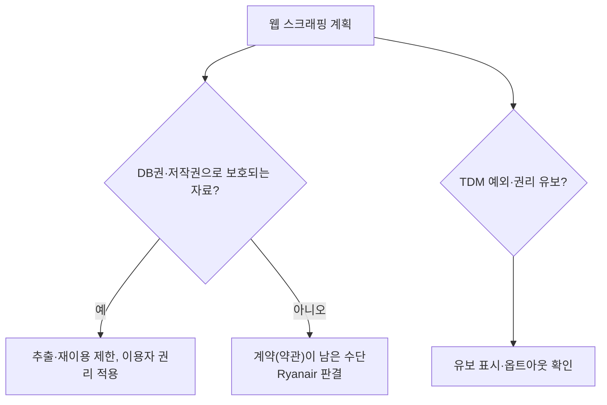
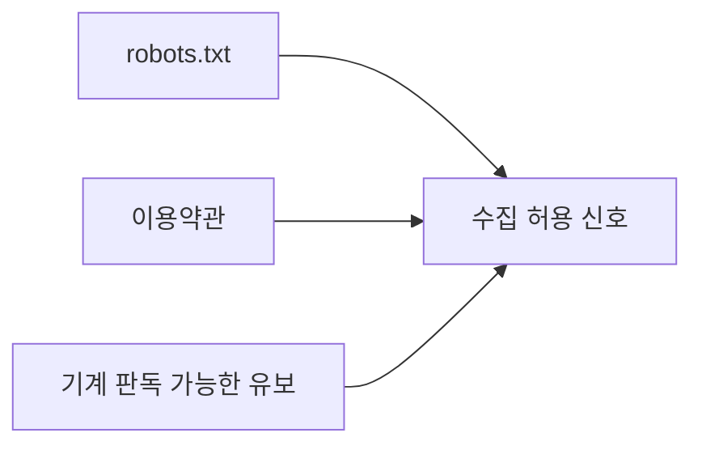

# 웹 스크래핑과 DB권

> 웹을 긁어(스크래핑) 학습 데이터를 만들 때 걸리는 법적 쟁점. **데이터베이스권(EU), 사이트 이용약관, 저작권, 텍스트·데이터 마이닝 예외**가 겹친다. 어느 것이 적용되는지는 국가·사안별이라 이 글은 공개 자료의 정리일 뿐 법률 자문이 아니다.

## 쉽게 말하면
남의 가게 진열대 사진을 매일 찍어 가는 일이 문제인지는 ① 진열 자체를 만든 투자가 보호되는지 ② 가게 입구의 "촬영 금지" 안내를 받아들였는지 ③ 사진에 찍힌 상품의 저작권은 어떤지, 여러 겹으로 따져야 한다.

## 자세히
- **Ryanair v PR Aviation(C-30/14, EU 사법재판소, 2015-01-15)**: 가격 비교 사이트가 라이언에어 웹사이트의 항공편 정보를 자동 추출했다. 라이언에어 이용약관은 상업적 자동 추출을 금지했다. 해당 데이터는 저작권·sui generis 데이터베이스권 어느 쪽으로도 보호되지 않는다고 봤다. 쟁점은 지침 96/9의 이용자 권리 조항(6조 1항·8조·15조)이 이런 비보호 데이터베이스에도 적용돼 계약으로 제한할 수 없는지였다. 법원은 그 조항들이 **저작권이나 sui generis권으로 보호되지 않는 데이터베이스에는 적용되지 않는다**고 판단했고, 따라서 이용 조건에 관한 계약 조항을 막지 않는다고 했다. 웹사이트 운영자가 약관으로 스크래핑을 금지할 수 있지만 **적용 가능한 국내법을 침해하지 않는 범위**에서다(Pinsent Masons, Wolters Kluwer 블로그에서 직접 확인; 판결문 원문은 열지 못함).
- **계약의 한계(블로그 해설)**: 계약은 당사자만 구속하므로 약관에 동의하지 않은 제3자의 재게시를 계약 위반으로 직접 막기는 어렵다고 한다. 항공 데이터가 비보호였다는 전제가 결론의 핵심이다.
- **보호되는 데이터베이스라면**: 상당한 투자가 있는 DB는 추출·재이용 제한과 적법한 이용자의 비상당 부분 이용권이 함께 적용된다([추출과 재이용](#extraction-reutilization)).
- **텍스트·데이터 마이닝(TDM) 예외(DSM 지침 2019/790 4조)**: 이번에 확인한 것은 조문의 일부뿐이다. 권리 보유자가 권리를 유보하는 방식이 "온라인에 공개된 콘텐츠의 경우 기계 판독 가능한 수단 같은 적절한 방식"이라는 문구가 있다(EUR-Lex 페이지 일부, 나머지 항 미확인). 이 예외의 적용 범위, 한국·미국 법과의 차이는 이 글에서 다루지 않았다.
- **사이트 쪽 신호 확인(제안)**: robots.txt, 약관, 기계 판독 가능한 유보 표시를 점검한다([옵트아웃·라이선스 점검](#robots-txt-basics)).
- **한계**: 공개 자료 일부만 읽었고 판결문·조문 전체는 열지 못했다. 실제 수집 전에 법무 검토가 필요하다.

## 그림으로 보기

## 예시
| 상황 | 쟁점 |
|---|---|
| 비보호 항공 데이터를 약관 금지에도 스크래핑 | Ryanair: 약관(계약)이 유효할 수 있음 |
| 투자가 큰 DB 대량 복사 | 추출·재이용 |
| 학습 목적 수집 | TDM 예외와 유보 여부(미확인 부분 많음) |
- 업무 장면: 외부 사이트 100개의 글을 수집하기 전에 약관·robots.txt를 표로 정리해 허용·금지·불명확으로 분류하고 불명확한 곳은 법무에 보낸다.

## 헷갈리는 것과 비교
| 개념 | 차이 |
|---|---|
| DB권 | 투자 보호 권리(EU) |
| 저작권 | 창작성 보호 |
| 약관(계약) | 동의한 당사자만 구속 |
| [데이터베이스권 보호 기간](#database-right-term) | 권리 존속기간 15년 |

## 더 읽을거리
- [Pinsent Masons: Ryanair 판결 해설](https://www.pinsentmasons.com/out-law/news/website-operators-can-prohibit-screen-scraping-of-unprotected-data-via-terms-and-conditions-says-eu-court-in-ryanair-case) — 약관으로 스크래핑 금지 가능 범위(직접 읽음).
- [Wolters Kluwer 저작권 블로그: Ryanair v PR Aviation](https://legalblogs.wolterskluwer.com/copyright-blog/ryanair-ltd-v-pr-aviation-bv-contracts-rights-and-users-in-a-low-cost-database-law/) — 판결 요지와 계약의 한계(직접 읽음).
- [DSM 지침 2019/790 (EUR-Lex)](https://eur-lex.europa.eu/eli/dir/2019/790/oj/eng) — 4조 TDM 예외(일부만 확인).
