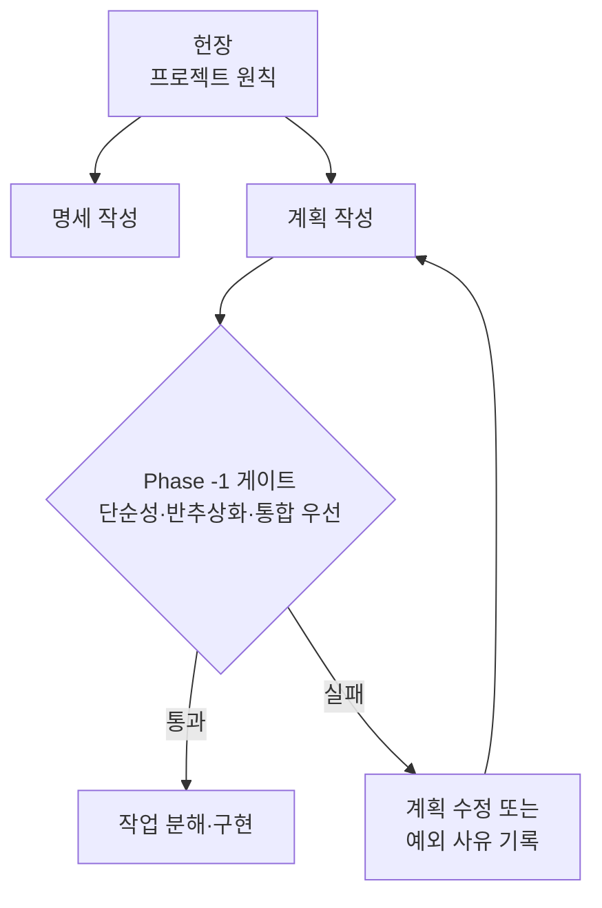
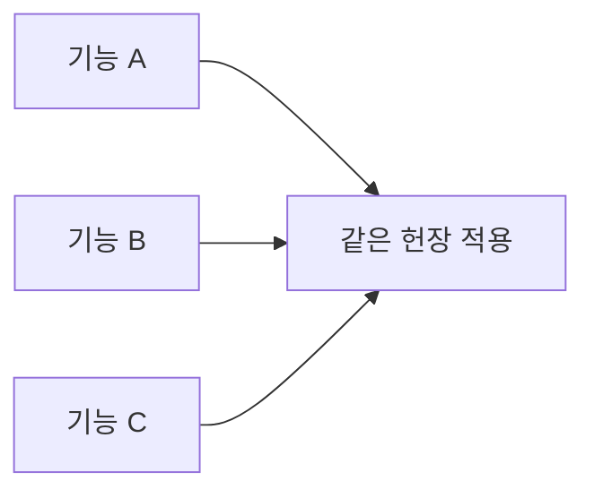

# SDD 헌장(constitution)

> 모든 기능 개발에 공통으로 적용할 프로젝트 원칙을 한 번 문서로 정해 두는 SDD의 첫 단계. AI가 계획·구현을 할 때마다 이 문서를 기준으로 삼는다.

## 쉽게 말하면
회사의 사규와 같다. 프로젝트마다 "테스트부터 쓴다", "외부 라이브러리를 감싸지 않고 직접 쓴다" 같은 규칙을 한 번 정해 두면, 새 기능을 맡은 AI 직원이 매번 같은 선을 지킨다. 매번 프롬프트로 일일이 당부하지 않아도 된다.

## 자세히
GitHub Spec Kit 문서(`spec-driven.md`)가 설명하는 구조다.
- **위치**: `memory/constitution.md` 파일. 명령은 `/speckit-constitution`(버전에 따라 `/speckit.constitution`)으로 만든다.
- **9개 조항 템플릿**
  - 조항 I **라이브러리 우선**: 모든 기능은 독립 라이브러리로 시작한다.
  - II **CLI 인터페이스**: 라이브러리는 텍스트 입출력(필요 시 JSON)으로 쓸 수 있어야 한다.
  - III **테스트 우선(타협 불가)**: 테스트를 쓰고, 사용자가 승인하고, 실패를 확인한 뒤에야 구현한다.
  - IV~VI: 프로젝트가 정한다(통합 테스트, 관측성, 버전 관리 등 자리 표시).
  - VII **단순성**: 초기 구현은 프로젝트 3개 이하. 더 필요하면 정당화한다.
  - VIII **반추상화**: 프레임워크 기능을 감싸지 않고 직접 쓴다.
  - IX **통합 우선 테스트**: 목(mock)보다 실제 DB 같은 현실 환경, 구현 전 계약 테스트.
- **강제 방식**: 계획 템플릿의 "Phase -1 사전 구현 게이트"가 단순성·반추상화·통합 우선 항목을 체크리스트로 점검한다. 통과 못 하면 계획을 고치거나 "복잡도 추적" 절에 예외 사유를 적는다. 문서는 이를 아키텍처의 컴파일 시점 검사에 비유한다.
- **쓰는 요령**: 처음부터 아홉 조항을 다 채울 필요는 없다. 팀이 실제로 겪은 실패(예: 목 때문에 놓친 버그)에서 조항을 뽑는다. 조항은 AI가 판단할 수 있게 "무엇을 하라/하지 마라"로 구체적으로 쓴다.
- **주의**: 9개 조항은 Spec Kit 템플릿의 예시로, 모든 프로젝트에 맞는 표준은 아니다(주장이 아니라 템플릿 설명임).

## 그림으로 보기




## 예시
사내 도구 프로젝트의 헌장 일부:
```
- 모든 기능은 먼저 테스트를 쓰고 실패를 확인한다.
- 외부 API 호출은 실제 샌드박스로 테스트하고 목은 최후 수단.
- 새 패키지 추가 전 기존 패키지로 되는지 먼저 적는다.
```
이후 "견적서 PDF 내보내기" 명세를 쓰면 AI가 계획 단계에서 이 원칙을 지켰는지 점검한다.

## 헷갈리는 것과 비교
| 개념 | 차이 |
|---|---|
| 헌장 | 모든 기능에 공통인 원칙(드물게 바뀜) |
| [명세](#writing-good-specs) | 한 기능의 무엇·왜(기능마다 새로 씀) |
| CLAUDE.md·AGENTS.md | 에이전트 지침 파일. 헌장은 SDD 절차 속 원칙 문서로 역할이 비슷한 부분이 있음 |
| [Spec Kit](#spec-kit) | 헌장을 만들고 게이트로 검사하는 도구 |

## 더 읽을거리
- [spec-driven.md (github/spec-kit)](https://github.com/github/spec-kit/blob/main/spec-driven.md) — 9개 조항과 게이트 설명
- [Spec-driven development with AI (GitHub Blog)](https://github.blog/ai-and-ml/generative-ai/spec-driven-development-with-ai-get-started-with-a-new-open-source-toolkit/) — 4단계 흐름
