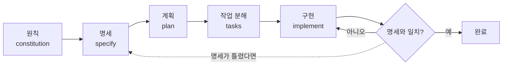

# SDD (스펙 주도 개발)

> 코드를 쓰기 전에 "무엇을, 왜 만드는지"를 명세(spec)로 먼저 쓰고, 계획·작업·코드를 모두 그 명세에서 끌어내는 개발 방식. AI 코딩에서는 명세가 곧 AI에게 주는 설계도다.

## 쉽게 말하면
건축에서 도면 없이 "대충 멋진 집 지어 줘"라고 하면 인부가 마음대로 짓는다. 도면(스펙)을 먼저 확정하고 시공 계획, 공정표, 시공 순으로 내려가면 결과가 예측 가능하다. 바이브코딩이 "분위기로 지시"라면 SDD는 "도면부터 합의"다.

## 자세히
GitHub Spec Kit(오픈소스, 2026-10 README 확인) 기준 흐름. 코딩 에이전트의 채팅창에서 한 단계씩 실행하고, 결과를 검토한 뒤 다음으로 간다.
1. `/speckit-constitution` — 프로젝트의 원칙(코드 품질, 테스트, 유지보수성)을 정한다. 프로젝트당 한 번.
2. `/speckit-specify` — 만들 기능을 *무엇·왜* 중심으로 쓴다. (예: 날짜별 앨범이 있는 사진 정리 앱)
3. `/speckit-plan` — 기술 선택(언어, 프레임워크, 저장소)을 정한다.
4. `/speckit-tasks` — 계획을 작은 작업 목록으로 쪼갠다.
5. `/speckit-implement` — 작업대로 구현한다. 이후 `/speckit-converge`로 명세와 코드가 맞는지 확인하고, "Converged"가 나올 때까지 반복한다.
- **핵심 원칙**: 명세가 단일 진실 공급원(source of truth). 어긋나면 코드가 아니라 명세를 먼저 고친다.
- **언제 좋은가**: 기능이 크고 여러 세션에 걸칠 때, AI가 자꾸 엉뚱하게 만들 때. **작은 수정**에는 과하다.

## 그림으로 보기

## 예시
- 명세 문장: "사용자는 사진을 날짜별 앨범으로 본다. 앨범 안에서 드래그로 순서를 바꿀 수 없다(이번 범위 밖)."처럼 *하지 않을 것*도 적는다.
- 프롬프트: "구현 전에 spec.md의 모호한 부분을 질문 3개로 먼저 물어봐."

## 헷갈리는 것과 비교
| 개념 | 차이 |
| --- | --- |
| [TDD](#tdd) | 테스트를 먼저 씀(행동을 코드로 고정). SDD는 문서 명세가 먼저. 같이 써도 됨 |
| [GitHub Spec Kit](#spec-kit) | SDD를 실행하게 해 주는 도구 모음 |
| [바이브코딩](#vibecoding) | 즉흥 지시 중심. SDD는 합의된 명세 중심 |
| [AGENTS.md](#agents-md) | 프로젝트 상시 규칙. 스펙은 기능별 설계도 |

## 더 읽을거리
- [github/spec-kit](https://github.com/github/spec-kit) — 명령어 흐름과 설치법
