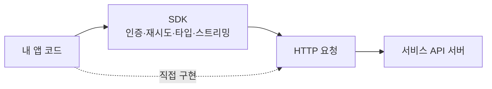
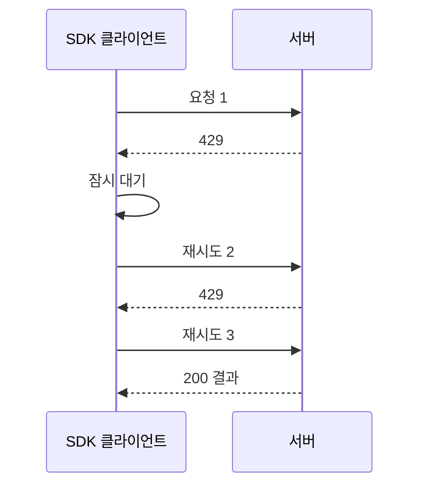

# SDK vs API

> **API**는 서비스가 정해 둔 **요청·응답 규칙**(보통 HTTP+JSON)이고, **SDK**는 그 API를 내 프로그래밍 언어에서 **편하게 쓰도록 만들어 둔 라이브러리**다. SDK는 같은 API를 감싼 것이라, 인증·재시도·오류 처리·타입·스트리밍 같은 번거로운 부분을 대신해 준다.

## 쉽게 말하면
API는 식당의 "주문 규칙"(어떤 형식으로 주문서를 써서 어느 창구에 내는지)이고, SDK는 그 규칙을 알아서 지켜 주는 "주문 도우미 앱"이다. 규칙을 직접 지켜도 되지만, 도우미 앱은 주문이 막히면 알아서 다시 시도해 준다.

## 자세히
(Anthropic 공식 SDK 개요 페이지 기준 + 직접 실행)
- **공식 도구 구성**(Anthropic 문서): 셸용 **CLI**, 7개 언어(Python·TypeScript·C#·Go·Java·PHP·Ruby)의 **클라이언트 SDK**, 다른 프레임워크용 라이브러리. 클라이언트 SDK는 "관용적 인터페이스, 타입 안정성, **스트리밍·재시도·오류 처리·추적**을 기본 지원"한다고 설명한다. 각 주요 버전은 기본으로 하나의 API 버전을 보낸다(2026-11-25 확인 시 Python 패키지 최신 2.14.0, 이 값은 곧 바뀔 수 있음).
- **직접 API 호출(HTTP)**: 요청 형식·인증 헤더·오류 처리·재시도를 **내가 구현**. 언어 제약이 없고 의존성이 없지만 반복 코드가 많다.
- **SDK**: 위를 대신해 주고, 타입으로 자동 완성·검증. 대신 라이브러리 의존성과 버전 관리가 생긴다.
- **직접 실행**(로컬 가짜 서버가 처음 2번 `429`를 주고 3번째에 `200`을 반환): 
  - 직접 HTTP 1회 호출 → **429로 실패**(재시도 없음).
  - SDK식 래퍼(재시도 3회, 대기 후 재시도 구현한 20줄짜리 축소판) → **성공**(`{'text':'안녕'}`), 서버가 받은 호출은 총 3번. 실제 SDK의 재시도 정책은 SDK마다 다르므로 문서를 확인한다.
- **언제 무엇을**:

| 상황 | 선택 |
|---|---|
| 일반 앱 개발 | SDK(재시도·타입·스트리밍 편리) |
| 지원 SDK가 없는 언어, 아주 가벼운 스크립트 | 직접 HTTP(curl 등) |
| 새 기능이 SDK에 아직 없음 | 직접 HTTP로 먼저 |
| 에이전트 루프·도구 실행까지 필요 | 더 높은 수준의 Agent SDK·프레임워크(문서 안내) |

- 한계: SDK도 결국 같은 API를 호출하므로 API 가격·한도·오류 규칙은 동일하다. SDK 버전과 API 버전의 관계는 서비스별 정책이다.

## 그림으로 보기



## 예시
```python
# SDK(예시: Anthropic Python SDK) — 인증은 환경 변수 ANTHROPIC_API_KEY에서
import anthropic
client = anthropic.Anthropic()
msg = client.messages.create(model="<모델명>", max_tokens=1024,
                             messages=[{"role": "user", "content": "안녕"}])
```
```bash
# 직접 HTTP(curl) — 같은 API를 직접 호출
curl https://api.anthropic.com/v1/messages ...
```
- 모델 이름·헤더 형식은 시점에 따라 바뀌므로 공식 문서의 예제를 그대로 확인한다.

## 헷갈리는 것과 비교
| 개념 | 차이 |
|---|---|
| API | 서비스의 요청·응답 규칙 |
| SDK | API를 언어별로 감싼 라이브러리 |
| CLI | 터미널에서 쓰는 명령줄 도구 |
| [HTTP 요청과 상태 코드](#http-basics) | SDK가 대신 처리하는 하위 계층 |
| [환경 변수와 API 키](#env-secrets) | 인증 키를 안전하게 주는 방법 |

## 더 읽을거리
- [Anthropic: SDKs, CLI, and libraries](https://platform.claude.com/docs/en/api/client-sdks) — 공식 SDK 종류와 기능.
