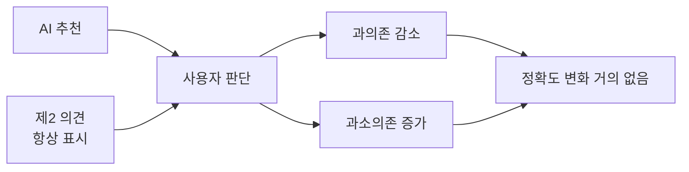
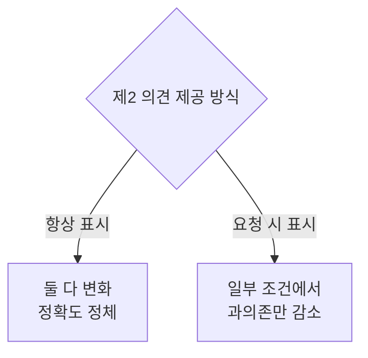

# 제2 의견 효과

> AI 추천 옆에 동료나 다른 AI의 의견을 항상 함께 보여 주면 AI를 맹신하는 오류(과의존)는 줄지만, AI가 맞을 때도 의심하는 오류(과소의존)가 함께 늘어 정확도는 그대로인 경우가 많다.

## 쉽게 말하면
의사 소견에 "다른 의사 의견"을 항상 붙여 주면 환자는 한 명 말만 믿지 않게 된다. 그런데 두 의견이 갈리면 맞는 소견까지 의심한다. 필요할 때 환자가 직접 "다른 의견도 보여 주세요"라고 요청하게 하면 이 부작용이 덜하다.

## 자세히
Lu·Wang·Yin의 연구(CSCW 2024, arXiv 2401.07058)는 사전 등록된 무작위 실험 3개로 확인했다. 과제는 영화 리뷰 20건의 긍정·부정 분류이고, AI는 RoBERTa 기반 분류기(이 20건 정확도 75%)였다. 참가자는 미국 Mechanical Turk 노동자 428·516·336명이다.
- **항상 같이 보여 줄 때(실험 1)**: 과의존이 줄고(효과크기 d 0.26~0.44) 과소의존이 늘었다(d 0.14~0.22). 정확도(적절한 의존)는 유의하게 달라지지 않았다. AI와 의견이 덜 일치할수록 변화가 컸다.
- **출처 표시(실험 2)**: 사람 동료인지 다른 AI인지는 큰 영향이 없었고, 의견이 AI와 얼마나 일치하느냐(내용)가 더 중요했다.
- **사용자가 요청할 때(실험 3)**: 요청한 사람은 34~39%뿐이었다. 요청한 사람 중에서는 AI와 의견이 잘 맞는 조건에서 과소의존 증가 없이 과의존이 줄었다(탐색적 비교라 단정은 이르다). AI가 틀린 문제에서 요청이 약간 더 많았지만 유의 수준 경계(p=0.086)였다.
- **한계**: 단일 연구 그룹, 단순 이진 분류 과제, 온라인 참가자 실험이다. 실제 업무로 일반화하려면 별도 검증이 필요하다. 논문 후반(논의)은 열지 못했다.
- **설계 시사점**: 제2 의견을 상시 노출하는 것은 뭉툭한 도구다. 요청 시 노출이나 [과소의존](#undertrust-ai)을 늘리지 않는 형태를 고민한다.

## 그림으로 보기

## 예시
- 대출 심사 보조 AI 화면에 "다른 모델의 판단" 버튼을 두고, 심사역이 누를 때만 보이게 한다.
- 교육 활용: "AI 두 개의 답이 다를 때 어떻게 판단하나?"를 토론 과제로 쓴다. 불일치가 곧 AI 오류라는 뜻은 아님을 가르친다.

## 헷갈리는 것과 비교
| 개념 | 차이 |
| --- | --- |
| [AI 과소의존](#undertrust-ai) | 맞는 조언을 버리는 오류. 제2 의견이 이를 키울 수 있음 |
| [인지 강제 기능](#cognitive-forcing-functions) | AI 추천 전에 먼저 결정하게 하는 다른 과의존 대책 |
| [적절한 의존 지표](#appropriate-reliance-metrics) | 의존이 적절한지 재는 기준 |
| 앙상블 | 모델 여러 개를 합쳐 한 답을 냄. 제2 의견은 사람이 둘을 비교 |

## 더 읽을거리
- [Does More Advice Help? (arXiv 2401.07058)](https://arxiv.org/abs/2401.07058) — 원논문 초록
- [같은 논문 HTML 본문](https://arxiv.org/html/2401.07058v1) — 실험 설계·수치(앞부분 10만 자까지 읽음)
