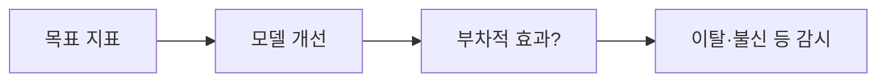

# 부차적 효과 시험

> 모델 평가에서 놓치기 쉬운 **예상 못 한 부작용**(특히 보상 함수를 정할 때)을 찾아보는 점검이다.

## 쉽게 말하면
학교가 시험 점수만 올리려고 했더니 학생들이 시험 기술만 연습하고 흥미를 잃는 부작용이 나타나는 것이다. 목표 지표만 보면 이런 부작용이 안 보인다.

## 자세히
(Google PAIR "Data Collection + Evaluation" 챕터를 직접 읽었다.)
- **권고(PAIR)**: 특히 **보상 함수**를 정의할 때 예상하지 못한 부차적 효과가 없는지 확인한다. 오류의 패턴, 데이터 드리프트, 시스템·맥락 관련 실패를 찾고 다음 반복에서 피할 방법을 묻는다.
- **예(PAIR)**: 달리기 앱이 칼로리 기반 중간 조언을 했더니 **사용자가 더 자주 중도 포기**했다. 알고리즘이 기온·체중 같은 요인을 과소 반영해 사용자가 계산을 불신하게 된 것.
- **시사(해석)**: 정확도 같은 단일 지표 외에 이탈·불만·행동 변화 같은 부차 지표를 함께 추적한다.

## 그림으로 보기

## 예시
- 상담 챗봇 해결률을 높이려 응답을 짧게 했더니 재문의가 늘었다면 재문의율을 부차 지표로 둔다(제안).

## 헷갈리는 것과 비교
| 개념 | 차이 |
|---|---|
| 부차적 효과 | 목표 밖에서 생기는 영향 |
| [데이터 연쇄](#data-cascade) | 초기 데이터 문제가 지연 폭발 |
| 회귀 평가 | 이전 성능이 유지되는지 확인 |

## 더 읽을거리
- [Google PAIR — Data Collection + Evaluation](https://pair.withgoogle.com/chapter/data-collection/) — 직접 읽음.
