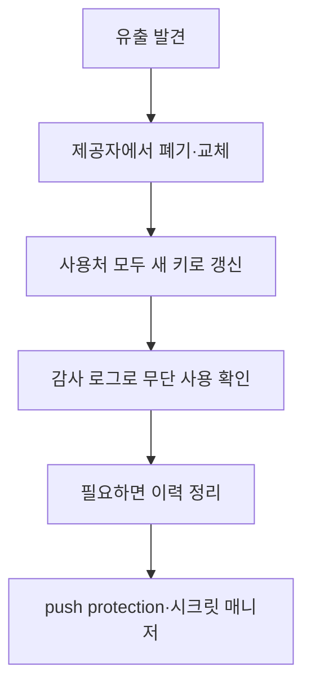

# 키 유출 대응

> API 키·토큰 같은 비밀값을 깃허브 등에 올렸다면, 지우는 것이 아니라 **즉시 폐기(revoke)하고 교체**하는 것이 첫 대응이다. 한 번 노출된 비밀은 이미 털렸다고 가정한다.

## 쉽게 말하면
집 열쇠 사진을 SNS에 올렸다면 사진을 지워도 이미 본 사람이 있을 수 있다. 정답은 사진 삭제가 아니라 **자물쇠를 바꾸는 것**이다.

## 자세히
GitHub 공식 문서(열어 본 출처)의 절차:
1. **유출 가정**: 코드에서 지우거나 새 커밋을 올리거나 저장소를 다시 만들어도 악용을 막지 못한다.
2. **제공자에서 먼저 폐기**: 가장 중요한 단계. 다운타임이 걱정되면 새 키를 만들고 앱을 옮긴 뒤 옛 키를 폐기한다.
3. **위험도별 우선순위**: 아직 유효하고 공개 노출됐거나 운영 환경 키면 즉시.
4. **교체와 갱신**: 옛 키가 쓰이는 모든 곳(코드, 배포 키, 시크릿·변수, 앱·연동)을 찾아 새 키로 바꾸고 테스트.
5. **무단 사용 점검**: GitHub 감사 로그와 제공자 로그(예: AWS CloudTrail) 확인.
6. **기록 재작성은 선택**: 커밋 이력에서 지우는 것은 파괴적이고 강제 푸시가 필요하며 폐기를 대체하지 못한다.
7. **알림 종료·재발 방지**: 시크릿 스캐닝 알림을 "Revoked"로 닫고 사건을 기록. push protection을 켜고, 환경변수·시크릿 매니저를 쓰고, 주기적으로 교체한다.

## 그림으로 보기

## 예시
`.env`를 실수로 푸시한 바이브코딩 프로젝트: 먼저 OpenAI·Supabase 콘솔에서 키 재발급 → Vercel 환경변수 교체 → 사용량 급증 여부 확인 → `.gitignore`에 `.env` 추가.

## 헷갈리는 것과 비교
| 개념 | 차이 |
| --- | --- |
| 폐기(revoke) | 키를 무효화. 핵심 |
| 커밋 삭제 | 키는 여전히 유효, 부족함 |
| 이력 재작성 | 선택 사항, 폐기 대체 불가 |
| [환경변수와 비밀키 관리](#env-variables-secrets) | 예방 쪽 |
| [IDOR](#idor) | 다른 종류의 취약점 |

## 더 읽을거리
- [Remediating a leaked secret — GitHub Docs](https://docs.github.com/en/code-security/secret-scanning/working-with-secret-scanning-and-push-protection/remediating-a-leaked-secret) — 단계별 대응
