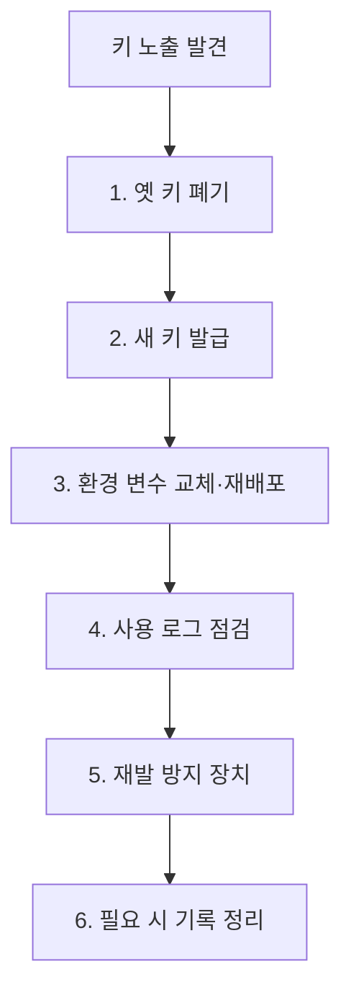

# 키 교체 절차 (Secret Rotation)

> 비밀값이 노출됐거나 정기 교체 시기가 되면, 새 키를 발급해 적용하고 옛 키를 폐기하는 순서를 지키는 절차다. 노출 사고에서는 "기록 정리"보다 "폐기·교체"가 먼저다.

## 쉽게 말하면
열쇠 복사본이 돌아다닌다면 문 앞 낙서를 지우는 것보다 자물쇠를 바꾸는 게 먼저다. 낙서(깃 기록)를 지워도 이미 복사된 열쇠는 계속 문을 연다.

## 자세히
GitHub Docs "민감 데이터 제거"(2026-11 확인)는 **0단계가 키 폐기·교체**라고 명시한다. 폐기하면 그 자격 증명으로는 접근할 수 없고 그것만으로 충분할 수 있다. 기록 재작성은 그 뒤에 필요할 때만 한다.
일반적인 순서(관행):
1. **폐기/비활성화**: 제공사 콘솔에서 노출된 키를 즉시 revoke.
2. **새 키 발급**: 최소 권한·만료 기한으로.
3. **적용**: 환경 변수·시크릿 매니저에 교체 후 재배포. 무중단이 필요하면 새 키 적용 확인 후 옛 키 폐기(이중 키 기간).
4. **사용 내역 점검**: 노출 기간 동안의 접근 로그·청구 이상 확인.
5. **재발 방지**: [푸시 보호](#github-push-protection), [pre-commit 스캔](#pre-commit-secret-scan), `.gitignore`.
6. 필요하면 [git-filter-repo](#git-filter-repo)로 기록 정리.
정기 교체 주기와 자동화는 조직 정책에 따른다(문서에 고정 수치 없음).

## 그림으로 보기

## 예시
AI 에이전트가 `.env`를 공개 저장소에 올림 → OpenAI·클라우드 콘솔에서 키 즉시 삭제 → 새 키를 시크릿 매니저에 저장 → 청구 대시보드 확인.

## 헷갈리는 것과 비교
| 개념 | 차이 |
|---|---|
| 키 교체 | 자격 증명을 무효화 — 노출 대응의 1순위 |
| [기록 재작성](#git-history-secret) | 저장소에서 흔적 제거 — 이미 복사된 키는 못 막음 |
| [force push 위험](#force-push-risks) | 기록 정리 뒤 반영 시 따르는 부작용 |

## 더 읽을거리
- [Removing sensitive data from a repository](https://docs.github.com/en/authentication/keeping-your-account-and-data-secure/removing-sensitive-data-from-a-repository) — 폐기 우선 원칙과 정리 절차.
