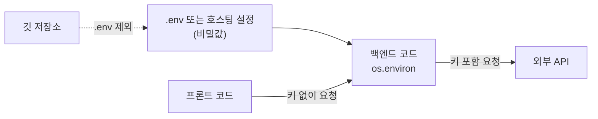

# 환경 변수와 비밀 관리

> API 키·비밀번호 같은 비밀값은 코드에 적지 않고, 실행 환경(환경 변수 등)으로 따로 주입한다.

## 쉽게 말하면
집 열쇠를 현관문에 테이프로 붙여 두지 않는 것과 같다. 코드는 여러 사람이 보고 깃에 올라가지만, 열쇠는 주인의 주머니(실행 환경)에만 있어야 한다.

## 자세히
- Twelve-Factor App 원칙: 배포마다 달라지는 설정(DB 주소, 외부 서비스 자격 증명)은 코드와 **엄격히 분리**해 환경 변수에 둔다.
- 점검법(원문 기준): "지금 이 코드를 공개해도 자격 증명이 새지 않는가?" 아니라면 분리가 덜 된 것이다.
- 로컬 개발: `.env` 파일에 `KEY=값`을 쓰고 `.gitignore`에 `.env`를 넣는다. 저장소에는 값 없는 `.env.example`만 올린다.
- 배포: 호스팅 서비스의 환경 변수 설정 화면에 입력한다.
- 이미 깃에 올라갔다면 **키를 폐기·재발급**하는 것이 정답이다(기록에서 지워도 이미 복사됐을 수 있다).
- 프론트엔드 코드에 들어간 값은 사용자가 볼 수 있다. 비밀은 [백엔드](#frontend-backend)에서만 쓴다.
- AI 코딩 도구에는 키를 채팅에 붙여 넣지 말고, 도구의 읽기 금지 규칙으로 `.env`를 막아 둔다([훅과 가드레일](#hooks-guardrails)).

## 그림으로 보기


## 예시
```python
import os
key = os.environ["ANTHROPIC_API_KEY"]  # 코드에 값을 적지 않는다
```
```
# .gitignore
.env
```

## 헷갈리는 것과 비교
| 개념 | 차이 |
| --- | --- |
| 환경 변수 | 실행 환경에서 주입, 코드와 분리 |
| 하드코딩 | 소스에 직접 기입. 유출 위험 |
| 시크릿 매니저 | 키를 암호화해 보관·회전하는 전용 서비스 |

## 더 읽을거리
- [The Twelve-Factor App: Config](https://12factor.net/config) — 설정과 코드의 분리 원칙
