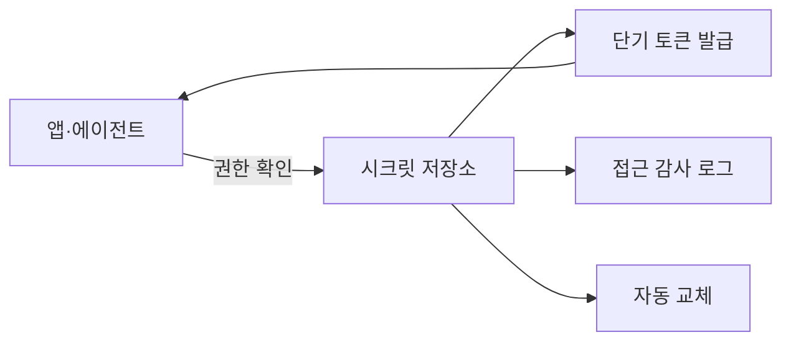

# 시크릿 관리

> API 키·토큰·비밀번호 같은 비밀 값을 코드 밖에서 안전하게 보관·배포·교체하는 관행. AI 앱은 모델 API 키가 곧 돈이라 특히 중요하다.

## 쉽게 말하면
집 열쇠를 현관 매트 밑에 두지 않고, 출입 기록이 남는 열쇠함에 두며, 정기적으로 자물쇠를 바꾸는 일이다.

## 자세히
OWASP Secrets Management Cheat Sheet 기준 원칙:
- **중앙화**: 저장·발급·감사·교체를 한 시스템에서 표준 절차로.
- **최소 권한**: 시크릿마다 세분화된 접근 정책.
- **자동 교체(rotation)**: 탈취돼도 유효 기간이 짧게. 키 교체는 데이터 재암호화가 필요할 수 있어 계획이 필요([봉투 암호화](#envelope-encryption)).
- **동적 시크릿**: 세션 한정 단기 자격증명을 발급하고 불필요하면 폐기. 앱을 재시작해도 탈취된 자격증명은 폐기되지 않는다.
- **CI/CD**: 파이프라인에 장기 정적 자격증명을 두지 않고 워크로드 아이덴티티 연합을 쓴다.
- **유출 방지**: 하드코딩 금지, Docker `ENV`·`ARG`에 넣지 않기, 환경 변수보다 파일·메모리 주입 선호, TLS로만 전송, 로그에 남기지 않기.
- **감사·탐지**: 누가 언제 접근했는지 변조 방지 로그, 코드·커밋·로그의 시크릿 스캔.
- **사고 대응**: 노출 즉시 폐기→자동 교체→노출 시스템에서 제거.
- AI 앱 적용: `.env`를 커밋하지 않기, 에이전트가 읽는 파일·로그에 키가 새지 않게 하기(프롬프트로 유출될 수 있음), 키마다 사용 한도 설정.

## 그림으로 보기


## 예시
```bash
# 나쁜 예: 코드에 하드코딩
API_KEY = "sk-..."
# 좋은 예: 실행 시 주입 (저장소에는 키 없음)
export API_KEY=$(vault kv get -field=key secret/llm)
```
키가 깃에 올라갔다면 지우는 것으로 끝나지 않는다. 즉시 폐기·재발급한다.

## 헷갈리는 것과 비교
| 개념 | 차이 |
| --- | --- |
| 환경 변수 | 간편하지만 유출 경로가 많아 OWASP는 파일·메모리 주입 선호 |
| 시크릿 매니저 | 중앙 보관·교체·감사 |
| [전송 중 암호화(TLS)](#tls-encryption-in-transit) | 전송 구간 보호, 보관과는 별개 |

## 더 읽을거리
- [OWASP Secrets Management Cheat Sheet](https://cheatsheetseries.owasp.org/cheatsheets/Secrets_Management_Cheat_Sheet.html) — 원칙과 점검 항목
