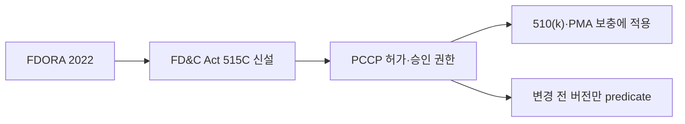

# FD&C Act 515C

> 2022년 FDORA 3308조가 연방 식품의약품화장품법에 추가한 조항(21 U.S.C. 360e-4). FDA가 의료기기의 사전 승인 변경 관리 계획(PCCP)을 허가·승인할 명시적 권한을 준다.

## 쉽게 말하면
"앞으로 이런 범위로 업데이트할 건데, 그때마다 새로 허가받지 않게 미리 계획을 승인해 달라"는 제도의 법적 뿌리다. 법이 없으면 FDA가 지침만으로 약속할 수 없다.

## 자세히
출처: 법률·규제 해설 검색 요약(법 조문 원문은 열지 않음). 조문은 law.cornell.edu 21 U.S.C. 360e-4에서 확인 가능.
- **도입**: FDORA(Pub. L. 117-328, 2022-12-29) 3308조가 FD&C Act 515C를 신설.
- **대상**: PMA 보충 신청(515조) 또는 510(k)가 필요한 기기.
- **조건**: PCCP에 적힌 계획 변경을 해도 기기가 안전·효과적이어야 하고, I·II류는 predicate와 실질적 동등성이 유지돼야 한다.
- **predicate 규칙(c)**: PCCP 변경 이전에 허가·승인된 버전만 predicate로 쓸 수 있다(변경 후 버전을 다음 기기의 비교 대상으로 쓰는 것은 막힘).
- **요구 가능 내용**: 안전하고 효과적인 사용을 보장하는 표시(라벨), 기기가 의도대로 작동하지 않을 때의 통지, 성능 요건.
- **후속 조치**: 2024년 기술 수정으로 21 CFR 807.81(b), 814.39(b)에 515C 하의 PCCP 문구가 반영됐다고 해설.
- **지침**: 2024년 초안(모든 기기)과 별도의 AI 기기 PCCP 최종 지침(2024-12, 검색 요약상 12/3 또는 12/4)이 있다. 둘의 관계·최신 상태는 FDA 사이트에서 확인해야 한다. AI 지침은 구속력 없는 권고다([변경 관리 계획 PCCP](#fda-pccp)).

## 그림으로 보기

## 예시
- AI 영상 소프트웨어 제조사가 "분기마다 신규 데이터로 재학습, 사전 정의한 성능 기준을 넘을 때만 배포"라는 PCCP를 승인받으면, 해당 범위 업데이트는 새 510(k) 없이 가능.

## 헷갈리는 것과 비교
| 개념 | 차이 |
|---|---|
| 515C | 법적 근거 조항 |
| [PCCP](#fda-pccp) | 제조사가 제출하는 계획 자체 |
| 가이던스 | FDA의 권고(구속력 없음) |

## 더 읽을거리
- [21 U.S.C. 360e-4 (Cornell LII)](https://www.law.cornell.edu/uscode/text/21/360e-4) — 515C 조문(검색 결과로만 확인)
- [Technical Amendments 2024-05473](https://regulations.justia.com/regulations/fedreg/2024/03/15/2024-05473.html) — 807.81·814.39 수정(검색 결과로만 확인)
