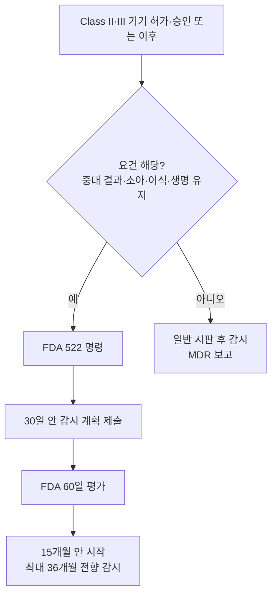

# 522 감시 연구

> FD&C Act 522조(21 U.S.C. 360l)에 따라 FDA가 제조사에 **시판 후 감시 연구를 명령**할 수 있는 제도. 허가·승인 시점이나 그 이후에 내릴 수 있으며, 의무 보고에 의존하는 수동적 감시를 능동적 연구로 보강한다. (법률 자문 아님)

## 쉽게 말하면
사고 신고만 기다리는 것(MDR)이 아니라, FDA가 "이 기기는 시판 뒤에도 이런 연구를 해서 결과를 제출하라"고 지시하는 제도다. 어린이에게 많이 쓰이거나 몸에 오래 이식되는 기기처럼 문제가 생기면 위험이 큰 기기가 주 대상이다.

## 자세히
출처: 21 U.S.C. 360l(Cornell LII, 열어서 읽음). FDA의 522 안내 페이지는 404여서 열지 못했다.
- **명령 대상**: Class II 또는 Class III 기기. 허가·승인 때나 그 후에 명령할 수 있다. 해당 요건 예: 실패하면 **심각한 건강 결과가 합리적으로 예상되는** 기기, **소아에서 상당히 많이 쓰일** 것으로 예상되는 기기, **1년 넘게 이식**되거나 **사용 시설 밖에서 생명 유지·보조**에 쓰이는 기기.
- **소아 기기**: 승인·허가의 **조건**으로 감시를 둘 수 있다.
- **일정**: 제조사는 명령을 받은 뒤 **30일 안에** 감시 계획을 제출. FDA는 60일 안에 지정 담당자의 자격과 계획이 유용한 자료를 낼지 평가. 감시는 명령 후 **15개월 안에 시작**해야 한다.
- **기간**: 전향적 감시는 **최대 36개월**. 더 길게 하려면 합의 또는 분쟁 해결이 필요. 소아 기기는 성장·발달 영향을 보기 위해 36개월 넘게 요구할 수 있다.
- **이의 제기**: 제조사가 명령의 검토를 요청할 수 있고, 검토 중에는 공중 보건 보호에 필요하다고 판단되지 않는 한 명령 위반으로 보지 않는다.
- **AI 기기에서(해설)**: 이 조문은 소프트웨어를 따로 정하지 않으므로, AI 기기가 위 요건에 해당하면 적용될 수 있다. AI 적응형 알고리즘 감시에 522가 얼마나 쓰였는지는 이번에 확인하지 못했다.
- **관련 DB**: FDA의 522 감시 연구 DB(의료기기 DB 목록 페이지에서 확인)에서 현재 진행 중인 연구를 제조사·기기로 검색할 수 있다([FDA 기기 데이터베이스](#fda-device-database)).

## 그림으로 보기

## 예시
- 소아에게 많이 쓰일 것으로 예상되는 의료 소프트웨어 기기가 허가될 때 시판 후 연구가 조건으로 붙을 수 있다는 구조(조문 취지, 실제 AI 사례는 확인하지 못함).
- 점검: 도입 후보 기기가 522 연구 DB에 올라 있는지 제조사·기기명으로 검색.

## 헷갈리는 것과 비교
| 개념 | 차이 |
|---|---|
| 522 감시 연구 | FDA 명령에 따른 능동적 연구 |
| [MDR 이상 사례 보고](#mdr-reporting) | 사건이 생기면 의무 보고하는 수동적 감시 |
| [MAUDE](#maude) | 보고 DB |
| 시판 후 승인 연구(PAS) | PMA 승인 조건으로 붙는 별도 연구 |

## 더 읽을거리
- [21 U.S.C. 360l (Cornell LII)](https://www.law.cornell.edu/uscode/text/21/360l) — 522조 조문(열어서 확인)
