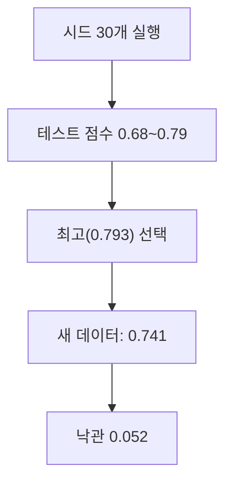
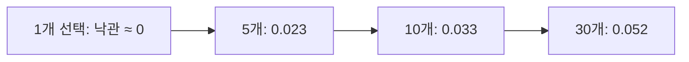

# 시드 골라잡기

> 여러 난수 시드로 분할·학습을 돌려 본 뒤 **테스트 점수가 가장 좋게 나온 시드만 골라 보고**하는 행위다. 시드가 우연히 만든 "운 좋은 분할"을 실력으로 착각하게 만들어, 새 데이터에서는 점수가 내려간다.

## 쉽게 말하면
주사위를 30번 굴려 가장 높은 눈이 나온 순간만 보여 주며 "내 주사위는 6이 잘 나온다"고 하는 것이다. 고른 결과는 우연의 최댓값이다.

## 자세히
(scikit-learn 1.9.1, 합성 이진 분류 2,500개: 한 번도 안 쓴 보류 1,500개 + 개발 1,000개. 개발 데이터를 시드 0~29로 70/30 분할해 결정트리(깊이 6) 학습, 직접 실행)
- **시드별 테스트 점수 분포**: 평균 **0.738**, 표준편차 0.025, 최소 0.680, 최대 **0.793**. 같은 모델·같은 데이터인데 시드만 바꿔 11%p 차이가 났다.
- **같은 30개 모델의 새 보류 데이터 점수**: 평균 0.741, 표준편차 0.012. 즉 진짜 성능은 약 0.74다.
- **골라잡기 효과**: 최고 점수 시드(시드 12)는 테스트 **0.793**이지만 새 보류에서는 **0.741**, 낙관 폭 **0.052**.
- **k개 중 최고를 고를 때의 평균 낙관(테스트 − 보류, 300회 반복)**: 1개 −0.003, 5개 0.023, 10개 0.033, 30개 **0.052**. 시도 횟수가 늘수록 우연 최댓값이 커져 낙관이 커진다.
- **원인**: 테스트 세트(300개)가 작아 점수의 표준편차가 크고, 그중 최댓값을 고르면 통계적으로 위로 치우친다(다중 비교·승자의 저주).
- **같은 문제의 변형**: 시드뿐 아니라 하이퍼파라미터, 전처리, 분할 비율을 테스트 점수 보며 반복 선택해도 똑같다([테스트 세트 재사용](#test-set-reuse-risk)).
- **공식 문서의 권고(scikit-learn Common pitfalls)**: 정수 `random_state`를 추정기에 넘기면 모든 폴드가 같은 시드를 써서 CV 점수가 **한 시드의 운**을 반영할 수 있다. 시드를 튜닝할 하이퍼파라미터로 취급하지 말라는 취지다. 재현성은 시드를 한 번 선언해 모든 객체에 전달해서 얻는다.
- **올바른 방법**: ① 시드는 사전에 정하고(예: 0) 결과를 보고 바꾸지 않는다 ② 여러 시드의 평균±표준편차를 보고([여러 시드 평균 보고](#seed-sweep-reporting)) ③ 모델 선택과 최종 보고를 분리해 최종은 보지 않은 테스트로 한 번만([홀드아웃과 CV](#holdout-vs-cv-estimates)).

## 그림으로 보기

## 예시
- 논문에서 "정확도 79.3%"를 시드 12에서 얻었다고 보고하면 재현 시 74% 근처. 평균 73.8±2.5%로 쓰는 것이 정직하다.
- 교육: 리더보드에서 제출 횟수가 많은 팀의 점수가 낙관적인 이유(적응적 과적합).

## 헷갈리는 것과 비교
| 개념 | 차이 |
|---|---|
| 시드 골라잡기 | 우연한 최고 시드를 선택 |
| 시드 고정 | 재현성을 위해 사전에 정함(결과 보고 바꾸지 않음) |
| [여러 시드 평균](#seed-sweep-reporting) | 분포 전체를 보고 |
| [테스트 세트 재사용](#test-set-reuse-risk) | 같은 문제를 다른 방식으로 |

## 더 읽을거리
- [scikit-learn Common pitfalls — Controlling randomness](https://scikit-learn.org/stable/common_pitfalls.html) — random_state 규칙과 단일 시드 의존의 위험.
- [train_test_split API](https://scikit-learn.org/stable/modules/generated/sklearn.model_selection.train_test_split.html) — `random_state` 파라미터.
