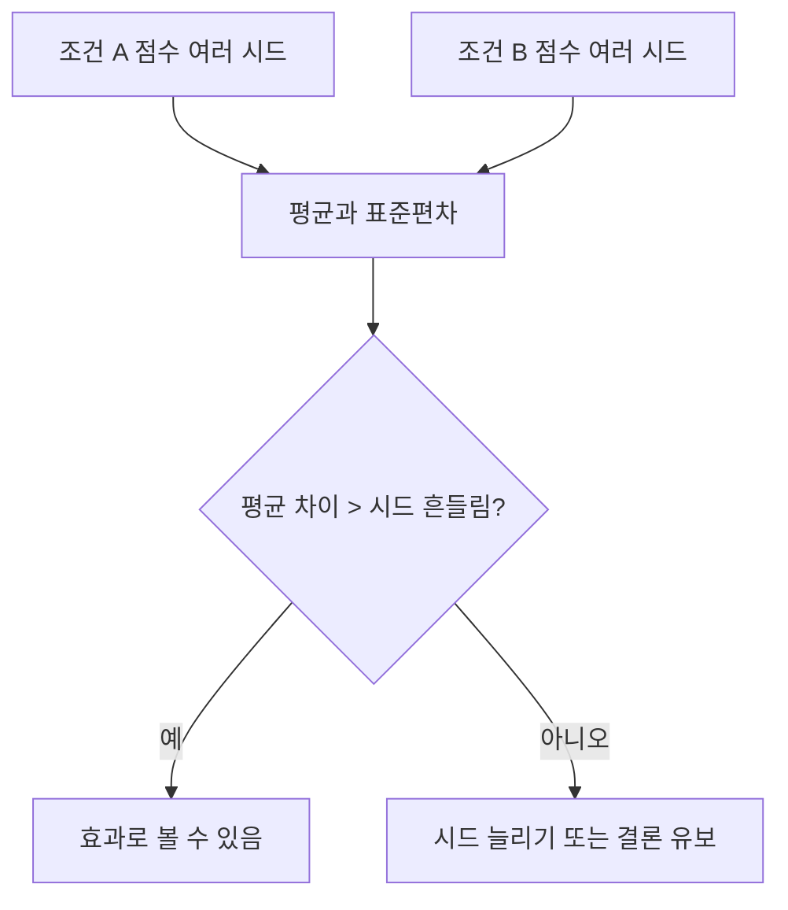
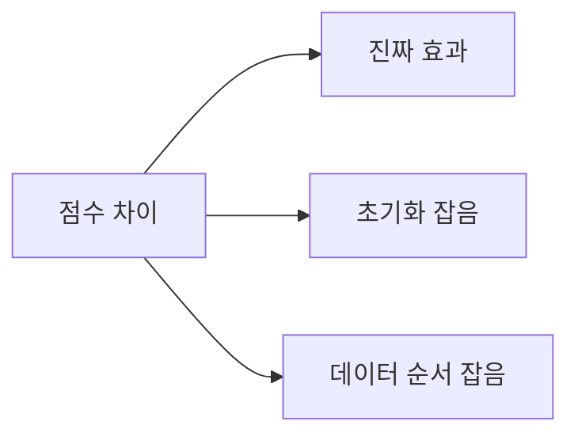

# 시드 잡음 대 효과 크기

> 두 모델이나 두 데이터셋의 점수 차이가 **무작위 시드로 생기는 흔들림보다 큰지** 따져 보는 일. 흔들림보다 작은 차이는 효과로 믿으면 안 된다.

## 쉽게 말하면
같은 선수가 같은 코스를 달려도 기록이 매번 조금씩 다르다. 두 선수의 기록 차이가 0.1초인데 한 선수의 평소 흔들림이 0.3초라면, 누가 더 빠르다고 단정할 수 없다. 모델 비교도 마찬가지다.

## 자세히
- **시드가 만드는 흔들림(Dodge 외 2020, arXiv 2002.06305, BERT 파인튜닝)**: 하이퍼파라미터와 사전학습 가중치를 고정하고 시드만 바꿨는데도 GLUE의 작은 데이터셋(MRPC·RTE·CoLA 등)에서 결과가 크게 갈렸다. 분류층 가중치 초기화와 데이터 순서가 분산에 **비슷한 정도로** 기여했다. 일부 실행은 다수 클래스 기준선 수준으로 망가졌다. 시드를 수백 번 시도해 최고만 고르면 이전 보고 BERT 점수보다 RTE·CoLA에서 약 7점 높게 나왔고, 기대 최고 성능은 수백 번 뒤에도 수렴하지 않았다. 즉 "최고 시드"만 보고하면 효과를 부풀린다.
- **벤치마크 분산을 측정하기(Madaan 외 2024, arXiv 2406.10229, 초록 기준)**: 시드 분산(같은 모델을 다른 시드로 학습했을 때 점수 변화)과 학습 중 단조성 등의 지표를 정의해 여러 모델에서 측정했다. 7B급 이하에서는 MMLU 같은 객관식을 완성(completion) 형식으로 바꾸는 단순한 변경이 분산을 줄일 수 있고, 인간 시험의 문항 분석·문항반응이론은 분산을 의미 있게 줄이지 못했다. 점수 차이는 분산을 고려하지 않으면 의미가 없을 수 있다고 권한다. 구체적 분산 값은 초록에 없어 확인하지 못했다.
- 판단 요령(일반): ① 같은 설정을 시드만 바꿔 여러 번 돌려 표준편차를 구한다 ② 두 조건의 평균 차이를 그 표준편차(또는 부트스트랩 신뢰구간)와 비교한다 ③ 차이가 흔들림보다 작으면 시드·평가 표본을 늘리거나 결론을 유보한다 ④ "최고 시드"가 아니라 평균±분산을 보고한다.
- 합의되지 않은 쟁점: 시드 분산만으로 유의성을 판정해도 되는지에 대해 2025년 연구들은 이견이 있다고 소개된다(검색 요약, 본문 미확인).
- 연결: [두 시드 평균](#two-seed-averaging)은 이 잡음을 줄이는 실무 방법이다.

## 그림으로 보기

## 예시
| 상황 | 해석 |
|---|---|
| 차이 0.4점, 시드 표준편차 0.5점 | 잡음 안쪽. 단정 불가 |
| 차이 3점, 시드 표준편차 0.5점 | 효과일 가능성 높음 |
- 업무 장면: 프롬프트 두 개의 정답률이 71%와 72%라면, 각각 5번씩 돌려 편차를 본 뒤에야 우열을 말한다.

## 헷갈리는 것과 비교
| 개념 | 차이 |
|---|---|
| 시드 잡음 대 효과 크기 | 차이가 잡음보다 큰지 판단 |
| [두 시드 평균](#two-seed-averaging) | 잡음을 줄이는 실험 설계 |
| [데이터 표본 잡음](#data-subset-noise) | 어떤 데이터를 뽑았느냐에서 오는 잡음 |
| [무작위 기준선 점검](#random-baseline-check) | 점수가 우연 수준인지 확인 |

## 더 읽을거리
- [Fine-Tuning Pretrained Language Models: Weight Initializations, Data Orders, and Early Stopping (arXiv 2002.06305)](https://arxiv.org/abs/2002.06305) — 시드 분산과 best-of-N 부풀림(직접 읽음).
- [Quantifying Variance in Evaluation Benchmarks (arXiv 2406.10229)](https://arxiv.org/abs/2406.10229) — 벤치마크 분산 지표(초록 직접 읽음).
