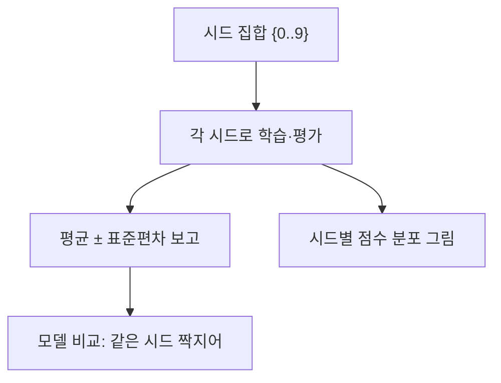

# 여러 시드 평균 보고

> 결과를 한 시드의 숫자 하나가 아니라 **여러 난수 시드로 반복한 평균과 표준편차**로 보고하는 습관이다. 시드는 분할·초기화·샘플링을 바꾸므로 점수가 흔들리는 폭을 함께 알려 줘야 한다.

## 쉽게 말하면
키를 한 번만 재서 "170cm"라고 하지 않고 여러 번 재서 "170±1cm"로 적는 것이다. ±가 있으면 두 사람의 키 차이가 의미 있는지 판단할 수 있다.

## 자세히
(scikit-learn 1.9.1, 합성 이진 분류 개발 1,000개, 랜덤 포레스트(깊이 6), 직접 실행)
- **시드 종류에 따라 흔들림이 다르다**: 분할 시드만 0~29로 바꾸고 모델 시드는 고정 → 평균 **0.788**, 표준편차 **0.030**, 범위 0.740~0.870. 모델 시드만 바꾸고 분할은 고정 → 평균 0.791, 표준편차 **0.010**, 범위 0.770~0.810. 이 설정에서는 분할이 모델 초기화보다 3배 정도 큰 변동 원인이었다. 어떤 시드가 얼마나 영향이 큰지 모르면 둘 다 바꿔 본다.
- **시드 개수에 따른 신뢰도(분할 시드 30개 중 k개를 500회 무작위로 뽑아 평가)**: 평균의 표준오차 k=3이면 0.0166, k=5 0.0129, k=10 0.0076. 보고하는 표준편차 추정치의 5~95% 범위는 k=3이 0.008~0.052로 매우 불안정, k=5 0.015~0.047, k=10 0.021~0.040이었다. **시드가 3개면 표준편차 자체를 믿기 어렵다.** 비용이 허용하면 10개 이상.
- **공식 문서의 취지(scikit-learn Common pitfalls)**: 정수 `random_state`를 추정기에 주면 모든 폴드가 같은 시드를 써서 CV 점수가 한 시드의 운을 반영할 수 있으니, `RandomState` 인스턴스(또는 None)로 폴드마다 난수를 달리하는 것이 견고하다. 문서에 명시적인 다중 시드 절차는 없고 변동을 보라는 취지로 읽는다. CV 분할기에는 정수를 줘서 모델 간 같은 분할로 비교한다.
- **보고 형식(제안)**: `평균 ± 표준편차 (n=시드 수)`, 시드 목록, 어떤 시드를 바꿨는지(분할·모델·데이터 셔플), 최소·최대. 그림은 시드별 점수 점이나 박스플롯.
- **모델 비교**: 같은 시드 세트에서 두 모델을 돌려 시드별 짝지은 차이를 본다([점수 차이와 노이즈](#cv-score-difference-vs-noise)). 평균 차이가 표준편차보다 작으면 우열을 말하지 않는다.
- **비용 대응**: 딥러닝처럼 한 번이 비싸면 시드 3~5개 + 불확실성을 솔직히 서술하거나 가벼운 모델·작은 데이터로 사전 변동 파악.
- **주의**: 시드를 많이 돌린 뒤 최고만 보고하면 [시드 골라잡기](#seed-cherry-picking)가 된다. 반드시 전부 보고.

## 그림으로 보기



## 예시
```python
import numpy as np
scores = [score(split_seed=s, model_seed=s) for s in range(10)]
print(f"{np.mean(scores):.3f} ± {np.std(scores, ddof=1):.3f} (n=10)")
```
- 논문 표에 "정확도 78.8 ± 3.0 (분할 시드 30)"처럼 표기.
- 교육: 측정 불확실성을 숫자와 함께 보고하는 습관(실험 보고서 기본).

## 헷갈리는 것과 비교
| 개념 | 차이 |
|---|---|
| 여러 시드 평균 | 변동을 함께 보고 |
| 단일 시드 | 운에 좌우될 수 있음 |
| [반복 교차검증](#repeated-cross-validation) | 분할을 반복하는 구체적 방법 |
| [시드 골라잡기](#seed-cherry-picking) | 반복 결과 중 최고만 보고(금지) |

## 더 읽을거리
- [scikit-learn Common pitfalls — Controlling randomness](https://scikit-learn.org/stable/common_pitfalls.html) — 정수·인스턴스 random_state와 단일 시드 의존.
- [RepeatedKFold API](https://scikit-learn.org/stable/modules/generated/sklearn.model_selection.RepeatedKFold.html) — 분할 반복 도구.
