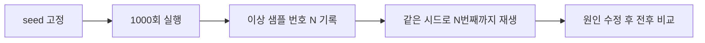
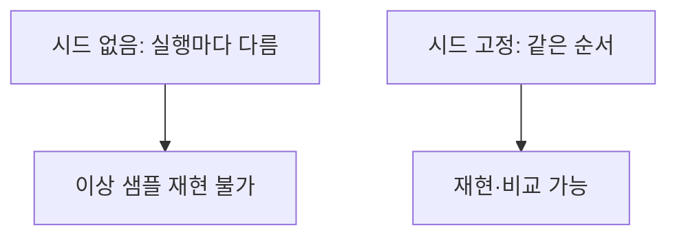

# 시드 고정 증강 디버깅

> 증강은 무작위라서 "이상한 샘플이 나왔는데 다시 보니 없다"가 생긴다. **난수 시드를 고정**하면 같은 순서의 증강 결과를 다시 만들어, 코드를 고치기 전후를 같은 샘플로 비교할 수 있다.

## 쉽게 말하면
주사위를 굴려 실험하다가 이상한 결과가 나왔는데 다시 굴리면 다른 숫자가 나온다. 주사위를 "같은 순서로 나오게 맞춰 두면" 같은 상황을 몇 번이고 다시 볼 수 있다.

## 자세히
- Albumentations 2.0.8의 `Compose`는 `seed` 인자와 `save_applied_params` 인자를 가진다(`inspect.signature`로 확인).
- 직접 실행 결과:
  - `Compose(..., seed=7)` 두 객체에서 같은 입력으로 3번씩 돌린 출력 순서가 **완전히 같았다**(`True`). 시드를 8로 바꾸면 달랐다.
  - 시드 없는 `Compose`는 실행마다 결과가 달랐다.
  - `t.set_random_seed(5)`를 호출하면 처음 `seed=5`로 만든 것과 **같은 결과 순서가 재생**됐다(합계 `472555`, `540385` …로 일치). 문제의 샘플 번호 N까지 재생해 디버깅하는 데 쓴다.
  - `save_applied_params=True`로 만들면 결과 딕셔너리에 `applied_transforms`가 담겼다. 예: `[('RandomBrightnessContrast', {'shape': (32,32,3), 'alpha': 1.049…, 'beta': 24.66…})]` — 실제로 적용된 변환과 그 매개변수를 알 수 있다(뒤집기가 이번엔 적용되지 않아 목록에 없다).
- 디버깅 절차(제안): ① 시드를 고정하고 파이프라인을 1,000회 돌려 이상 샘플의 번호를 기록 ② 같은 시드로 그 번호까지 재생해 입력·출력·적용 변환을 저장 ③ 코드 수정 뒤 같은 시드로 같은 샘플을 다시 만들어 전후 비교 ④ 해결되면 시드 고정을 풀고 일반 학습.
- 주의: 데이터 로더가 **여러 워커(프로세스)**를 쓰면 워커마다 난수 상태가 달라질 수 있다. 라이브러리 버전·프레임워크(PyTorch DataLoader의 worker seed)별 규칙을 확인한다(일반적 주의, 이번에는 다중 워커를 실험하지 않았다).
- 학습 재현성에서는 시드가 증강 하나만이 아니라 모델 초기화·데이터 순서에도 걸린다([증강 시드와 재현성](#random-seed-augmentation-repro)).

## 그림으로 보기



## 예시
```python
t = A.Compose([...], seed=5, save_applied_params=True)
r = t(image=img); print(r["applied_transforms"])
t.set_random_seed(5)   # 같은 순서로 다시 재생
```
- 교육: "버그를 다시 보려면 재현 가능해야 한다"는 디버깅 기본.

## 헷갈리는 것과 비교
| 개념 | 차이 |
|---|---|
| 시드 고정 | 같은 난수 순서 재현 |
| `save_applied_params` | 어떤 변환이 어떤 값으로 적용됐는지 기록 |
| 결정적 변환(p=1, 고정값) | 무작위를 없앰(증강 효과도 줄어듦) |
| [증강 통계 스크립트](#augmentation-stats-script) | 많은 샘플의 분포 요약 |

## 더 읽을거리
- [Albumentations 문서](https://albumentations.ai/docs/) — Compose 인자.
- 직접 실행: Albumentations 2.0.8 시드·재생 실험.
