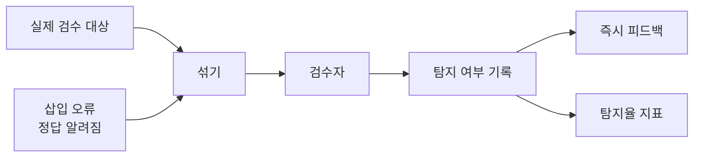
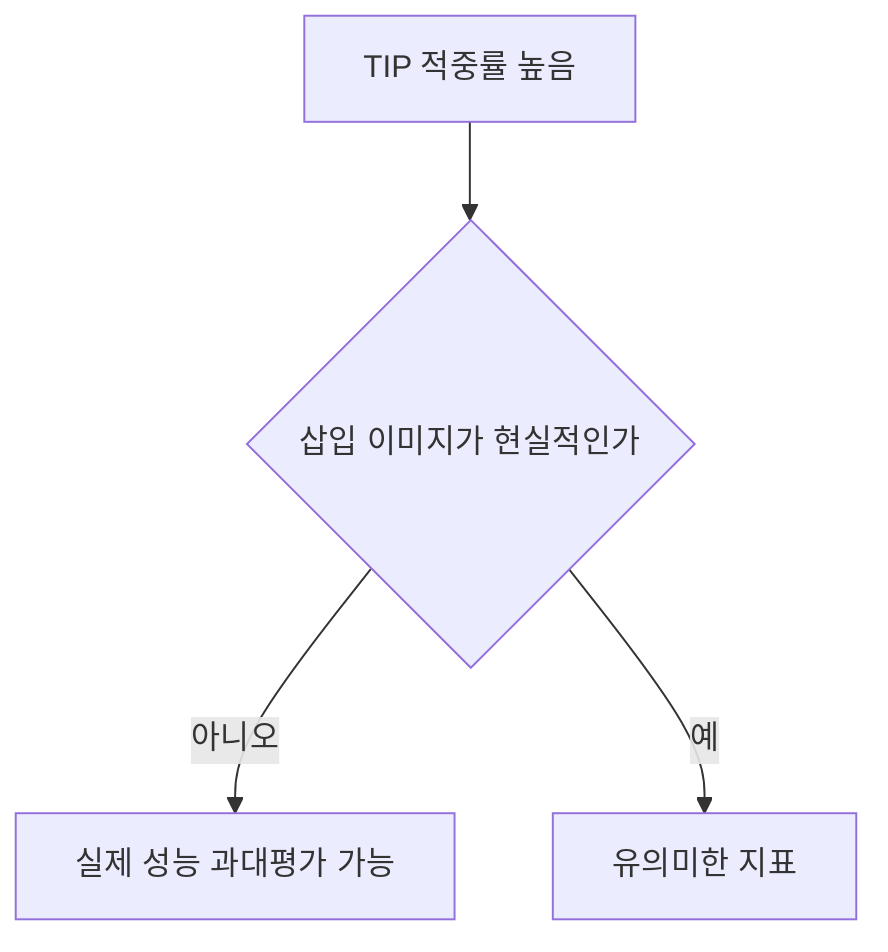

# 오류 삽입 테스트

> 검수·감시 업무에 정답을 아는 오류를 일부러 섞어 넣고 그것을 얼마나 잡아내는지 재는 방법. 항공 보안 검색의 위협 이미지 투영(TIP)이 대표적인 현실 사례다. AI 결과물 검수에서 검수자의 주의 수준을 가늠하고 유지하는 도구로 쓸 수 있다.

## 쉽게 말하면
공항 보안 검색 요원은 거의 하루 종일 위협이 없는 짐을 본다. 그래서 컴퓨터가 가끔 짐 사진에 가짜 총 사진을 슬쩍 합성해 보여 준다. 요원이 가짜를 잡으면 즉시 "탐지 성공" 피드백이 나온다. 요원은 계속 긴장하고, 관리자는 요원의 탐지율을 숫자로 알 수 있다. AI 검수자에게도 의도적 오류를 몇 개 섞어 같은 효과를 낼 수 있다.

## 자세히
출처: Human Factors 계열 논문 "How Realistic Is Threat Image Projection for X-ray Baggage Screening?"(PMC8952858, 직접 읽음), TIP 개요는 검색 결과 요약. 이 글의 AI 검수 적용은 제안이다.
- **TIP(Threat Image Projection)**: 사전 녹화한 위협 물품 X선 이미지(FTI, 가상 위협 이미지)를 실제 짐 이미지에 합성해 보여 준다. 실제 위협은 극히 드물기 때문에 위협의 **출현 빈도를 인위로 높이고** 요원에게 정기적으로 탐지 **피드백**을 준다. 미국 TSA가 2차원 X선 장비에 TIP 사용을 의무화했다는 검색 요약이 있다.
- **성과 지표로 쓰임**: 공항은 TIP 적중률(투영된 가상 위협 중 요원이 찾은 비율)을 성과 지표로 쓴다. 해당 연구에 따르면 EU 규정에서 최소 적중률에 못 미친 요원은 교정 훈련과 영상 판독 시험을 통과해야 복귀한다. 연구 대상 공항의 평균 적중률은 88%.
- **현실성 문제(연구 결과)**: 요원 51명이 TIP 이미지 600장을 7점 척도로 평가(이미지당 12명 이상). 24%가 합성 흔적(artifact; 주로 위치 17%, 정렬 15%), 26%가 비현실적 상황(예: 쉽게 찾을 위치에 위협을 둠), 합쳐 34%가 문제. 위협이 **쟁반 위 물건** 위에 놓인 이미지는 65%가 문제, 가방 안은 8%. 연구자들은 흔적 때문에 TIP 적중률이 실제 위협 탐지 성능을 **과대평가**할 수 있다고 주장하지만 이를 검증하지는 않았다(인식된 현실성만 측정).
- **연구의 권고**: 가방 안에 더 많이 합성, 겹침·복잡도가 높은 이미지 선호, 사전 품질 관리한 조합 이미지. 일부는 쟁반 위에 두어 주의를 유지.
- **한계**: 한 공항·한 시스템, 요원이 의식적으로 인지한 흔적만 보고, 요원이 실제 위협을 거의 보지 못함.
- **의료로의 확장(검색 결과)**: "영상의학에서 가상 환자로 품질 보증"을 묻는 설문 논문이 있다(초록은 열지 못함).
- **AI 검수에서의 설계(이 글의 제안)**
  1. 정답을 아는 **오류 사례(seeded error)** 를 전체의 1~3%쯤 섞는다(비율은 업무에 맞게 정함).
  2. 오류가 현실적으로 보이게 만든다(너무 티 나는 오류는 의미 없음).
  3. 요원이 잡은 즉시 피드백, 놓친 오류는 사후 설명.
  4. 개인 평가·징계용이 아니라 **주의 유지와 시스템 점검** 용도임을 사전에 알린다. 서로 불신을 만들 수 있다.
  5. 측정값은 [경계 저하](#vigilance-decrement) 감시 지표로 활용: 시간대별·검수량별 탐지율.
  6. 삽입 오류만 찾는 요령이 생기지 않게 유형을 계속 바꾼다(연구에서 TIP 흔적에 집중하는 위험을 언급한 검색 요약).

## 그림으로 보기

## 예시
- AI가 쓴 계약 요약 200건 중 4건에 일부러 틀린 금액·날짜를 넣어 두고 검수자가 몇 건 잡는지 본다(제안).
- 신용 거절 이유 통지 검수에서 틀린 이유 코드를 가끔 섞어 놓고 포착률을 측정한다(제안).

## 헷갈리는 것과 비교
| 개념 | 차이 |
|---|---|
| 오류 삽입 테스트 | 정답을 아는 오류를 몰래 섞음 |
| 레드팀 | 시스템 취약점을 공격적으로 탐색 |
| [경계 저하](#vigilance-decrement) | 이 테스트가 측정·완화하려는 현상 |
| [자동화 안주](#automation-complacency) | 감시 주의가 줄어드는 원인 |

## 더 읽을거리
- [How Realistic Is Threat Image Projection for X-ray Baggage Screening? (PMC)](https://pmc.ncbi.nlm.nih.gov/articles/PMC8952858/) — TIP 현실성 연구(직접 읽음)
- [Can Radiologists Learn From Airport Baggage Screening? (ScienceDirect)](https://www.sciencedirect.com/science/article/abs/pii/S1076633217303732) — 가상 환자 품질 보증 설문(열지 못함, 서지만 확인)
