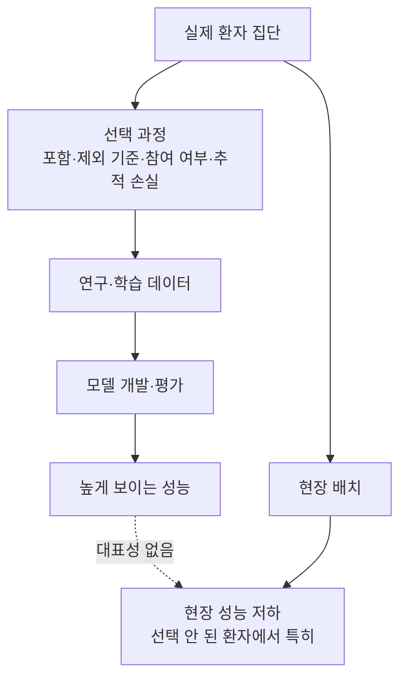

# 선택 편향

> 연구·학습에 포함된 환자 집단이 모델이 실제 쓰일 집단을 대표하지 못해 생기는 편향(sample selection bias). 정리된 병원 데이터만 쓰면 쉽게 생기며, 평가 점수가 실제 현장보다 좋게 나오게 만든다.

## 쉽게 말하면
수영 대회 선수들의 기록으로 "일반인 달리기 속도"를 예측하는 것과 같다. 데이터에 들어온 사람들이 이미 특별한 사람들이면, 모델은 그 집단에서만 잘 맞는다.

## 자세히
출처: Chauhan 외, "Sample Selection Bias in Machine Learning for Healthcare"(arXiv 2405.07841, 2024 최초 게시, v3 2025-08, ACM TCH 게재 승인, 원문 HTML 열어서 읽음), 검색 요약.
- **정의(논문)**: 연구 집단이 모델을 배치할 목표 집단을 대표하지 못하는 것. 환자를 비균등하게 골라서 데이터 분포가 달라진다.
- **원인(논문)**: ① 추적 손실·경쟁 사건으로 결과가 없는 환자가 제외됨, ② 생존 편향, ③ 연구 참여를 스스로 택하는 경우(예: UK Biobank), ④ 엄격한 포함·제외 기준.
- **결과(저자의 합성·준합성 데이터 실험)**: 순진한 모델은 편향 없는 기준 모델(Oracle)보다 목표 집단에서 평균 약 7% 낮았고, 선택된 집단과 선택되지 않은 집단 사이의 성능 격차가 일부 기준에서 평균 43~56%까지 벌어졌다. 일부 편향 보정 방법은 순진한 모델보다도 나빴다. 합성 데이터 결과이므로 실제 진료 데이터에서의 크기와 다를 수 있다.
- **완화**: 역확률 가중, 대체(imputation), 커널 평균 일치 등 기존 보정은 분포를 억지로 맞춰 예측 성능을 해칠 수 있다는 것이 저자 주장. 저자 제안은 **목표 집단 식별(TPI)**, 즉 연구 집단을 대표하는 환자인지 먼저 판단해 그들에게만 예측하고 나머지는 임상의에게 넘기는 방식(T-Net, MT-Net).
- **한계(저자)**: 선택이 환자 속성으로 추론 가능하다는 가정, 선택 단계의 오류 전파, 제외된 환자의 결과가 없어 실데이터 검증이 어렵다는 점.
- **관련 문헌 요약(검색, 원문 미확인)**: 공개 COVID-19 흉부 X선 데이터셋 100여 개 중 편향 위험 평가 기준을 충족한 것이 9개뿐이었다는 리뷰, 복부 CT 데이터셋이 특정 질환을 과대 대표한다는 리뷰(스펙트럼 편향), 의료 AI 연구의 참가자 선정 보고 표준이 없어 참가자 흐름도를 제안한 논문.
- **평가 도구**: PROBAST는 예측 모델의 편향 위험과 적용 가능성 평가용으로 소개된다(검색 요약). QUADAS-AI는 이번 검색에서 확인하지 못했다.

## 그림으로 보기

## 예시
- 한 대학병원에서 영상과 확정 진단이 모두 있는 환자만 골라 학습 → 진단이 불확실하거나 검사를 못 받은 환자에서는 성능이 떨어짐.
- 점검 질문: "누가 데이터에서 빠졌는가? 포함·제외 기준과 참가자 흐름도가 있는가? 목표 집단과 비교해 보았는가?"

## 헷갈리는 것과 비교
| 개념 | 차이 |
|---|---|
| 선택 편향 | 어떤 환자가 데이터에 들어오느냐의 문제 |
| [외부 검증](#external-validation) | 다른 데이터에서 일반화 확인, 선택 편향을 드러내는 방법 |
| [데이터 드리프트](#data-drift) | 시간에 따른 입력 분포 변화 |
| [후향·전향 연구](#retrospective-vs-prospective) | 상위 노드, 후향 데이터에서 선택 편향이 커지기 쉬움 |

## 더 읽을거리
- [Sample Selection Bias in Machine Learning for Healthcare (arXiv 2405.07841)](https://arxiv.org/html/2405.07841v3) — 정의·원인·실험(열어서 확인)
