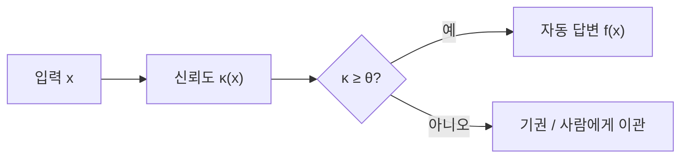
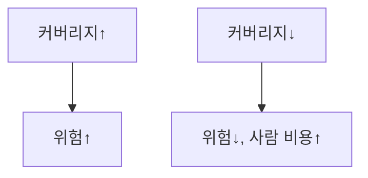

# 선택적 분류

> 모델이 확신이 낮은 입력에는 답하지 않고 "모르겠다(기권)"를 내거나 사람에게 넘기는 분류 방식이다. 얼마나 많이 답할지(커버리지)와 답한 것의 오류율(선택적 위험)을 맞바꾼다.

## 쉽게 말하면
시험에서 자신 있는 문제만 풀고 애매한 문제는 선생님께 넘기는 것이다. 많이 풀수록(커버리지↑) 틀릴 위험도 커진다. 어디서 멈출지 정하는 일이 핵심이다.

## 자세히
(Geifman & El-Yaniv, "Selective Classification for Deep Neural Networks", arXiv 1705.08500 전문을 직접 읽고 확인.)
- **정의**: 선택적 분류기는 (f, g) 쌍. g(x)=1이면 f(x)를 출력, 0이면 "모르겠다". **커버리지** φ = E[g], **선택적 위험** R = E[손실·g] / φ. 커버리지 대비 위험의 곡선이 risk-coverage curve. "reject option"은 약 60년 된 개념이라고 논문이 소개.
- **목표**: 위험 R이 r*을 넘을 확률이 δ 미만이도록 보장하면서 커버리지를 최대화. 선택 규칙은 신뢰도 함수 κ(x) ≥ θ. 알고리즘 SGR은 이항 꼬리 경계로 위험 상한을 보장.
- **신뢰도 함수**: Softmax Response(SR, 최대 softmax 값) vs MC-dropout. CIFAR에서는 비슷, ImageNet에서는 SR이 더 낫다.
- **보고 수치(δ=0.001)**: ImageNet top-5(VGG-16) r*=0.02 → 테스트 위험 0.0179, 커버리지 0.535(초록: 99.9% 확률로 오류 2%, 커버리지 약 60%). CIFAR-10 r*=0.01 → 커버리지 0.786(위험 0.0092), r*=0.05 → 0.960. CIFAR-100 r*=0.02 → 0.213, r*=0.25 → 0.883.
- **한계**: 신뢰도 점수가 잘 보정되어야 쓸모가 있다([과신 모델의 분배 실패](#overconfidence-routing-failure)). El-Yaniv & Wiener(2010) 등 이론 원전은 이번에 열지 않았다.

## 그림으로 보기

## 예시
- 문서 분류에서 κ ≥ 0.9인 70%는 자동 처리하고 30%만 검수.
- 교육 활용: 위험-커버리지 곡선을 그려 "어디까지 자동화할까"를 결정하는 워크숍.

## 헷갈리는 것과 비교
| 개념 | 차이 |
|---|---|
| 선택적 분류 | 확신 낮으면 기권 |
| 일반 분류 | 항상 답함 |
| [임계값 곡선](#threshold-curve-selection) | θ를 고르는 방법 |

## 더 읽을거리
- [Selective Classification for Deep Neural Networks (arXiv 1705.08500)](https://arxiv.org/abs/1705.08500) — 정의·보장·표.
