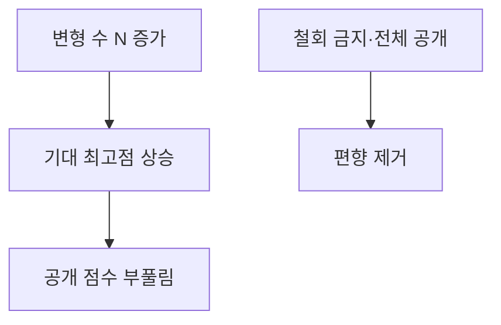

# 선택적 점수 공개

> 선택적 점수 공개는 여러 모델 변형을 비공개로 시험해 보고 점수가 좋은 것만 공개(나머지는 철회)하는 관행이다. 측정에 노이즈가 있으므로 "N개 중 최고점"을 공개하면 점수가 실제 실력보다 부풀려진다.

## 쉽게 말하면
같은 실력의 학생에게 시험을 열 번 보게 하고 가장 좋은 점수만 성적표에 적는 것이다. 운이 좋았던 회차가 뽑히므로 성적표 점수는 실력보다 높다. 몇 번 봤는지 공개하지 않으면 독자는 알 수 없다.

## 자세히
- **연구 주장(The Leaderboard Illusion, arXiv 2504.20879, 초록과 본문 앞부분 열람)**: 일부 제공자가 공개 전에 여러 변형을 비공개로 시험하고 원하지 않는 점수를 철회할 수 있어, 가장 높은 변형만 공개하면 Chatbot Arena 점수가 편향된다. 저자는 Llama 4 출시 전 Meta가 시험한 비공개 변형 27개(주 리더보드)를 확인했고, 비전 리더보드 16개를 더하면 43개이며 Google은 10개, Cohere는 4개(저자들의 실험)였다고 쓴다. 이 내용은 저자들의 분석이며 해당 제공자의 반론은 확인하지 못했다.
- **최고점 선택 편향**: 변형 N개를 시험해 최고점만 공개하면 노이즈가 큰 추정치 중 높은 것이 뽑혀 점수가 위로 치우친다. 논문의 시뮬레이션은 이득을 대략 50~100점으로 제시하는데 본문의 두 수치(1절: 10개 변형에 약 100점, 3.2절: 20개에 약 50점)가 서로 일치하지 않는다고 확인되었다. 실제 사례로 똑같은 Aya-Vision-8B 체크포인트 두 개가 1052와 1069(노이즈만으로 17점 차), 전략적으로 고른 Aya-Vision-32B 변형 둘이 1097과 1059(38점 차)였다.
- **직접 해 본 시뮬레이션(순수 파이썬, 참 실력 같은 변형 N개, 점수 측정 노이즈 정규분포, 2만 번 반복)**: 노이즈 표준편차가 5점이면 N=3일 때 평균 최고점이 실제보다 +4.2, N=10이면 +7.7, N=27이면 +10.0점 부풀려진다. 표준편차가 10점이면 +8.5, +15.3, +20.0이다. 부풀림은 노이즈 크기와 변형 수의 로그 정도에 비례해 커지며 논문의 50~100점이라는 수치는 이 가정(노이즈 크기)에서만 나오는 값이 아니라는 점은 확인하지 못했다(논문 시뮬레이션 설정은 열람하지 못함).
- **정책 권고(같은 논문)**: ① 점수 철회 금지(시험한 모든 변형 점수 공개) ② 제공자당 비공개 변형 수 상한 공개(예: 동시 3개) ③ 퇴출 기준 공개와 라이선스 범주별 하위 30% 퇴출 ④ 공정한 표본 추출 ⑤ 시험·퇴출·표본 모델 전체 목록 공개.
- **독자가 할 일(해석)**: 순위표 점수를 볼 때 "이 점수는 몇 개 변형 중 고른 것인가?"를 묻는다. 우리 조직의 내부 평가에서도 프롬프트를 여러 번 바꿔 시험한 뒤 가장 좋은 결과만 보고하지 않도록 시험 횟수를 기록하고 [보류 평가 세트](#held-out-eval-set)로 최종 점수를 낸다.

## 그림으로 보기

## 예시
- 사내에서 프롬프트 변형 30개를 같은 200문항으로 시험하고 최고 정확도만 보고하면 부풀려진다. 변형 수를 보고서에 적고 새 보류 문항으로 최고 변형만 한 번 재측정한다.
- 교육 활용: 주사위 10개를 던져 가장 큰 눈만 기록하는 실습으로 최고점 선택의 편향을 직접 체험한다.

## 헷갈리는 것과 비교
| 개념 | 차이 |
| --- | --- |
| [리더보드 작은 격차](#leaderboard-small-gap) | 상위 주제 |
| [Arena 데이터 접근 불균형](#arena-data-access-asymmetry) | 제공자별 표본 비중 차이. 선택적 공개와 별개의 편향 |
| 다중 비교 문제 | 여러 번 시험하면 우연히 좋은 결과가 나올 확률이 커지는 일반 현상 |
| [보류 평가 세트](#held-out-eval-set) | 최종 점수를 한 번만 재측정해 편향을 막는 장치 |

## 더 읽을거리
- [The Leaderboard Illusion (arXiv 2504.20879)](https://arxiv.org/abs/2504.20879) — 비공개 시험·철회·데이터 불균형 분석
