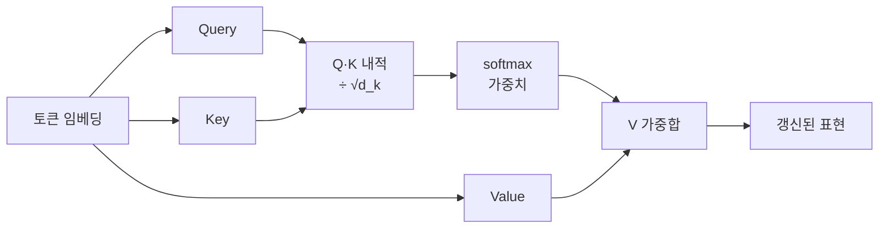
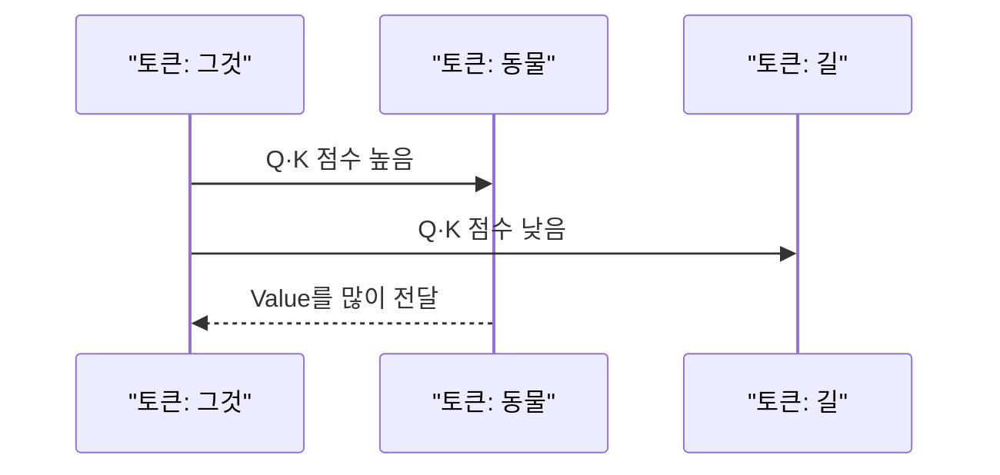

# 셀프 어텐션: Query·Key·Value

> 셀프 어텐션은 문장 속 각 토큰이 **다른 모든 토큰을 얼마나 참고할지 점수를 매기고**, 그 점수로 정보를 섞어 자기 표현을 갱신하는 연산이다. Query·Key·Value는 그 계산에 쓰는 세 가지 벡터다.

## 쉽게 말하면
도서관 검색을 생각해 보자. 나는 **질문(Query)** 을 들고 가서 모든 책의 **색인 카드(Key)** 와 비교해 관련도를 매기고, 관련 높은 책의 **내용(Value)** 을 그 비율대로 섞어 읽는다. 문장의 모든 단어가 동시에 이 일을 한다. "그것은 너무 피곤해서"의 "그것"이 어느 명사를 가리키는지도 이렇게 점수로 정해진다.

## 자세히
Jay Alammar의 Illustrated Transformer(원 논문 설정 기준) 요약:
1. 각 토큰의 임베딩(512차원)에 학습된 행렬 W_Q, W_K, W_V를 곱해 Q·K·V 벡터(각 64차원)를 만든다.
2. **점수**: 한 토큰의 Q와 모든 토큰의 K를 내적한다.
3. **스케일**: √d_k(=8)로 나눠 기울기를 안정시킨다.
4. **softmax**로 합이 1인 가중치를 만든다.
5. 가중치로 V를 가중합 → 그 토큰의 새 표현.
- 전체를 행렬 곱으로 한 번에 계산한다: softmax(QKᵀ/√d_k)·V.
- **멀티헤드**([multi-head-attention](#multi-head-attention)): 이 과정을 서로 다른 W로 8번 병렬 수행해 서로 다른 관계(문법·지시·위치)를 보고, 이어 붙여 다시 섞는다(8×64=512).
- 디코더형 LLM은 미래 토큰을 못 보도록 **마스크**를 씌운다([attention-mask](#attention-mask)).
- 비용: 모든 토큰 쌍을 비교하므로 길이 n에 대해 n²로 늘어난다 → 긴 컨텍스트가 비싼 이유. 생성 시에는 지난 K·V를 저장해 재사용한다([kv-cache](#kv-cache)).

## 그림으로 보기



## 예시
```python
import numpy as np
def attn(Q,K,V):
    s = Q @ K.T / np.sqrt(K.shape[1])
    w = np.exp(s - s.max(1,keepdims=True)); w /= w.sum(1,keepdims=True)
    return w @ V
```
토큰 4개, 차원 8짜리 난수 행렬로 돌려 보고 `w`(4×4 가중치표)를 출력해 보면 어텐션이 "표"라는 걸 눈으로 확인할 수 있다.

## 헷갈리는 것과 비교
| 개념 | 차이 |
|---|---|
| 셀프 어텐션 | 같은 문장 안 토큰끼리 |
| [크로스 어텐션](#cross-attention-diffusion) | 한쪽(예: 이미지 조건)이 다른 쪽(텍스트)을 참조 |
| Query vs Key | Q는 "찾는 것", K는 "나는 이런 정보" 표지 |
| Key vs Value | K는 매칭용, V는 실제로 전달할 내용 |

## 더 읽을거리
- [The Illustrated Transformer](https://jalammar.github.io/illustrated-transformer/) — Q·K·V 단계별 그림, 차원 수치(열어서 확인).
- [Attention Is All You Need (2017)](https://arxiv.org/abs/1706.03762) — 원 논문(참고, 이번엔 본문 열람 안 함).
