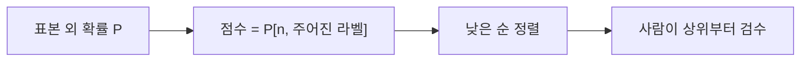
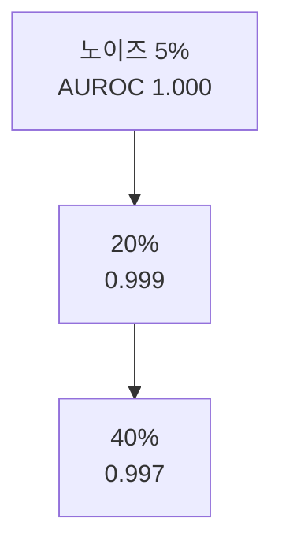

# self_confidence 점수

> self_confidence 점수는 샘플의 "주어진 라벨"에 대해 모델이 낸 예측 확률 그 자체를 라벨 품질 점수로 쓰는 방식이다. 점수가 낮을수록 그 라벨이 틀렸을 가능성이 크다고 보고 낮은 순으로 검수 순서를 정한다.

## 쉽게 말하면
답안지에 적힌 정답에 대해 "안 본 조교"가 얼마나 확신하는지를 점수로 삼는 것이다. 조교가 "이 정답은 3%만 맞는 것 같다"고 하면 그 답안지를 가장 먼저 다시 확인한다.

## 자세히
- **계산(해석)**: [표본 외 예측 확률](#out-of-sample-probabilities) P를 구하고 샘플 n의 점수를 P[n, 주어진 라벨]로 둔다. 점수는 0~1이고 낮을수록 의심스럽다. cleanlab의 라벨 품질 점수 방식 중 하나로 알려져 있으나 이 글에서 cleanlab 문서를 직접 열어 확인하지는 않았다.
- **직접 해 본 실험(숫자 손글씨 1,797개, 라벨 일부를 무작위로 변경, 랜덤 포레스트 5겹의 표본 외 확률)**: 오라벨을 낮은 점수로 구분하는 AUROC가 노이즈 5%에서 1.000, 20%에서 0.999, 40%에서 0.997이었다. 점수가 낮은 순으로 실제 오라벨 수만큼 뽑았을 때 정밀도(precision@k)는 0.97, 0.96, 0.96이었다. 이 데이터는 깨끗한 구조가 뚜렷한 쉬운 데이터라 거의 완벽하게 구분됐다. 어려운 데이터나 모델이 약한 경우에는 훨씬 낮을 것이다. 한 번의 실험이다.
- **사용법(해석)**: 점수가 낮은 순으로 사람이 검수하는 우선순위 목록을 만든다. 검수 예산이 정해져 있으면 상위 k개만 본다. 정밀도가 높을수록 검수 효율이 좋다.
- **한계(해석)**: ① 어려운 샘플이나 소수 클래스도 낮은 점수를 받아 오탐이 생긴다 ② 점수는 확률의 보정(캘리브레이션) 상태에 영향을 받는다 ③ 노이즈가 한 클래스 쌍에 몰리면 일부 오라벨은 높은 점수를 유지할 수 있다([Confident Joint](#confident-joint)가 이런 구조를 센다).
- **다른 점수와의 관계**: 확신도 외에 예측 확률의 마진이나 엔트로피로 만든 점수도 있으나 이 글에서는 비교하지 않았다.

## 그림으로 보기



## 예시
```python
oos = cross_val_predict(model, X, y_given, cv=5, method="predict_proba")
score = oos[np.arange(len(y_given)), y_given]
review_order = np.argsort(score)   # 낮은 점수부터
```
교육 활용: 상위 100개를 사람이 직접 확인해 실제 오라벨 비율(정밀도)을 계산해 본다.

## 헷갈리는 것과 비교
| 개념 | 차이 |
| --- | --- |
| self_confidence | 주어진 라벨의 예측 확률 |
| 예측 정확도 | 모델이 맞혔는가(라벨 품질과 다름) |
| [표본 외 예측 확률](#out-of-sample-probabilities) | 이 점수의 입력 |
| [Confident Joint](#confident-joint) | 클래스 쌍별 오류 개수 추정 |

## 더 읽을거리
- [Confident Learning (arXiv 1911.00068)](https://arxiv.org/abs/1911.00068) — 라벨 오류 탐지의 이론과 cleanlab
